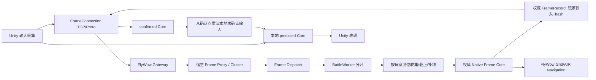

# 第三课：帧同步版——从玩家输入到可预测、可回滚的实时战斗

> 课程位置：`docs/Skynet_BattleNavigation第三课_帧同步版_实操.md`。本文件是第三课帧同步版的完整实操教程，承接**已验收的第二课**。状态同步版另行设计，两种同步方案不共享强制性的 Battle Core。
>
> 基线：Skynet v1.8.0、自带 Lua 5.4.7、C++17、团结引擎 1.10.0（Unity 2022.3 LTS）、AI Navigation 1.1.7、Protobuf 唯一协议源、`server/third_party/skynet-flywow` 固定 gitlink。禁止按 GitHub 最新 `main` 猜测子模块 API。
>
> 重要：主实操正文包含其基线范围内每个受影响文件的最终累计完整代码。本次已按该实操完成帧同步版实施：课程宿主代码与 Unity 客户端已落地，FlyWow Gateway 修改由实施者完成；你可以对照本节代码、实际差异和验证记录审核。源码构建、自动化测试与双进程联调的已通过范围见进度记录；Unity Editor Play、长期压力和未列出的目标平台仍需后续验证。

## 0. 最终运行效果与课程主线

### 0.1 最小战斗场景

场景保持简单：一名真实玩家控制地面单位 `1001`，服务端模拟地面 AI `2002` 和飞行 AI `2001`。地面单位受 BMAP、坡度、体型和动态占位约束；基础主线中的飞行单位沿明确的三轴整数规则移动，不使用地面 A* 模拟立体空域。第 4 阶段为飞行 AI 接入 AIRN V1，在固定飞行高度规划水平路径，并由连续扫掠校验可变高度移动；地面 BMAP 不能代替空中障碍资产。技能保留近战、表现弹丸、逻辑弹丸三种例子。需要证明的是**客户端与服务端在正式输入下复现相同战斗结果**；玩家/单位/技能数量不是架构成熟度指标。

操作手感必须立即响应。WASD/J/K/L 在 Unity 预测 Core 中下一固定步执行，网络侧把意图绑定到明确帧号发送。正式输入抵达后，以服务器确认 Core 为准回滚和重演未确认帧。回滚期间表现层需要处理动画、投射物和特效的重建与收敛；Unity Transform 不允许直接写回正式 State。

正常通讯只传完整的权威输入帧与分歧诊断 hash；进入战斗、断线恢复、状态分歧、超窗恢复允许传完整 Checkpoint。这样仍属于帧同步，不能把偶发 Checkpoint 误判为持续状态同步。

### 0.2 最终完整调用链



Battle Process 中：`battle_id -> battle_id % worker_count + 1` 的固定路由符合本课多 Worker 要求。业务与 Skynet Service 的所有权边界按实际调用链安排：Gateway 持有 Socket；Proxy 持有转发路由；Dispatch 持有 Worker handles；Worker 持有多个 Battle；每场 Battle 独占 Runtime、Engine 和 NavigationContext；FlyWow MapRegistry 在**进程内**共享只读地图快照（BMAP 与可选 AirAsset）；不同 OS 进程的 MapRegistry 不是同一实例。

**一场 Battle 不等于一个 Skynet Service，也不等于一个 OS Worker Thread。** 每个 BattleWorker Service 的一个 Lua State 可以管理多场 Battle；同一 Native Engine 不能由两个协程交错进入。本文规定核心推进调用是同步、no-yield 的，任何 Skynet/Cluster I/O 均在该边界之外。

### 0.3 11 个教学阶段

| 阶段 | 本阶段核心问题 | 真正可检查的结果 |
|---|---|---|
| 1 | 输入帧究竟是什么、谁决定截止 | 文字合同、数值例子、时序图、负向用例 |
| 2 | 两端为何能确定性运行 | C++17 Core、Checkpoint、Native Golden、无半步提交 |
| 3 | 地面导航如何成为模拟的一部分 | FlyWow `FindPath`/`AdvancePath`/Occupancy、路径复用、重建 |
| 4 | 飞行单位如何绕过空域障碍并执行升降 | AIRN 配对导出/加载、固定高度寻路、动态 AABB、变高连续扫掠、确定性恢复 |
| 5 | 玩家输入怎样形成一条权威帧 | 聚合、超窗、补缺、确认、稳定顺序 |
| 6 | Gateway 如何回推帧 | 定向 Push、身份重验、边界测试 |
| 7 | Skynet 如何调度多场 Battle | Runtime/Worker/Dispatch、过载和生命周期 |
| 8 | Unity 如何立即响应 | confirmed/predicted、预测回滚、表现收敛 |
| 9 | 如何恢复和复现一场战斗 | Checkpoint、重连、重放、逐帧 hash |
| 10 | 如何真正跑通双进程 | 实际握手、单客户端、异常网络联调 |
| 11 | 如何评价商业工程质量 | 测试分层、导航性能、Tick p99、容量边界、发布 |

### 0.4 操作目录与仓库约束

WSL 主编辑源：`~/workspace/skynet-battle-navigation-commercial-learning`，负责 `server/`、`docs/`、`shared/protocol/`、FlyWow 子模块；Windows 编辑源：`G:\simbi\dev\skynet-battle-navigation-commercial-learning`，负责 `unity/`、Unity 导出资产与生成的 Unity C# 协议。非 Unity 文件通过 Git 串行同步；本文不要求复制工作区、替换 Git 历史、自动提交/推送。

课程沿用既有协议/资产目录，不再另建第二份 proto、第二套导航实现或重复 Gateway。代码和配置不得引用开发机绝对路径。操作类型统一为【新建或整文件覆盖】及【只读】；真正操作前检查 `git status --short` 和 `git submodule status`，防止覆盖学习过程中已有的修改。

## 1. 帧同步核心合同：帧号、采集、截止、正式执行

每个逻辑帧固定代表 1/60 秒（约 16.667ms）的模拟时间。这个步长是模拟合同，不是函数运行的真实 CPU 时间。理论逻辑帧 `f` 的模拟时刻是 `f/60` 秒；第 10 帧产生的伤害不会因为服务器忙 100ms 而按 `dt=100ms` 执行。实际墙钟只决定某场 Battle **什么时候处理截止和推进**。

用户按住右键、按下 J，并不会通过网络发送“当前位置 X=5200、HP=88”；发送的是 `{frame=51, x=1, z=0, skill=1}`，表示请求这些输入在第 51 帧生效。服务端先验证发送者是否是该 Battle 的相应玩家席位，再验证帧号和输入字段范围；合法且在截止前的请求被保存到席位输入槽，不马上推进 Core。

第 51 帧到期时，Worker 为唯一玩家席位构造一条正式输入帧。若玩家缺输入，按确定性缺输入规则补齐。服务端执行一次 Core Step，得到状态、胜负和下一帧；向该玩家推送正式输入与 State Hash。玩家不能提交命中结果，命中由客户端和服务端按相同规则计算。

### 1.1 输入截止与迟到

假设已确认 `frame=40`，Worker 后续帧的截止点由 60Hz 单调时间线计算；10ms Skynet Timer 只检查截止，不改变逻辑帧的 1/60 秒步长。Timer 晚执行不会重开历史；网络发送方自己的墙钟不可用于业务截止，因为客户端可伪造且与服务器时钟不同步。

| 情况 | 服务端规则 | 客户端后续行为 |
|---|---|---|
| 合法未来帧，截止前到达 | 每席位每帧接受第一次合法输入 | 等正式确认，不覆盖确认值 |
| 相同内容重复提交 | `OK` 幂等；不改变日志 | 可以安全重试 |
| 同席位同帧提交不同内容 | `CONFLICT`；保留首次值 | 等正式帧校正 |
| `frame <= last_confirmed` 或截止已过 | `LATE` | 不修改已运行的历史 |
| 超出未来窗口 | `INPUT_WINDOW` | 减少发送提前量或恢复 |
| 席位缺输入 | 最多保留前六帧的方向，技能始终为 0 | 正式帧以补缺结果为准 |
| 不同玩家不同延迟 | 各自独立收集与补缺，整场继续推进 | 同一正式帧必须一致 |
| Worker 落后 | 固定 Tick 连续补帧，最多追赶指定次数 | 无跳帧，超过预算报告 `OVERLOAD` |

缺输入计数器与上一帧方向**必须按席位保存**。例如玩家上一正式帧向右移动，连续缺输入时最多六帧（100ms）沿用该方向，第七帧补零；每个缺输入帧的技能均补零。玩家断线时是否立即清空方向由合同规定；本课选择**断线后直接清空旧会话 future pending，之后每 Tick 按缺输入策略推进**，不会无限重复施法。

### 1.2 输入序列、席位、帧号的关系

`seat_id` 由加入 Battle 时的服务端绑定分配，不能仅凭客户端提交的 `unit_instance_id` 当作权限。本课使用 `seat_id + frame` 作为同帧幂等键：首次合法输入生效，相同内容重复提交返回成功，不同内容返回 `CONFLICT`。输入必须由 Gateway 当前会话与 Battle 授权共同校验。客户端不可以指定获胜方、受到的伤害、Server 帧时间或 Worker 索引。

一条完整正式记录中保留各玩家的实际采用输入及 `supplied` 标志。正式记录顺序先按逻辑帧递增，再按固定 Seat 顺序处理；用 `pairs()` 遍历玩家表决定模拟顺序是禁用写法，因为 Lua table 迭代顺序不能成为跨端的确定性合同。

### 1.3 输入提前量与客户端体验

默认提前量六帧（100ms）、预测上限二十四帧（400ms），用于覆盖既定输入缓冲时长；公网RTT超过提前量覆盖区间时会出现迟到或超窗。必须实测并记录 40/80/120/200ms RTT 与抖动条件。客户端采用 `frame = last_confirmed + lead` 的窗口机制时，还需要保证帧编号**单调分配且不重复覆盖**；不能每个 Update 都写同一未来帧。服务器的具体起始执行时刻和客户端的输入 lead 在 Join Response 中约定或基于明确的当前 `frame/deadline` 计算。

低延迟动作反馈不是可选优化：玩家本地按键应该立即进入 predicted Core 并显示可撤销的预备效果。正式结果依然由 confirmed Core 决定。若玩家连续八帧无法获得确认，应停止盲目继续预测、展示连接状态并走恢复流程，而非持续把 predicted 状态漂移到未来。

### 1.4 TCP 与可靠性

沿用 FlyWow 已有 TCP/Protobuf Envelope、握手、2 字节 big-endian netpack framing。TCP 字节有序不等于固定 Tick 的业务时序保证；失包可能出现队头阻塞，服务端仍需帧截止、future window、重演与断线恢复。网络线程不访问 Unity GameObject。Gateway 不调用 Native Battle、不持有 A* Context、不跨 Cluster 传 fd 或 socket buffer；仅转发已经解码的值记录。

## 2. 确定性 C++ Core：从 State 到 Checkpoint

### 2.1 为什么同一份 C++ 仍需要确定性纪律

客户端与服务端共享 C++ 源代码可以减少两套规则产生的差异，但不能自动保证所有平台逐帧相同。浮点取整、未定义行为、容器迭代、内存布局、并发写入、外部时间和随机源仍可能造成分歧。课程统一使用有符号 64 位世界毫米坐标、明确的整数运算、固定处理顺序和显式小端字节协议。

必需合同是客户端和服务端对同一个模拟版本、同一份正式输入，按相同逻辑帧得到相同的可验证结果；还必须能拒绝版本不兼容的客户端。本课选用的实现是共享 C++17 模拟源代码，分别编译为 Linux 的 Skynet Native 依赖和 Windows 的 Unity DLL；Skynet Lua负责连接授权、输入截止、帧调度、断线恢复和Replay编排，Unity C#负责输入采集、预测回滚和表现。该实现方便教学和跨端一致性验证，但不是所有商业帧同步游戏唯一的部署方式；另一种方案是客户端与服务端各自实现模拟规则，再用跨平台Golden和一致性测试约束。若修改Native模拟代码，本课必须同时更新两端构建产物并递增simulation_version；运行中的Battle不切换模拟版本。本课采用精确版本匹配，不实现源码Hash注册或多版本灰度平台。

严禁将正式战斗计算交给 Unity Rigidbody、NavMeshAgent、动画事件或 `Time.deltaTime`。Unity 的秒与米仅出现在视图边界。例如 `x_mm=1500` 对应 Unity `x=1.5`；负数是相对世界原点的另一侧，不是非法坐标。地面 Y 来自 BMAP；空中 Y 是 Core 逻辑状态，2.5D BMAP 不能凭空提供桥上桥下同 XZ 的多层地面，也不能表达任意楼板和禁飞体积。

### 2.2 每帧固定的处理次序

```text
(1) 读取上一帧已提交 State + 完整 FrameInputs
(2) 校验 FrameInputs 的席位集合、方向、技能和帧号
(3) 计算 AI 意图（按单位 ID，使用同一帧起始状态）
(4) 依固定单位 ID 顺序执行移动；地面调用 FlyWow，空中按自己的三轴规则
(5) 执行技能/冷却/生成弹丸
(6) 推进全部逻辑弹丸，积累待提交伤害
(7) 同一帧统一结算伤害、死亡与胜负
(8) 检查不变量、提交新 State、维护导航事实
(9) 序列化本帧 Checkpoint，计算诊断 State Hash
```

位置、HP、冷却、弹丸的 `next_id`、AI 目标与规划状态、路径推进 Cursor、动态占位与影响未来决策的计数器，都必须有一致的恢复规则。仅保存单位坐标再临时调用一次 A*，如果改变后续移动路线或重规划节奏，则不是正确回滚。

从业务开发角度，用候选 State 提交可以保证输入非法或模拟异常时不留下半帧；但单靠 `State before = state_` 不足以回滚 FlyWow NavigationContext：AdvancePath 可能已经修改动态占位和 Cursor。**本课要求状态事务同时覆盖 Battle State 与导航事实**，详见第 3 节。

### 2.3 技能边界：保留最小例子，避免硬编码成为框架合同

| 输入 | 规则 | 结果阶段 |
|---|---|---|
| J（近战） | 校验目标类型、距离、冷却 | 当前帧立即登记伤害 |
| K（表现弹丸） | 伤害在施放时结算，飞行仅是表现 | 不得落地时再次伤害 |
| L（逻辑弹丸） | 到达目标或超时决定结果 | Core 维护弹丸完整状态 |

Unit、Navigation 和技能业务配置以项目现有 Lua 配置为唯一来源；技能数值放在本课已有的 config.frame_sync.lua。Skynet 直接加载 Lua 配置；Unity 在本课接入 Lua Runtime 后加载同一套配置模块。配置脚本只返回纯数据，不依赖服务端 Service、文件系统或运行时副作用。Native Core 不读取第二份手工配置；Skynet 和 Unity 在启动阶段读取同一批 Lua 数据并通过 C ABI 传入，Native 校验后保存一份进程内只读配置表，Battle 创建时固定引用它。这里说的是配置在进程内的保存方式，不会把这张表作为网络消息发给客户端。

服务端 Skynet Lua 热更只能修改本服务端拥有的业务/调度；影响模拟结果的规则更新必须同时覆盖两端，已开始的 Battle 保持其创建时规则，不允许热更后半场突然改变技能伤害。Native 行为变化通过标准客户端/服务端构建发布；本课不实现 Native DLL 原地热替换。

### 2.4 Checkpoint 格式

本课使用 Checkpoint V3，新增单位的统一 Profile ID 和上次规划的目标坐标；旧格式应重新生成，不实现历史格式迁移。

Checkpoint **逐字段**写入并校验小端字节，不允许 `memcpy(State)`，也不能把指针、堆内存地址、Skynet handle、Nav A* heap scratch 放入持久格式。

每个 Checkpoint 至少包含：格式版本、逻辑帧号、胜负、固定顺序的单位表、单位 HP/冷却/AI 状态、弹丸、路径跟随逻辑字段以及必要的确定性规则计数器。玩家席位信息属于 Worker Runtime；客户端重连还需要 Worker 提供所需的席位绑定和输入收集状态，但不能把当前 socket fd 当作持久身份。

反序列化采用“先完整检查候选数据，再提交”的原子语义：验证格式、长度、单位数量、ID 排序、范围、重复 ID、所有引用、帧数、剩余路径点、Cursor 和导航占位，再替换 Engine State。失败必须保持上一个已提交状态可继续使用。回滚恢复不能先把 State 替换，再发现 Navigation 重建失败而返回错误；应构造候选 NavigationContext，验证后再整体交换。

`State Hash` 采用对规范化 Checkpoint 字节执行的 FNV32（诊断用途）。它不承担身份鉴权、软件版本控制或资产完整性检验。**移除旧文档的 `rules_hash`、`fs_rules_hash()` 以及 CMake 的源码 SHA 拼接机制。** 地图发布资产仍遵守 `manifest` 的 SHA-256 校验；原有 Proto 版本和 Checkpoint 格式版本继续保留。


## 3. 导航为什么必须纳入帧同步的确定性状态

只保存单位坐标还不够。地面AI会缓存Path、下一路点下标和线段进度；这些值影响下一Tick的移动。正式帧、回滚、断线恢复和Replay必须能还原它们，否则同一输入在恢复后可能发生新的A*、改走另一条路线，客户端与服务端就会分歧。

本课采用 FlyWow 已存在的 `NavigationContext`、`DynamicOccupancy`、`FindPathToRange` 和 `AdvancePath`，不额外编写A*或导航占位系统。对于普通空地到指定点的规划可调用 `FindPath`；追击**已经占位的目标单位**时，用 `FindPathToRange` 找目标附近可站的 Cell，以免目标自己所在格变成不可达终点。

一场Battle的地面单位走下面的闭环：

```text
预加载 BMAP (OS进程一次)
    -> 创建Battle Native Engine + 私有NavigationContext
    -> 初始地面单位按ID登记DynamicOccupancy
    -> 需要寻路时 FindPathToRange (本场动态阻挡事实)
    -> 保存Path / Cursor / target_instance_id / 下一次规划帧
    -> 正常Tick调用 AdvancePath (内部MoveUnit复验并提交footprint)
    -> 阻挡/目标变化/规划到期 -> 定时重规划
    -> Checkpoint V3保存路线点+Cursor+节流状态
    -> Restore重建独立NavigationContext与全部地面占位
    -> 正式帧继续推进并计算相同State Hash
```

**关键例子：** 路线为 `A -> B -> C` 时，`next_point=1` 表示正在从A走向B；`progress_mm=300` 表示本段已推进300毫米。如果回滚只恢复坐标却把Cursor重置到A，下一帧便可能反向运动。`Path`可由Checkpoint中的世界坐标点重建；FlyWow的A* NodeScratch、Heap和Context内存指针不序列化。

地面玩家使用FlyWow `MoveUnit`提交动态占位，AI沿Path使用`AdvancePath`；空中AI按确定性三轴逻辑行动，不冒充3D NavMesh。技能、弹丸、HP的原理集中在Core中，Gateway不直接调用Navigation。

## 4. 先明确实操规则：只复制整文件

本课给出下面全部文件的最终内容。**没有“先复制一半、再在第八节追加某些函数”的步骤。** 实操时按下一节顺序建立文件；对于第二课已有文件，先保留Git工作副本，再用所列最终全文覆盖。生成的Proto/Lua Registry/C#文件由已有构建脚本生成，禁止手工编辑。

| 类别 | 文件及处理方式 |
|---|---|
| 整文件写入 | `server/native/frame_sync/CMakeLists.txt` |
| 整文件写入 | `server/native/frame_sync/frame_core.h` |
| 整文件写入 | `server/native/frame_sync/frame_core.cpp` |
| 整文件写入 | `server/native/frame_sync/frame_binding.cpp` |
| 整文件覆盖 | `server/config/unit_profiles.lua` |
| 整文件覆盖 | `server/config/unit_profiles/profile1.lua` |
| 新建 | `server/config/unit_profiles/profile2.lua` |
| 只读并沿用 | `server/config/navigation_profiles.lua` |
| 只读并沿用 | `server/config/navigation_profiles/profile1.lua` |
| 整文件写入 | `server/native/frame_sync/frame_test.cpp` |
| 整文件写入 | `server/scripts/lessons/prepare_frame_sync.py` |
| 协议改动 | `shared/protocol/wire_header.proto` 增加命令号；`shared/protocol/lesson_03/frame_sync.proto` 定义帧同步消息 |
| 整文件写入 | `server/config/frame_sync.lua` |
| 整文件写入 | `server/lualib/battle/frame_sync/runtime.lua` |
| 整文件写入 | `server/service/battle/frame_sync/worker.lua` |
| 整文件写入 | `server/service/battle/frame_sync/dispatch.lua` |
| 整文件写入 | `server/service/battle/frame_sync/main.lua` |
| 整文件写入 | `server/service/gateway/frame_sync/proxy.lua` |
| 整文件写入 | `server/service/gateway/frame_sync/main.lua` |
| 整文件写入 | `server/config/frame_battle_process.lua` |
| 整文件写入 | `server/config/frame_gateway_process.lua` |
| 整文件写入 | `server/tests/frame_binding_test.lua` |
| 整文件写入 | `server/tests/frame_runtime_test.lua` |
| 整文件写入 | `server/tests/frame_sync_integration.py` |
| 新建 | unity/BattleNavigation/Assets/BattleNavigation/client/FrameLuaProfileLoader.cs |
| 整文件写入 | unity/BattleNavigation/Assets/BattleNavigation/client/FrameNative.cs |
| 整文件写入 | `unity/BattleNavigation/Assets/BattleNavigation/client/FrameConnection.cs` |
| 整文件写入 | `unity/BattleNavigation/Assets/BattleNavigation/client/FrameBattleController.cs` |

已存在的第二课`server/scripts/linux/run_server.sh`、`server/tests/gateway_handshake_client.py`与地图发布链不直接替换。唯一例外是FlyWow已有的Gateway文件：本课不覆盖或自动改写它，而是让你亲自按上下文修改一个很小的发送校验合同，并先用测试证明旧行为、再审计修改后的边界。

## 5. Native、Protocol、Skynet与Unity：按文件提供最终完整代码

每个文件的职责、Owner、输入/输出及失败语义先在段落里说明；紧接着是其最终全文。可以逐文件复制，不需要翻到另一章节合并同一文件的第二段代码；Gateway 源码变更按专节由学习者亲自完成和审计。

### 5.0.1 Unity 接入 xLua Lua 5.4

**操作：安装本课固定的 xLua 发行包，并新增配置加载器。** Unity 工程当前没有 Lua Runtime。本课固定使用 xLua v2.1.16_ndkr21b_with_win 发布中的 Lua 5.4 插件包；从 Tencent/xLua 官方 Release 下载对应 lua54_...tgz，不能下载 GitHub 自动生成的 Source code 压缩包。导入 Assets/XLua 与 Lua 5.4 Windows x64 Native Plugin 后，在 Editor 做一次最小 LuaEnv.DoString 冒烟验证。该版本固定在工程决策 D043；不得静默更换 Lua 后端或插件版本。

xLua 在这里仅负责加载现有 Lua 配置并转换为 C# POD 记录，不运行战斗规则。Unity 的 C++ 帧模拟仍由 frame_core.dll 执行；Lua 只作为配置源，不进入预测/回滚热路径。

配置目录 server/config/ 按原层级复制到 Assets/StreamingAssets/config/。自定义 Loader 把 require "config.unit_profiles" 映射为 StreamingAssets/config/unit_profiles.lua，嵌套 require "config.unit_profiles.profile1" 同样按模块路径加载。文件缺失、Lua 报错或字段类型不符，Unity 启动失败，不回退到 C# 默认表。

官方依据：[xLua Lua 5.4 Windows Release](https://github.com/Tencent/xLua/releases/tag/v2.1.16_ndkr21b_with_win)、[xLua 自定义 Loader 文档](https://github.com/Tencent/xLua/blob/master/Assets/XLua/Doc/XLua%E6%95%99%E7%A8%8B.md)。

### 5.0.2 复用现有 Lua UnitProfile 与 NavigationProfile

**操作：只读现有配置，并在本课步骤中扩展已有记录。不要新建独立 CFG；本课扩展现有 UnitProfile Lua 记录。**

帧率合同：Server Native Core 与 Unity 都只以整数逻辑帧推进；一帧恒为 1/60 秒。单位配置使用 mm/s，Core 按绝对帧号对累计距离做整数差分，因此 3000 mm/s 的单位每帧移动 50 mm，20000 mm/s 的飞行单位每帧移动 333/334 mm，连续移动60帧总计20000mm。单段间歇移动的整数毫米量化误差小于1mm；Core不使用浮点模拟时间。技能冷却、弹丸寿命和 AI 重规划仍以帧计量，并按相同实际时长换算。Skynet 的 10ms Timer 仅轮询截止；Worker 从单调时钟起点按绝对帧号计算截止并向上取整到 10ms，避免逐帧累加舍入误差。Checkpoint V3 的字段仍保存帧号和帧计量状态，布局不变；60Hz 是本课模拟合同，由 Join/Replay 元数据中的 simulation_version=2 与 tick_rate_hz=60 标识，旧 20Hz 客户端或回放必须拒绝。

本课复用仓库已有的配置来源：

- `server/config/unit_profiles.lua` 聚合通用 `UnitProfile`，具体记录位于 `server/config/unit_profiles/`。
- `server/config/navigation_profiles.lua` 聚合 FlyWow Navigation 使用的 `NavigationProfile`，具体记录位于 `server/config/navigation_profiles/`。
- `server/config/battle.lua` 已组装并向 Battle 启动入口提供这两份配置；Skynet 启动时加载并保存 UnitProfile 只读副本，并调用 `battle_nav.load_navigation_profiles`。

本课需要的移动模式、移动速度、最大 HP 和飞行边界等通用单位属性，扩展现有 UnitProfile；地面导航半径、台阶、坡度和 Area 通行参数继续留在现有 NavigationProfile。所有地面与飞行单位都使用同一套 UnitProfile 记录格式，通过 `movement.mode` 区分移动方式；只有需要地面导航的 Unit 才需要 NavigationProfile。Battle实例使用 `instance_id`；`UnitProfile.unit_id` 是静态UnitProfile配置查询键。两者用途不同，不再把实例ID简称为 `id`。

Unity 在本课接入 Lua Runtime 后，加载同一套 Lua 配置模块。发布 Unity 构建时包含这些 Lua 源文件；它们仍只有一个权威来源，不手工维护第二份 CFG、JSON 或 C# Profile 表。两端在创建 Native Battle Engine 前读取并检查配置，再把有效记录交给 Native。Native 在启动阶段校验所有记录，并把这一批 Unit、Navigation、Skill 配置作为一份只读表保存在进程内；创建 Battle 时，Engine 固定持有该表。这里的“保存只读表”仅指进程内配置副本，不是向客户端发送网络快照。Native Core 不解析 Lua 文件，也不在 Tick 中读取配置。

下面三份配置文件是本课的最终改动。UnitProfile 统一包含地面和飞行单位的通用属性；NavigationProfile 继续复用已有 FlyWow 配置，只为地面单位提供导航参数；Skill 配置放在本课帧同步 Lua 配置中，由两端读取同一份记录。

以下 LuaDoc 是配置 record 的字段合同。实际值仍由每个 Profile 文件提供；注释中的单位和含义适用于所有记录。

```lua
---@class UnitMovementProfile
---@field mode string "ground"：地面移动；"air"：单位自己控制高度的飞行移动。
---@field speed_mm_per_sec integer 单个移动轴的速度，单位毫米/秒；每帧按绝对逻辑帧号做整数累计差分换算位移；连续移动时长期平均速度精确，单段间歇移动的量化误差小于1mm。多轴输入会确定性归一化。

---@class UnitFlightProfile
---@field min_air_clearance_mm integer 单位高于当前位置地表的最小间隙，单位毫米。
---@field max_air_altitude_mm integer 单位相对当前位置地表的最大高度，单位毫米；不是固定世界高度。

---@class UnitCombatProfile
---@field attack_range_mm integer 普通攻击的中心点XZ最大距离，单位毫米；不把导航半径加进攻击距离。

---@class UnitProfile
---@field unit_id integer 静态UnitProfile配置查询键；Battle实例使用独立的instance_id。
---@field movement UnitMovementProfile 移动模式与毫米/秒速度。
---@field max_hp integer 战斗开始时的初始HP及允许达到的最大HP。
---@field flight UnitFlightProfile? 只供空中单位填写；地面单位省略。
---@field combat UnitCombatProfile 战斗基础属性。
```

`server/config/unit_profiles.lua`：

```lua
--- 职责：聚合本进程要使用的 UnitProfile；数组顺序不作为 Profile ID。
---@type UnitProfile[]
local unit_profiles =
{
    (require "config.unit_profiles.profile1"),
    (require "config.unit_profiles.profile2"),
}
return unit_profiles
```

`server/config/unit_profiles/profile1.lua`：

```lua
---@type UnitProfile
return
{
    unit_id = 1, -- 静态UnitProfile配置查询键；不是战斗中的单位实例ID。
    movement =
    {
        mode              = "ground", -- 地面单位按地图高度移动，并使用对应NavigationProfile。
        speed_mm_per_sec = 3000,      -- 单轴速度，毫米/秒；每个60Hz Tick约50mm。
    },
    max_hp = 100, -- 初始HP和最大HP。
    combat =
    {
        attack_range_mm = 900, -- 双方中心点XZ距离上限，毫米；不加导航半径。
    },
}
```

`server/config/unit_profiles/profile2.lua`：

```lua
---@type UnitProfile
return
{
    unit_id = 2, -- 静态UnitProfile配置查询键；不是战斗中的单位实例ID。
    movement =
    {
        mode              = "air", -- 空中移动，不申请地面NavigationProfile。
        speed_mm_per_sec = 20000,  -- 单轴速度，毫米/秒；每个60Hz Tick约333/334mm。
    },
    max_hp = 100, -- 初始HP和最大HP。
    flight =
    {
        min_air_clearance_mm = 200,   -- 与当前位置地表至少相隔200毫米。
        max_air_altitude_mm  = 10000, -- 最高在当前位置地表上方10000毫米，不是固定高度。
    },
    combat =
    {
        attack_range_mm = 9000, -- 双方中心点XZ距离上限，毫米；不加导航半径。
    },
}
```

NavigationProfile 仍从 config.navigation_profiles 读取，并用相同的 unit_id 匹配。帧同步 Skill 参数由 config.frame_sync.skills 提供。Skynet Binding 和 Unity xLua 都把三张 Lua 表转换为相同的 C ABI 记录；Native 再将整批记录校验后保存在一份只读配置表中。

### 5.1 CMake 构建边界与宿主接入

#### FlyWow Navigation 的 CMake 目标归属

**操作：完整替换 `server/third_party/skynet-flywow/navigation/native/CMakeLists.txt`。** Navigation 的地图、路径、动态占位与 Context 实现文件直接放在 `native/`；测试和 Benchmark 分别放在 `native/tests/` 与 `native/benchmark/`，由 Navigation 模块根 CMake 一并构建。

该 CMake 定义一个真实静态库 `flywow_navigation_core`，以及一个不产生文件、只作为消费者名称的别名 `FlyWow::Navigation`。Skynet Lua 需要 Binding 时才启用 `flywow_navigation_lua`，产物名为 `flywow_navigation_native.so`。C++ 消费者链接 `FlyWow::Navigation`；Lua 运行时加载 Native .so；不会把三个名称当作三个库同时链接。

完整替换后的文件如下：

```cmake
# 职责：定义完整 FlyWow Navigation Native 库、Lua Binding、测试与 Benchmark。
# 边界：地图与寻路实现属于 Navigation Native；不单独构建或发布 Grid 库。
# 使用方式：
# - 同一 CMake 构建树中的 C++ 消费者通过 FlyWow::Navigation 链接静态库。
# - Skynet Lua 构建时设置 FLYWOW_NAVIGATION_LUA=ON，并提供 SKYNET_ROOT；
#   生成的 flywow_navigation_native.so 由 flywow_navigation.lua 加载。
# 产物：静态核心库、可选 Lua Native .so、测试与 Benchmark 可执行文件。
cmake_minimum_required(VERSION 3.16)
project(flywow_navigation LANGUAGES CXX C)

set(CMAKE_CXX_STANDARD 17)
set(CMAKE_CXX_STANDARD_REQUIRED ON)
set(CMAKE_CXX_EXTENSIONS OFF)

enable_testing()
find_package(Threads REQUIRED)

# 完整 Navigation 核心只有一个静态库目标；地图、寻路与运行时状态源码共同组成 Navigation 核心。
add_library(flywow_navigation_core STATIC
    bmap_reader.cpp
    grid_map.cpp
    map_registry.cpp
    nav_result.cpp
    dynamic_occupancy.cpp
    navigation_context.cpp
    navigation_profile_registry.cpp
    grid_pathfinder.cpp
)

# 静态库还会链接进 Lua MODULE，因此 Linux 下需要位置无关的目标文件。
set_target_properties(flywow_navigation_core PROPERTIES POSITION_INDEPENDENT_CODE ON)

# 对外头文件位于 native 根目录；通过 PUBLIC 传递给链接 Navigation 的消费者。
target_include_directories(flywow_navigation_core PUBLIC "${CMAKE_CURRENT_SOURCE_DIR}")
target_link_libraries(flywow_navigation_core PUBLIC Threads::Threads)

# 给消费者稳定的模块级名称；ALIAS 不会生成第二份库文件。
add_library(FlyWow::Navigation ALIAS flywow_navigation_core)

# 编译选项按工具链区分，保持同一 Navigation 核心可被 Linux Server 与 Windows 客户端宿主构建。
if(MSVC)
    target_compile_options(flywow_navigation_core PRIVATE /W4 /permissive-)
else()
    target_compile_options(flywow_navigation_core PRIVATE -Wall -Wextra -Wpedantic)
endif()

# 测试和 Benchmark 通过公开别名链接，验证的就是消费者看到的 Navigation 目标。
add_executable(grid_map_test tests/grid_map_test.cpp)
target_link_libraries(grid_map_test PRIVATE FlyWow::Navigation)
if(MSVC)
    target_compile_options(grid_map_test PRIVATE /UNDEBUG)
else()
    target_compile_options(grid_map_test PRIVATE -UNDEBUG)
endif()
add_test(NAME grid_map_test COMMAND grid_map_test)

add_executable(navigation_test tests/navigation_test.cpp)
target_link_libraries(navigation_test PRIVATE FlyWow::Navigation)
if(MSVC)
    target_compile_options(navigation_test PRIVATE /W4 /permissive- /UNDEBUG)
else()
    target_compile_options(navigation_test PRIVATE -Wall -Wextra -Wpedantic -UNDEBUG)
endif()
add_test(NAME navigation_test COMMAND navigation_test)

# Benchmark 只构建，不注册为自动测试，避免把性能采样混入正确性门禁。
add_executable(navigation_benchmark benchmark/navigation_benchmark.cpp)
target_link_libraries(navigation_benchmark PRIVATE FlyWow::Navigation)
if(MSVC)
    target_compile_options(navigation_benchmark PRIVATE /W4 /permissive-)
else()
    target_compile_options(navigation_benchmark PRIVATE -Wall -Wextra -Wpedantic)
endif()

option(FLYWOW_NAVIGATION_LUA "构建供 Skynet Lua 5.4.7 加载的 Native Binding" OFF)
set(FLYWOW_NATIVE_OUTPUT_DIR "" CACHE PATH "FlyWow Lua Native .so 的输出目录")

if(FLYWOW_NAVIGATION_LUA)
    # 该 Binding 使用 Linux Skynet ABI 和 ELF 链接选项；Windows Unity 只构建静态核心依赖。
    if(NOT CMAKE_SYSTEM_NAME STREQUAL "Linux")
        message(FATAL_ERROR "FLYWOW_NAVIGATION_LUA requires Linux and the host Skynet Lua ABI")
    endif()

    # 必须使用宿主固定版本 Skynet 自带的 Lua 头文件，不能意外链接系统 Lua。
    set(SKYNET_ROOT "" CACHE PATH "宿主固定版本 Skynet 源码目录")
    set(SKYNET_LUA_DIR "${SKYNET_ROOT}/3rd/lua")
    if(NOT EXISTS "${SKYNET_LUA_DIR}/lua.h")
        message(FATAL_ERROR "Skynet bundled Lua headers not found: ${SKYNET_LUA_DIR}")
    endif()

    # 复用 FlyWow 通用 Lua Binding 支持库；Navigation 自己只实现领域 API 适配。
    if(NOT TARGET flywow_lua_binding)
        add_subdirectory("${CMAKE_CURRENT_SOURCE_DIR}/../../lua-binding"
                         "${CMAKE_BINARY_DIR}/lua-binding" EXCLUDE_FROM_ALL)
    endif()

    add_library(flywow_navigation_lua MODULE navigation_binding.cpp)
    target_include_directories(flywow_navigation_lua PRIVATE
        "${CMAKE_CURRENT_SOURCE_DIR}"
        "${CMAKE_CURRENT_SOURCE_DIR}"
        "${SKYNET_LUA_DIR}"
    )
    target_link_libraries(flywow_navigation_lua PRIVATE FlyWow::Navigation flywow_lua_binding)
    target_compile_options(flywow_navigation_lua PRIVATE -Wall -Wextra -Wpedantic)

    # Lua Wrapper 名称与 Native 模块名称不同，避免 require 递归加载 Wrapper 自身。
    set_target_properties(flywow_navigation_lua PROPERTIES
        PREFIX ""
        OUTPUT_NAME "flywow_navigation_native"
    )
    if(FLYWOW_NATIVE_OUTPUT_DIR)
        set_target_properties(flywow_navigation_lua PROPERTIES
            LIBRARY_OUTPUT_DIRECTORY "${FLYWOW_NATIVE_OUTPUT_DIR}"
        )
    endif()

    # 自定义 allocator 必须进入同一 DSO，避免其符号被其它模块实现抢先解析。
    target_sources(flywow_navigation_lua PRIVATE
        "${CMAKE_CURRENT_SOURCE_DIR}/../../common/native/skynet_allocator.cpp"
    )
    target_link_options(flywow_navigation_lua PRIVATE "-Wl,-Bsymbolic-functions")
endif()
```

在本课宿主的 CMake 中，通过 `add_subdirectory("${FLYWOW}/navigation/native" ...)` 引入这个模块，再用 `target_link_libraries(frame_core PUBLIC FlyWow::Navigation)` 接入。这样课程只依赖稳定目标名，不需要列举 FlyWow 内部 CPP 文件。

#### Gateway 握手 Native：CMake 构建的是一个 .so

Gateway Lua Service 在 Skynet 宿主进程中执行 `require "flywow_gateway_crypto"`。Lua 根据 `gateway_process.lua` 的 `lua_cpath` 查找 `third_party/skynet-flywow/build/native/flywow_gateway_crypto.so`，再加载其中导出的 `luaopen_flywow_gateway_crypto`。因此 CMake 目标只负责这个 C++ Native 动态模块，不编译 Gateway Lua Service、客户端 SDK 或协议工具。

文件：server/third_party/skynet-flywow/gateway/native/CMakeLists.txt。它声明 OpenSSL 3 Crypto，链接 FlyWow 的 flywow_lua_binding 静态目标，编译握手实现与 Skynet allocator，并把完整 .so 原子发布到统一 Native 目录。CMake 缓存位于 server/third_party/skynet-flywow/build/cmake/gateway/。完整文件和逐段注释见 [gateway/native/CMakeLists.txt](../server/third_party/skynet-flywow/gateway/native/CMakeLists.txt)。

FlyWow 的 scripts/build_flywow.sh 仍是模块统一入口；本课脚本通过它构建 Gateway，再配置帧同步宿主。一条 Lesson 3 构建命令会准备 Gateway Lua 加载所需的 Native 文件，但不会构建 Gateway Service 本身。

#### 宿主 `server/native/frame_sync/CMakeLists.txt`

```cmake
# 职责：把宿主帧同步Core分别构建成Windows Unity DLL与Linux Lua Native依赖。
# 边界：课程宿主只链接固定FlyWow submodule公开的FlyWow::Navigation目标，不枚举导航实现源码。
# 输入/输出：宿主frame_core与Binding源码 -> frame_core, lesson_frame_native, frame_test。
# 不负责：重复枚举FlyWow内部CPP、生成规则源码Hash、修改Skynet源码。
cmake_minimum_required(VERSION 3.16)
project(lesson_frame LANGUAGES CXX)
set(CMAKE_CXX_STANDARD 17)
set(CMAKE_CXX_STANDARD_REQUIRED ON)
set(CMAKE_CXX_EXTENSIONS OFF)

set(FLYWOW "${CMAKE_CURRENT_SOURCE_DIR}/../../third_party/skynet-flywow")
add_subdirectory("${FLYWOW}/navigation/native"
                 "${CMAKE_CURRENT_BINARY_DIR}/flywow_navigation" EXCLUDE_FROM_ALL)

add_library(frame_core SHARED frame_core.cpp)
target_include_directories(frame_core PUBLIC "${CMAKE_CURRENT_SOURCE_DIR}")
target_link_libraries(frame_core PUBLIC FlyWow::Navigation)
if(MSVC)
    target_compile_options(frame_core PRIVATE /W4 /permissive- /EHsc /utf-8)
else()
    target_compile_options(frame_core PRIVATE -Wall -Wextra -Wpedantic)
endif()

add_executable(frame_test frame_test.cpp)
target_link_libraries(frame_test PRIVATE frame_core)
if(MSVC)
    target_compile_options(frame_test PRIVATE /UNDEBUG /utf-8)
else()
    target_compile_options(frame_test PRIVATE -UNDEBUG)
endif()

enable_testing()
add_test(NAME frame_native
         COMMAND frame_test "${CMAKE_CURRENT_SOURCE_DIR}/../../../shared/navigation/battle_1001/battle_1001.bmap"

option(LESSON_FRAME_LUA "构建Skynet Lua 5.4.7 Binding；Windows Unity构建时设OFF" ON)
if(LESSON_FRAME_LUA)
    set(SKYNET_LUA_DIR "${CMAKE_CURRENT_SOURCE_DIR}/../../third_party/skynet/3rd/lua")
    add_subdirectory("${FLYWOW}/lua-binding"
                     "${CMAKE_CURRENT_BINARY_DIR}/flywow_lua_binding" EXCLUDE_FROM_ALL)
    add_library(lesson_frame_native MODULE frame_binding.cpp)
    target_include_directories(lesson_frame_native PRIVATE
                               "${SKYNET_LUA_DIR}" "${FLYWOW}/lua-binding")
    target_link_libraries(lesson_frame_native PRIVATE frame_core flywow_lua_binding)
    set_target_properties(lesson_frame_native PROPERTIES
                          PREFIX "" BUILD_RPATH "$ORIGIN")
endif()
```

### 5.2 `server/native/frame_sync/frame_core.h`

**操作：新建或整文件覆盖。** 确定性State、单席位C ABI、每场独占Navigation Context的公开合同。

```cpp
// 职责：第三课跨 Unity/Skynet 的确定性帧模拟及唯一 C ABI。
// 边界：宿主 Battle Native；不使用 Lua、Unity、Skynet、Socket 或墙钟。
// 输入/输出：已预热 immutable BMAP + 完整席位输入 -> State/Checkpoint。
// ownership：每个 Engine 独占 State 与 NavigationContext；地图由 FlyWow
// Registry 共享。
#pragma once

#include "grid_pathfinder.h"
#include "map_registry.h"
#include "navigation_profile.h"
#include <array>
#include <cstddef>
#include <cstdint>
#include <memory>
#include <string>
#include <vector>

namespace lesson_frame
{
constexpr std::uint32_t kTickRateHz = 60; // 固定逻辑频率；每帧推进1/60秒，不读取墙钟delta。
constexpr std::uint32_t kMaxFrames = 10800; // 180秒；60 Tick/s下的单场Replay帧数。
constexpr std::uint32_t kMaxUnits  = 16;   // 当前课例单位/AI数量上限。
constexpr std::uint32_t kMaxBolts  = 128;  // 当前课例弹丸上限。
constexpr std::uint32_t kMaxRoutes = 16;   // 最多为每个单位保持一条路径。
constexpr std::size_t   kMaxState  = 65535;

struct PlayerInput
{
    std::uint32_t seat_id          = 0;  ///< Worker授权后生成的输入席位；本课固定为席位1。
    std::uint32_t unit_instance_id = 0;  ///< 该席位控制的Battle单位实例ID；不是静态UnitProfile配置键。
    std::int32_t  x                = 0;  ///< 本帧X轴方向意图，取-1/0/1；表示方向，不是坐标。
    std::int32_t  z                = 0;  ///< 本帧Z轴方向意图，取-1/0/1；表示方向，不是坐标。
    std::int32_t  skill            = 0;  ///< 本帧技能命令：0无技能，1近战，2表现弹丸，3逻辑弹丸。
};

struct UnitProfile
{
    std::uint32_t                        unit_id                 = 0;  ///< 静态配置键；不是Battle实例ID。
    std::uint32_t                        movement_mode           = 0;  ///< 移动模式：1地面，2空中；由Lua配置加载。
    std::uint32_t                        move_speed_mm_per_sec = 0;  ///< 单轴速度，单位mm/s；每帧按固定频率累计换算。
    std::int32_t                         max_hp                  = 0;  ///< 静态最大HP；当前值存入Unit。
    std::uint32_t                        min_air_clearance_mm    = 0;  ///< 空中单位高于当前位置地表的最小间隙，单位mm。
    std::uint32_t                        max_air_altitude_mm     = 0;  ///< 空中单位高于当前位置地表的最大高度，单位mm。
    flywow_navigation::NavigationProfile navigation;                   ///< 该单位使用的地面导航规则；空中单位不使用。
};

using UnitProfileTable = std::vector<UnitProfile>;

struct Skill
{
    std::int64_t  range_mm    = 0;  ///< 技能中心点最大作用距离，单位mm；命中规则包含高度。
    std::uint32_t cooldown    = 0;  ///< 冷却时长，单位逻辑Tick；施放后换算为最早可用帧。
    std::int32_t  damage      = 0;  ///< 技能命中后扣除的HP数值。
    std::uint32_t target_mask = 0;  ///< 目标类别位：1地面、2空中、3两类均可。
    std::uint32_t effect      = 0;  ///< 效果类型：1瞬发，2立即结算的表现弹丸，3到达后结算的逻辑弹丸。
};

using SkillTable = std::array<Skill, 3>;

struct ProfileSnapshot
{
    UnitProfileTable units;   ///< 本Battle固定持有的只读单位静态配置表。
    SkillTable       skills;  ///< 本Battle固定持有的只读技能规则表。
};

struct Unit
{
    std::uint32_t instance_id     = 0;   ///< Battle内唯一单位实例ID；用于输入、目标、路径和动态占位。
    std::uint32_t unit_profile_id = 0;   ///< 静态UnitProfile查询键；所有单位都必须对应有效配置。
    std::uint32_t camp            = 0;   ///< 阵营：1玩家方，2敌方；用于敌我筛选。
    std::uint32_t movement_mode   = 0;   ///< 从UnitProfile复制的移动模式：1地面，2空中；恢复时校验。
    std::int64_t  x               = 0;   ///< 单位当前世界X坐标，单位mm。
    std::int64_t  y               = 0;   ///< 单位当前世界高度坐标，单位mm。
    std::int64_t  z               = 0;   ///< 单位当前世界Z坐标，单位mm。
    std::int32_t  hp              = 0;   ///< 单位当前HP；归零后进入死亡状态。
    std::uint32_t ready[3]        = {};  ///< 三个技能槽各自最早可施放的逻辑帧号；索引对应技能1至3。
};

struct Bolt
{
    std::uint32_t id                 = 0;  ///< Battle内弹丸实例ID；用于稳定排序和分配下一个弹丸ID。
    std::uint32_t caster_instance_id = 0;  ///< 创建该弹丸的单位实例ID。
    std::uint32_t target_instance_id = 0;  ///< 该弹丸锁定的目标单位实例ID。
    std::uint32_t expires            = 0;  ///< 弹丸失效的逻辑帧号；到期后从活动列表移除。
    std::int32_t  damage             = 0;  ///< 到达目标时结算的伤害；0表示仅供表现的弹丸。
    std::int64_t  x                  = 0;  ///< 弹丸当前世界X坐标，单位mm。
    std::int64_t  y                  = 0;  ///< 弹丸当前世界高度坐标，单位mm。
    std::int64_t  z                  = 0;  ///< 弹丸当前世界Z坐标，单位mm。
};

struct Route
{
    std::uint32_t           unit_instance_id   = 0;      ///< 拥有该路径的Battle实例ID；也用作Navigation占位句柄。
    std::uint32_t           target_instance_id = 0;      ///< 当前追击目标单位实例ID；目标改变时当前路径失效。

    std::int64_t            planned_target_x   = 0;      ///< 最近一次寻路采用的目标X坐标，单位mm；用于检测目标移动。
    std::int64_t            planned_target_y   = 0;      ///< 最近一次寻路采用的目标高度坐标，单位mm；用于检测目标移动。
    std::int64_t            planned_target_z   = 0;      ///< 最近一次寻路采用的目标Z坐标，单位mm；用于检测目标移动。

    std::uint32_t           repath_at          = 0;      ///< 下一次允许发起路径查询的逻辑帧号；用于控制重规划时机。
    std::uint32_t           blocked_frames     = 0;      ///< 自上次重规划以来路径被动态占位阻挡的帧数。

    std::uint32_t           next_point         = 1;      ///< 下一个待跟随路径点索引。
    std::uint64_t           progress_mm        = 0;      ///< 当前路径线段已推进的距离，单位mm；对应游标线段进度。

    bool                    valid              = false;  ///< 缓存路径当前可继续推进；被阻挡、到达终点或目标切换后失效。
    flywow_navigation::Path path;                        ///< FlyWow路径对象；各Tick复用。
};

struct State
{
    std::uint32_t      frame     = 0;  ///< 当前已提交的逻辑帧号；新Engine从0开始。
    std::uint32_t      winner    = 0;  ///< Battle结果：0进行中，1/2为胜方阵营，3为平局。
    std::uint32_t      next_bolt = 1;  ///< 下一个可分配的弹丸实例ID。

    std::vector<Unit>  units;          ///< Battle单位状态表；始终按instance_id严格升序。
    std::vector<Bolt>  bolts;          ///< 活动弹丸状态表；始终按弹丸id严格升序。
    std::vector<Route> routes;         ///< 地面追击路径状态表；始终按unit_instance_id严格升序。
};

class Engine final
{
  public:
    explicit Engine(std::shared_ptr<const flywow_navigation::GridMap> map);
    /// 每帧包含唯一玩家席位的正式输入；AI由Core推进，失败不发布半帧。
    void         stepFrame(std::uint32_t frame, const PlayerInput *inputs, std::size_t count);
    /// 规范化Checkpoint V3，小端逐字段编码，不序列化指针或A* scratch。
    std::string  save() const;
    /// 验证后原子替换 State 与 Occupancy；失败旧状态不变。
    void         restore(const std::string &bytes);
    const State &state() const noexcept
    {
        return state_;
    }
    std::uint32_t mapId() const noexcept
    {
        return map_->metadata().map_id;
    }
    std::uint32_t mapVersion() const noexcept
    {
        return map_->metadata().map_version;
    }

  private:
    std::shared_ptr<const flywow_navigation::GridMap>     map_;
    // Engine创建时固定同一批Unit、Navigation、Skill配置；Tick不读文件。
    std::shared_ptr<const ProfileSnapshot>               profiles_;
    std::unique_ptr<flywow_navigation::NavigationContext> context_; // Battle-local scratch/占位。
    State                                                 state_;
    bool poisoned_ = false; // 异常补偿失败时拒绝继续推进。

    void        reset();
    void        runFrame(const PlayerInput *inputs);
    bool        sampleGround(const Unit &unit, std::int64_t x, std::int64_t z, std::int64_t from_y,
                             std::int64_t &new_y) const;
    bool        sampleAir(const Unit &unit, std::int64_t x, std::int64_t z, std::int64_t target_y,
                          std::int64_t &new_y) const;
    bool        moveGround(Unit &unit, std::int32_t x, std::int32_t z);
    void        moveAir(Unit &unit, std::int32_t x, std::int32_t z, std::int32_t y);
    void        chaseGround(Unit &unit, const Unit &target);
    void        chaseAir(Unit &unit, const Unit &target);
    void        cast(Unit &unit, std::int32_t skill_id, std::vector<std::int32_t> &damage);
    void        moveBolts(std::vector<std::int32_t> &damage);
    void        finish(const std::vector<std::int32_t> &damage);
    std::size_t targetOf(const Unit &unit, std::uint32_t move_mask) const;
    Route      &routeFor(std::uint32_t unit_instance_id);
    std::unique_ptr<flywow_navigation::NavigationContext> buildContext(const State &state) const;
};
} // namespace lesson_frame

#if defined(_WIN32)
#define LESSON_FRAME_API __declspec(dllexport)
#else
#define LESSON_FRAME_API __attribute__((visibility("default")))
#endif

// C ABI不传std::vector或std::string，不让C++异常穿过P/Invoke/Lua。
struct FsPlayerInput
{
    std::uint32_t seat_id;           ///< 由Worker授权的输入席位ID；本课固定为1。
    std::uint32_t unit_instance_id;  ///< 该席位控制的Battle单位实例ID。
    std::int32_t  x;                 ///< 本帧X轴方向意图，取-1/0/1；不是世界坐标。
    std::int32_t  z;                 ///< 本帧Z轴方向意图，取-1/0/1；不是世界坐标。
    std::int32_t  skill;             ///< 技能命令：0无技能，1近战，2表现弹丸，3逻辑弹丸。
};

struct FsUnitProfile
{
    std::uint32_t unit_id;                  ///< 静态UnitProfile配置查询键。
    std::uint32_t movement_mode;            ///< 移动模式：1地面，2空中。
    std::uint32_t move_speed_mm_per_sec;  ///< 单轴速度，单位mm/s。
    std::int32_t  max_hp;                   ///< 单位静态最大HP。
    std::uint32_t min_air_clearance_mm;     ///< 空中单位离当前地表的最小间隙，单位mm。
    std::uint32_t max_air_altitude_mm;      ///< 空中单位相对当前地表的最高高度，单位mm。
};

struct FsNavigationProfile
{
    std::uint32_t unit_id;                  ///< 与同一UnitProfile配置记录关联的静态查询键。
    std::int32_t  radius_mm;                ///< 地面单位导航碰撞半径，单位mm。
    std::int32_t  max_step_mm;              ///< 允许跨越的最大地面台阶高度，单位mm。
    std::uint32_t max_slope_permille;       ///< 允许的最大地面坡度，单位千分比。
    std::uint8_t  area_allowed[256];        ///< 每个Area是否允许通行；已应用Lua配置默认值。
    std::uint16_t area_cost_permille[256];  ///< 每个Area的相对寻路代价，单位千分比；已应用Lua默认值。
};

struct FsSkillProfile
{
    std::uint32_t skill_id;        ///< 技能槽ID：1近战，2表现弹丸，3逻辑弹丸。
    std::uint64_t range_mm;        ///< 技能最大作用距离，单位mm。
    std::uint32_t cooldown_ticks;  ///< 技能冷却时长，单位逻辑Tick。
    std::int32_t  damage;          ///< 技能命中后扣除的HP数值。
    std::uint32_t target_mask;     ///< 目标类别位：1地面、2空中、3两类均可。
    std::uint32_t effect;          ///< 效果类型：1瞬发，2表现弹丸，3逻辑弹丸。
};
static_assert(sizeof(FsUnitProfile) == 24, "Unit profile ABI changed");
static_assert(sizeof(FsNavigationProfile) == 784, "Navigation profile ABI changed");
static_assert(sizeof(FsSkillProfile) == 32, "Skill profile ABI changed");
static_assert(sizeof(FsPlayerInput) == 20, "Frame ABI struct size must remain 20 bytes");
// 仅改输入字段名；字段顺序和值不变，因此 C ABI 与 Checkpoint V3 字节布局不变。

extern "C"
{
    /// 加载验证过的BMAP并发布到进程MapRegistry；启动/部署阶段调用，有同步磁盘I/O。
    LESSON_FRAME_API int   fs_preload_map(const char *path);
    /// 接收宿主从Lua读取的Unit、Navigation、Skill记录，校验后一次替换进程配置表。
    /// 失败返回0且旧表不变；已创建Engine继续持有旧表，新Engine固定完整新表。
    LESSON_FRAME_API int   fs_load_profiles(const FsUnitProfile *units, std::uint32_t unit_count,
                                                const FsNavigationProfile *navigation,
                                                std::uint32_t navigation_count,
                                                const FsSkillProfile *skills,
                                                std::uint32_t skill_count);
    /// 按已加载map_id创建独占Engine，并固定完整配置表；无磁盘I/O。
    LESSON_FRAME_API void *fs_open(std::uint32_t map_id);
    /// 仅同一owner调用；nullptr安全，重复释放非空handle非法。
    LESSON_FRAME_API void  fs_close(void *handle);
    /// 校验连续帧、seat/unit映射和输入值；成功1，失败0且旧状态不变。
    LESSON_FRAME_API int   fs_step_frame(void *handle, std::uint32_t frame,
                                         const FsPlayerInput *players, std::uint32_t count);
    /// 缓冲由调用方拥有，成功返回字节数，失败0，最大65535字节。
    LESSON_FRAME_API int   fs_save(void *handle, unsigned char *output, int capacity);
    /// 恢复候选Checkpoint；失败0，不产生半步提交。
    LESSON_FRAME_API int   fs_restore(void *handle, const unsigned char *bytes, int count);
    LESSON_FRAME_API std::uint32_t fs_map_id(void *handle);
    LESSON_FRAME_API std::uint32_t fs_map_version(void *handle);
}
```

### 5.3 `server/native/frame_sync/frame_core.cpp`

**操作：新建或整文件覆盖。** 本文件把上一帧状态和本帧正式输入推进为新状态，同时维护 FlyWow 路径和动态占位。

按执行顺序精读：`fs_load_profiles → fs_open → Engine::reset → stepFrame → runFrame → save/restore`。第一遍先掌握四件事：每个 `Unit.instance_id` 标识一个战斗实例；`Unit.unit_profile_id` 只用于查询静态 UnitProfile。移动模式和速度等参数来自该表、Path/Cursor 跨帧复用、恢复时状态与导航事实一起提交。

玩家实例 `1001` 和地面敌人实例 `2002` 都引用 Profile `1`；飞行敌人 `2001` 引用 Profile `2`。三者都必须通过同一个 `profileFor` 查询到完整记录。地面单位把记录中的 Navigation 参数交给 FlyWow；飞行单位从同一记录读取飞行边界。任何单位都没有“无 Profile”哨兵值。

完成后运行第 5.5 节的 Native 测试：同一输入逐帧输出相同 Checkpoint，恢复上一帧再执行也得到相同结果。Lua 配置缺失、非法或战斗 roster 引用了不存在的 UnitProfile 时，进程启动或创建 Engine 应失败。

`chaseGround` 的重规划间隔只限制查询频率。已有路径有效、追击目标未换且位置未变时，每个 Tick 调用 `AdvancePath` 消费最多 150 mm，保持路径和 Cursor；目标移动或路径失效才在允许的帧重新规划。上次规划的目标坐标、下一可规划帧和 Cursor 都写入 Checkpoint，恢复后保持相同决策。

完成后运行第 5.5 节的 Native 测试：同一输入逐帧输出相同 Checkpoint，恢复上一帧再执行也得到相同结果。Lua 配置缺失、非法或地面 Unit 缺少对应 NavigationProfile 时，启动或创建 Engine 应失败。

```cpp
// 职责：实现第三课帧同步确定性模拟、FlyWow导航复用、Checkpoint V3与C ABI。
// 边界：Battle
// Native；地图/导航来自FlyWow，玩法来自宿主，本文件不访问网络/Skynet/Lua。
// 输入/输出：每帧单席位输入 ->
// State/诊断Checkpoint；持有每场私有NavigationContext。
// 不负责：账户身份授权、BMAP SHA256部署校验、Unity渲染、Native热替换。
#include "frame_core.h"

#include <algorithm>
#include <array>
#include <atomic>
#include <cstring>
#include <limits>
#include <stdexcept>
#include <utility>

namespace
{
std::shared_ptr<const lesson_frame::ProfileSnapshot> g_profiles;
}

namespace lesson_frame
{
namespace
{
constexpr std::int64_t  kPositionLimit = 500000000;
constexpr std::uint32_t kRepathDelay   = 30; // 500ms重规划间隔；60 Tick/s下为30帧。
constexpr std::uint32_t kBlockedRetry  = 12; // 200ms阻挡重试间隔；60 Tick/s下为12帧。

std::int64_t strideForAxes(std::uint32_t speed_mm_per_sec, std::int32_t axis_count,
                           std::uint32_t zero_based_frame)
{
    if (axis_count == 0)
        return 0;
    // 对角方向用整数千分比近似单位向量，避免多轴合成速度变快。
    const std::uint32_t scale_permille =
        axis_count == 1 ? 1000 : axis_count == 2 ? 707 : 577;
    const std::uint64_t denominator = kTickRateHz * 1000ULL;
    const std::uint64_t scaled_speed =
        static_cast<std::uint64_t>(speed_mm_per_sec) * scale_permille;
    // 用累计距离之差分配每帧整数毫米，避免每帧独立取整造成长期速度漂移。
    const std::uint64_t before =
        static_cast<std::uint64_t>(zero_based_frame) * scaled_speed / denominator;
    const std::uint64_t after =
        (static_cast<std::uint64_t>(zero_based_frame) + 1) * scaled_speed / denominator;
    return static_cast<std::int64_t>(after - before);
}

std::int32_t sign(std::int64_t n)
{
    return (n > 0) - (n < 0);
}
std::int64_t absolute(std::int64_t n)
{
    return n < 0 ? -n : n;
}
std::int64_t distance2(const Unit &a, const Unit &b)
{
    const auto dx = a.x - b.x, dy = a.y - b.y, dz = a.z - b.z;
    return dx * dx + dy * dy + dz * dz; // 输入边界保证绝对坐标有界。
}
flywow_navigation::WorldPosition position(const Unit &unit)
{
    return {unit.x, unit.y, unit.z};
}
const UnitProfile &profileFor(const UnitProfileTable &profiles, std::uint32_t unit_id)
{
    // 配置发布前按 unit_id 排序；所有单位只查这一张不可变表。
    const auto found = std::lower_bound(profiles.begin(), profiles.end(), unit_id,
                                        [](const UnitProfile &profile, std::uint32_t id)
                                        { return profile.unit_id < id; });
    if (found == profiles.end() || found->unit_id != unit_id)
    {
        throw std::runtime_error("UNIT_PROFILE_NOT_FOUND");
    }
    return *found;
}

// 在Pathfinder规划和提交阶段使用同一业务阻挡规则；FlyWow只记录动态footprint。
bool blockOccupancy(void *, const flywow_navigation::DynamicNavigationQuery &query)
{
    return query.agent && query.agent->profile && query.occupancy &&
           !query.occupancy->IsFootprintBlocked(*query.agent->profile, query.target,
                                                query.agent->handle);
}
flywow_navigation::DynamicNavigationPolicy policy()
{
    return {nullptr, &blockOccupancy};
}

// 显式逐字节小端格式；不允许序列化struct padding或指针。
void put(std::string &out, std::uint64_t n, unsigned count)
{
    for (unsigned i = 0; i < count; ++i)
        out.push_back(static_cast<char>((n >> (8 * i)) & 255u));
}
std::uint64_t get(const std::string &in, std::size_t &offset, unsigned count)
{
    if (count > in.size() - std::min(offset, in.size()))
        throw std::runtime_error("STATE_TRUNCATED");
    std::uint64_t value = 0;
    for (unsigned i = 0; i < count; ++i)
        value |= static_cast<std::uint64_t>(static_cast<unsigned char>(in[offset++])) << (8 * i);
    return value;
}
std::int64_t signed64(std::uint64_t n)
{
    // 无符号大整数转有符号是实现定义；这里手动还原二补数。
    return n <= static_cast<std::uint64_t>(INT64_MAX)
               ? static_cast<std::int64_t>(n)
               : -1 - static_cast<std::int64_t>(UINT64_MAX - n);
}
std::int32_t signed32(std::uint64_t n)
{
    return n <= static_cast<std::uint64_t>(INT32_MAX)
               ? static_cast<std::int32_t>(n)
               : -1 - static_cast<std::int32_t>(UINT32_MAX - n);
}
void requirePosition(std::int64_t n)
{
    if (n < -kPositionLimit || n > kPositionLimit)
        throw std::runtime_error("POSITION_RANGE");
}
void validatePoint(const flywow_navigation::WorldPosition &point)
{
    requirePosition(point.x_mm);
    requirePosition(point.y_mm);
    requirePosition(point.z_mm);
}
} // namespace

Engine::Engine(std::shared_ptr<const flywow_navigation::GridMap> map)
    : map_(std::move(map)),
      profiles_(std::atomic_load_explicit(&g_profiles, std::memory_order_acquire))
{
    if (!map_ || map_->metadata().cell_size_mm < 100)
        throw std::runtime_error("MAP_INVALID");
    if (!profiles_ || profiles_->units.empty())
        throw std::runtime_error("PROFILES_NOT_LOADED");
    reset();
}

bool Engine::sampleGround(const Unit &unit, std::int64_t x, std::int64_t z, std::int64_t from_y,
                          std::int64_t &new_y) const
{
    const auto query = map_->QueryWorld({x, from_y, z});
    if (!query.ok() || !query.value.IsWalkable())
        return false;
    const auto &profile = profileFor(profiles_->units, unit.unit_profile_id).navigation;
    const auto  required =
        flywow_navigation::RequiredClearanceCells(profile, map_->metadata().cell_size_mm);
    if (query.value.clearance_cells < required)
        return false;
    new_y = query.value.height_mm;
    return absolute(new_y - from_y) <= profile.max_step_mm;
}

bool Engine::sampleAir(const Unit &unit, std::int64_t x, std::int64_t z, std::int64_t target_y,
                       std::int64_t &new_y) const
{
    const auto &profile = profileFor(profiles_->units, unit.unit_profile_id);
    const auto  query   = map_->QueryWorld({x, 0, z});
    if (!query.ok() ||
        target_y <
            static_cast<std::int64_t>(query.value.height_mm) + profile.min_air_clearance_mm ||
        target_y > static_cast<std::int64_t>(query.value.height_mm) + profile.max_air_altitude_mm)
        return false;
    new_y = target_y;
    return true;
}

std::unique_ptr<flywow_navigation::NavigationContext>
Engine::buildContext(const State &candidate) const
{
    auto next_context = std::make_unique<flywow_navigation::NavigationContext>(map_);
    // 单位按instance_id升序；恢复占位不依赖unordered_map遍历顺序。
    for (const auto &unit : candidate.units)
    {
        if (unit.movement_mode != 1 || unit.hp <= 0)
            continue;
        const auto &navigation_profile = profileFor(profiles_->units, unit.unit_profile_id).navigation;
        const auto  grid    = map_->WorldToGrid(position(unit));
        if (!grid.ok())
            throw std::runtime_error("STATE_GRID");
        // 占位用Battle实例ID索引；navigation_profile是该实例使用的静态导航规则。
        if (next_context->occupancy().IsFootprintBlocked(
                navigation_profile, grid.value, {unit.instance_id}))
            throw std::runtime_error("STATE_OCCUPANCY_CONFLICT");
        const auto result = next_context->occupancy().Move(
            {unit.instance_id}, navigation_profile, grid.value);
        if (!result.ok() || !result.value)
            throw std::runtime_error("STATE_OCCUPANCY_COMMIT");
    }
    return next_context;
}

void Engine::reset()
{
    State candidate;
    Unit  player;
    player.instance_id         = 1001;
    player.unit_profile_id = 1;
    player.camp       = 1;
    player.x          = -11000;
    player.z          = 4000;
    candidate.units.push_back(player);

    Unit flying_enemy;
    flying_enemy.instance_id         = 2001;
    flying_enemy.unit_profile_id = 2;
    flying_enemy.camp       = 2;
    flying_enemy.x          = 11000;
    flying_enemy.y          = 2000;
    flying_enemy.z          = -4000;
    candidate.units.push_back(flying_enemy);

    Unit ground_enemy;
    ground_enemy.instance_id         = 2002;
    ground_enemy.unit_profile_id = 1;
    ground_enemy.camp       = 2;
    ground_enemy.x          = 11000;
    ground_enemy.z          = -4000;
    candidate.units.push_back(ground_enemy);

    for (auto &unit : candidate.units)
    {
        const auto &profile   = profileFor(profiles_->units, unit.unit_profile_id);
        unit.movement_mode    = profile.movement_mode;
        unit.hp               = profile.max_hp;
        std::int64_t ground_y = unit.y;
        const bool   sampled  = unit.movement_mode == 1
                                    ? sampleGround(unit, unit.x, unit.z, unit.y, ground_y)
                                    : sampleAir(unit, unit.x, unit.z, unit.y, ground_y);
        if (!sampled)
            throw std::runtime_error("SPAWN_BLOCKED");
        unit.y = ground_y;
    }
    auto next_context = buildContext(candidate);
    state_            = std::move(candidate);
    context_          = std::move(next_context);
}

std::size_t Engine::targetOf(const Unit &unit, std::uint32_t move_mask) const
{
    auto         best    = state_.units.size();
    std::int64_t nearest = INT64_MAX;
    for (std::size_t index = 0; index < state_.units.size(); ++index)
    {
        const auto &other = state_.units[index];
        if (other.hp <= 0 || other.camp == unit.camp || !(other.movement_mode & move_mask))
            continue;
        const auto score = distance2(unit, other);
        if (score < nearest)
        {
            nearest = score;
            best    = index;
        }
    }
    return best; // 严格升序遍历，距离相同时instance_id较小者获胜。
}

Route &Engine::routeFor(std::uint32_t unit_instance_id)
{
    auto it = std::lower_bound(state_.routes.begin(), state_.routes.end(), unit_instance_id,
                               [](const Route &route, std::uint32_t value)
                               { return route.unit_instance_id < value; });
    if (it == state_.routes.end() || it->unit_instance_id != unit_instance_id)
        it = state_.routes.insert(it, Route{});
    it->unit_instance_id = unit_instance_id;
    return *it;
}

bool Engine::moveGround(Unit &unit, std::int32_t x, std::int32_t z)
{
    if (x == 0 && z == 0)
        return false;
    const auto  &unit_profile = profileFor(profiles_->units, unit.unit_profile_id);
    const auto   stride = strideForAxes(unit_profile.move_speed_mm_per_sec, (x != 0) + (z != 0), state_.frame - 1);
    const auto   target_x = unit.x + x * stride;
    const auto   target_z = unit.z + z * stride;
    std::int64_t target_y = unit.y;
    if (!sampleGround(unit, target_x, target_z, target_y, target_y))
        return false;
    const auto                              &navigation = unit_profile.navigation;
    const flywow_navigation::NavigationAgent agent{{unit.instance_id}, &navigation};
    const auto                               result = flywow_navigation::GridPathfinder::MoveUnit(
        *context_, agent, position(unit), {target_x, target_y, target_z}, policy());
    if (!result.ok() || !result.value)
        return false;
    unit.x = target_x;
    unit.z = target_z;
    unit.y = target_y;
    return true;
}

void Engine::moveAir(Unit &unit, std::int32_t x, std::int32_t z, std::int32_t y)
{
    const auto  &profile  = profileFor(profiles_->units, unit.unit_profile_id);
    const auto   axes     = (x != 0) + (z != 0) + (y != 0);
    const auto   stride   = strideForAxes(profile.move_speed_mm_per_sec, axes, state_.frame - 1);
    std::int64_t result_y = unit.y;
    const auto   new_y    = unit.y + y * stride;
    if (sampleAir(unit, unit.x + x * stride, unit.z + z * stride, new_y, result_y))
    {
        unit.x += x * stride;
        unit.z += z * stride;
        unit.y = result_y;
    }
}

void Engine::chaseGround(Unit &unit, const Unit &target)
{
    // 900 mm 是追击/停止移动距离；进入该距离后保留已有 Route，但本帧不再推进它。
    if (distance2(unit, target) <= 900 * 900)
        return;
    auto &route = routeFor(unit.instance_id);
    // Route 按单位实例缓存；追击目标一旦改变，旧路径立即失去业务前提。
    if (route.target_instance_id != target.instance_id)
    {
        route.valid     = false;
        route.target_instance_id = target.instance_id;
        route.repath_at = state_.frame;
    }

    const bool target_moved = target.x != route.planned_target_x ||
                              target.y != route.planned_target_y ||
                              target.z != route.planned_target_z;
    // 只有路径失效或目标坐标变化且重规划冷却已到期时才重新 A*；其余 Tick 复用旧路径。
    if (state_.frame >= route.repath_at && (!route.valid || target_moved))
    {
        const auto &navigation_profile = profileFor(profiles_->units, unit.unit_profile_id).navigation;
        const flywow_navigation::NavigationAgent agent{{unit.instance_id}, &navigation_profile};
        // 目标单位占位本身不能作为终点；找其附近允许站立的位置。
        // FindPathToRange沿用FlyWow的真实动态A*查询实现。
        auto candidate = flywow_navigation::GridPathfinder::FindPathToRange(
            *context_, agent, position(unit), position(target), 800, policy(), true);
        route.repath_at        = state_.frame + kRepathDelay;
        route.planned_target_x = target.x;
        route.planned_target_y = target.y;
        route.planned_target_z = target.z;
        route.blocked_frames   = 0;
        route.valid            = candidate.ok() && candidate.value.count() > 1;
        route.path             = flywow_navigation::Path{};
        route.next_point       = 1;
        route.progress_mm      = 0;
        if (route.valid)
            route.path = std::move(candidate.value);
    }

    if (!route.valid)
        return;
    const auto                         &path = route.path;
    flywow_navigation::PathFollowCursor cursor;
    cursor.next_point_index                             = route.next_point;
    cursor.segment_progress_mm                          = route.progress_mm;
    const auto                              &profile    = profileFor(profiles_->units, unit.unit_profile_id);
    const auto                              &navigation = profile.navigation;
    const flywow_navigation::NavigationAgent agent{{unit.instance_id}, &navigation};
    const auto result = flywow_navigation::GridPathfinder::AdvancePath(
        *context_, agent, path, cursor, position(unit), strideForAxes(profile.move_speed_mm_per_sec, 1, state_.frame - 1), policy());
    if (!result.ok())
        throw std::runtime_error("NAV_ADVANCE_FAILED");
    unit.x            = result.value.position.x_mm;
    unit.y            = result.value.position.y_mm;
    unit.z            = result.value.position.z_mm;
    route.next_point  = static_cast<std::uint32_t>(cursor.next_point_index);
    route.progress_mm = cursor.segment_progress_mm;
    if (result.value.status == flywow_navigation::PathAdvanceStatus::kBlocked)
    {
        route.valid = false;
        ++route.blocked_frames;
        route.repath_at = state_.frame + kBlockedRetry;
    }
    else if (result.value.status == flywow_navigation::PathAdvanceStatus::kReached)
    {
        route.valid     = false;
        route.repath_at = state_.frame + kRepathDelay;
    }
}

void Engine::chaseAir(Unit &unit, const Unit &target)
{
    // 读取该单位的静态配置；升降方向的判断使用其每 Tick 基础步长。
    const auto &profile = profileFor(profiles_->units, unit.unit_profile_id);

    // 以 X/Z 两轴偏差的较大值作为水平追击间距，单位 mm；这不是欧氏直线距离。
    const auto horizontal = std::max(absolute(target.x - unit.x), absolute(target.z - unit.z));

    // 当前追击高度规则：目标上方基础抬升 400 mm，再增加水平间距的一半，额外高度最多 2400 mm。
    // 例如 horizontal=1000 mm 时，desired_y=target.y+900 mm；整数除法向下截去不足 1 mm 的部分。
    // 400 和 2400 是 Frame Core 当前写定的规则值，不从 UnitProfile 读取。
    const auto desired_y = target.y + 400 + std::min<std::int64_t>(2400, horizontal / 2);

    // x/z/y 都是每轴方向意图（-1、0、1），不是坐标或毫米位移。
    const std::int32_t x = sign(target.x - unit.x);
    const std::int32_t z = sign(target.z - unit.z);

    // 仅当高度误差至少达到一个基础 Tick 步长时才输出升降意图；更小误差会被置为 0。
    // moveAir 再按本 Tick 同时活动的轴数计算每轴实际位移。
    const std::int32_t y = absolute(desired_y - unit.y) >=
            strideForAxes(profile.move_speed_mm_per_sec, 1, state_.frame - 1)
                               ? sign(desired_y - unit.y)
                               : 0;

    // distance2 是三维距离平方，单位 mm²；超过 800 mm 的追击停止半径才继续靠近。
    // 该半径是 AI 追击规则，不等同于技能自身的作用距离。
    if (distance2(unit, target) > 800 * 800)
        moveAir(unit, x, z, y);
}

void Engine::cast(Unit &unit, std::int32_t skill_id, std::vector<std::int32_t> &damage)
{
    if (skill_id == 0)
        return;
    const Skill &skill = profiles_->skills[static_cast<std::size_t>(skill_id - 1)];
    const auto   index = targetOf(unit, skill.target_mask);
    if (index == state_.units.size() || state_.frame < unit.ready[skill_id - 1] ||
        distance2(unit, state_.units[index]) > skill.range_mm * skill.range_mm)
        return;
    // 逻辑弹丸必须有活动槽位才允许施放；表现弹丸满槽时仍可保留已确认的技能伤害。
    if (skill.effect == 3 && state_.bolts.size() >= kMaxBolts)
        return;

    // 冷却只在技能通过目标、射程和逻辑弹丸容量检查后开始。
    unit.ready[skill_id - 1] = state_.frame + skill.cooldown;
    // effect=1 直接记伤害；effect=2 先记伤害再生成零伤害表现弹丸；effect=3 在弹丸抵达时记伤害。
    if (skill.effect == 1)
    {
        damage[index] += skill.damage;
        return;
    }
    if (skill.effect == 2)
        damage[index] += skill.damage;
    if (state_.bolts.size() == kMaxBolts)
        return; // 纯表现弹丸满槽不撤销已结算伤害。
    // 弹丸逻辑寿命固定为3秒，即180个60Hz逻辑帧；超时不再命中。
    state_.bolts.push_back({state_.next_bolt++, unit.instance_id, state_.units[index].instance_id, state_.frame + 180,
                            skill.effect == 2 ? 0 : skill.damage, unit.x, unit.y, unit.z});
}

void Engine::moveBolts(std::vector<std::int32_t> &damage)
{
    // 用新数组一次性收集仍活动的弹丸，避免遍历时删除导致漏处理后续弹丸。
    std::vector<Bolt> next;
    next.reserve(kMaxBolts);
    for (auto bolt : state_.bolts)
    {
        const auto it = std::find_if(state_.units.begin(), state_.units.end(), [&](const Unit &unit)
                                     { return unit.instance_id == bolt.target_instance_id && unit.hp > 0; });
        if (it == state_.units.end() || bolt.expires <= state_.frame)
            continue;
        const auto dx = it->x - bolt.x, dy = it->y - bolt.y, dz = it->z - bolt.z;
        // 弹丸速度为8000 mm/s；本帧位移使用与单位相同的整数帧号差分算法，到达判定按本帧位移检查。
        const auto span = std::max({absolute(dx), absolute(dy), absolute(dz)});
        const auto bolt_stride = strideForAxes(8000, 1, state_.frame - 1);
        if (span <= bolt_stride)
        {
            damage[static_cast<std::size_t>(it - state_.units.begin())] += bolt.damage;
            continue;
        }
        bolt.x += dx * bolt_stride / span;
        bolt.y += dy * bolt_stride / span;
        bolt.z += dz * bolt_stride / span;
        next.push_back(bolt);
    }
    state_.bolts.swap(next);
}

void Engine::finish(const std::vector<std::int32_t> &damage)
{
    bool alive1 = false, alive2 = false;
    for (std::size_t i = 0; i < state_.units.size(); ++i)
    {
        auto &unit = state_.units[i];
        unit.hp    = std::max(0, unit.hp - damage[i]);
        if (unit.hp == 0 && unit.movement_mode == 1)
        {
            const auto released = context_->occupancy().Release({unit.instance_id});
            if (!released.ok())
                throw std::runtime_error("NAV_RELEASE_FAILED");
        }
        alive1 = alive1 || (unit.camp == 1 && unit.hp > 0);
        alive2 = alive2 || (unit.camp == 2 && unit.hp > 0);
    }
    if (!alive1 || !alive2)
        state_.winner = alive1 ? 1 : alive2 ? 2 : 3;
    else if (state_.frame >= kMaxFrames)
        state_.winner = 3;
}

void Engine::runFrame(const PlayerInput *inputs)
{
    ++state_.frame;
    std::vector<std::int32_t>  damage(state_.units.size(), 0);
    // 先冻结 AI 移动阶段的目标实例 ID：单位移动的遍历先后不得改变本帧追击目标。
    std::vector<std::uint32_t> target_instance_ids(state_.units.size(), 0);
    for (std::size_t index = 0; index < state_.units.size(); ++index)
    {
        if (state_.units[index].instance_id == 1001 || state_.units[index].hp <= 0)
            continue;
        const auto target_index = targetOf(state_.units[index], 3);
        if (target_index != state_.units.size())
            target_instance_ids[index] = state_.units[target_index].instance_id;
    }
    // 全部单位按instance_id升序执行；玩家1001由正式帧输入驱动，其余单位由Core规则驱动。
    for (auto &unit : state_.units)
    {
        if (unit.hp <= 0)
            continue;
        if (unit.instance_id == 1001)
        {
            const auto &input = inputs[0];
            moveGround(unit, input.x, input.z);
        }
        else
        {
            const auto target_instance_id =
                target_instance_ids[static_cast<std::size_t>(&unit - state_.units.data())];
            const auto it = std::find_if(state_.units.begin(), state_.units.end(),
                                         [&](const Unit &other) { return other.instance_id == target_instance_id; });
            if (it == state_.units.end())
                continue;
            if (unit.movement_mode == 1)
                chaseGround(unit, *it);
            else
                chaseAir(unit, *it);
        }
    }
    // 移动完成后按稳定单位顺序选择施法；伤害先累加，最后统一提交以保留同帧互相命中的结果。
    for (auto &unit : state_.units)
    {
        if (unit.hp <= 0)
            continue;
        std::int32_t skill_id = 0;
        if (unit.instance_id == 1001)
            skill_id = inputs[0].skill;
        else
        {
            const auto enemy = targetOf(unit, 3);
            if (enemy != state_.units.size())
                skill_id =
                    (unit.movement_mode == 1 && distance2(unit, state_.units[enemy]) <= 900 * 900)
                        ? 1
                        : 3;
        }
        cast(unit, skill_id, damage);
    }
    moveBolts(damage);
    finish(damage);
}

void Engine::stepFrame(std::uint32_t frame, const PlayerInput *inputs, std::size_t count)
{
    if (poisoned_ || state_.winner != 0 || frame != state_.frame + 1 || frame > kMaxFrames ||
        !inputs || count != 1 || inputs[0].seat_id != 1 || inputs[0].unit_instance_id != 1001)
        throw std::runtime_error("FRAME_INPUT");
    for (std::size_t i = 0; i < count; ++i)
    {
        if (inputs[i].x < -1 || inputs[i].x > 1 || inputs[i].z < -1 || inputs[i].z > 1 ||
            inputs[i].skill < 0 || inputs[i].skill > 3)
            throw std::runtime_error("FRAME_INPUT_RANGE");
    }
    const State before = state_; // 失败路径补偿；商业规模需Benchmark评估快照复制成本。
    try
    {
        runFrame(inputs);
    }
    catch (...)
    {
        try
        {
            auto restored = buildContext(before);
            state_        = before;
            context_      = std::move(restored);
        }
        catch (...)
        {
            poisoned_ = true;
        }
        throw;
    }
}

std::string Engine::save() const
{
    if (poisoned_)
        throw std::runtime_error("STATE_POISONED");
    // Checkpoint V3 按固定字段顺序逐项小端编码；不能序列化 C++ struct 布局、指针或导航 scratch。
    std::string out;
    out.reserve(4096);
    put(out, 3, 4);
    put(out, state_.frame, 4);
    put(out, state_.winner, 4);
    put(out, state_.next_bolt, 4);
    put(out, state_.units.size(), 4);
    for (const auto &unit : state_.units)
    {
        put(out, unit.instance_id, 4);
        put(out, unit.unit_profile_id, 4);
        put(out, unit.camp, 4);
        put(out, unit.movement_mode, 4);
        put(out, static_cast<std::uint64_t>(unit.x), 8);
        put(out, static_cast<std::uint64_t>(unit.y), 8);
        put(out, static_cast<std::uint64_t>(unit.z), 8);
        put(out, static_cast<std::uint32_t>(unit.hp), 4);
        for (const auto ready : unit.ready)
            put(out, ready, 4);
    }
    put(out, state_.bolts.size(), 4);
    for (const auto &bolt : state_.bolts)
    {
        put(out, bolt.id, 4);
        put(out, bolt.caster_instance_id, 4);
        put(out, bolt.target_instance_id, 4);
        put(out, bolt.expires, 4);
        put(out, static_cast<std::uint32_t>(bolt.damage), 4);
        put(out, static_cast<std::uint64_t>(bolt.x), 8);
        put(out, static_cast<std::uint64_t>(bolt.y), 8);
        put(out, static_cast<std::uint64_t>(bolt.z), 8);
    }
    put(out, state_.routes.size(), 4);
    for (const auto &route : state_.routes)
    {
        put(out, route.unit_instance_id, 4);
        put(out, route.target_instance_id, 4);
        put(out, static_cast<std::uint64_t>(route.planned_target_x), 8);
        put(out, static_cast<std::uint64_t>(route.planned_target_y), 8);
        put(out, static_cast<std::uint64_t>(route.planned_target_z), 8);
        put(out, route.repath_at, 4);
        put(out, route.blocked_frames, 4);
        put(out, route.valid ? 1 : 0, 4);
        put(out, route.path.count(), 4);
        put(out, route.next_point, 4);
        put(out, route.progress_mm, 8);
        put(out, route.path.length_mm(), 8);
        put(out, std::string(route.path.status()) == "partial" ? 1 : 0, 4);
        for (const auto &point : route.path.points())
        {
            put(out, static_cast<std::uint64_t>(point.x_mm), 8);
            put(out, static_cast<std::uint64_t>(point.y_mm), 8);
            put(out, static_cast<std::uint64_t>(point.z_mm), 8);
        }
    }
    if (out.size() > kMaxState)
        throw std::runtime_error("STATE_SIZE_LIMIT");
    return out;
}

void Engine::restore(const std::string &bytes)
{
    if (poisoned_ || bytes.size() > kMaxState)
        throw std::runtime_error("STATE_INVALID");
    // 先解析并验证到局部 candidate；只有路径和动态占位都重建成功后才替换当前 Battle 状态。
    std::size_t offset = 0;
    if (get(bytes, offset, 4) != 3)
        throw std::runtime_error("STATE_VERSION");
    State candidate;
    candidate.frame     = static_cast<std::uint32_t>(get(bytes, offset, 4));
    candidate.winner    = static_cast<std::uint32_t>(get(bytes, offset, 4));
    candidate.next_bolt = static_cast<std::uint32_t>(get(bytes, offset, 4));
    const auto units    = get(bytes, offset, 4);
    if (units != 3 || candidate.frame > kMaxFrames || candidate.winner > 3 ||
        candidate.next_bolt == 0 || candidate.next_bolt > kMaxFrames * kMaxUnits + 1)
        throw std::runtime_error("STATE_HEADER");
    for (std::uint64_t i = 0; i < units; ++i)
    {
        Unit unit;
        unit.instance_id            = static_cast<std::uint32_t>(get(bytes, offset, 4));
        unit.unit_profile_id    = static_cast<std::uint32_t>(get(bytes, offset, 4));
        unit.camp          = static_cast<std::uint32_t>(get(bytes, offset, 4));
        unit.movement_mode = static_cast<std::uint32_t>(get(bytes, offset, 4));
        unit.x             = signed64(get(bytes, offset, 8));
        unit.y             = signed64(get(bytes, offset, 8));
        unit.z             = signed64(get(bytes, offset, 8));
        unit.hp            = signed32(get(bytes, offset, 4));
        for (auto &ready : unit.ready)
            ready = static_cast<std::uint32_t>(get(bytes, offset, 4));
        requirePosition(unit.x);
        requirePosition(unit.y);
        requirePosition(unit.z);
        if (unit.hp < 0 || unit.camp < 1 || unit.camp > 2 || unit.movement_mode < 1 ||
            unit.movement_mode > 2 ||
            (!candidate.units.empty() && candidate.units.back().instance_id >= unit.instance_id))
            throw std::runtime_error("STATE_UNIT");
        for (const auto ready : unit.ready)
            if (ready > candidate.frame + 24)
                throw std::runtime_error("STATE_READY");
        candidate.units.push_back(unit);
    }
    if (candidate.units[0].instance_id != 1001 || candidate.units[1].instance_id != 2001 ||
        candidate.units[2].instance_id != 2002)
        throw std::runtime_error("STATE_UNIT_IDS");
    if (candidate.units[0].unit_profile_id != 1 || candidate.units[1].unit_profile_id != 2 ||
        candidate.units[2].unit_profile_id != 1)
        throw std::runtime_error("STATE_PROFILE_IDS");
    for (const auto &unit : candidate.units)
    {
        const auto &profile = profileFor(profiles_->units, unit.unit_profile_id);
        if (unit.movement_mode != profile.movement_mode || unit.hp > profile.max_hp)
            throw std::runtime_error("STATE_PROFILE_MISMATCH");
    }
    const auto bolts = get(bytes, offset, 4);
    if (bolts > kMaxBolts)
        throw std::runtime_error("STATE_BOLT_LIMIT");
    for (std::uint64_t i = 0; i < bolts; ++i)
    {
        Bolt bolt;
        bolt.id      = static_cast<std::uint32_t>(get(bytes, offset, 4));
        bolt.caster_instance_id  = static_cast<std::uint32_t>(get(bytes, offset, 4));
        bolt.target_instance_id  = static_cast<std::uint32_t>(get(bytes, offset, 4));
        bolt.expires = static_cast<std::uint32_t>(get(bytes, offset, 4));
        bolt.damage  = signed32(get(bytes, offset, 4));
        bolt.x       = signed64(get(bytes, offset, 8));
        bolt.y       = signed64(get(bytes, offset, 8));
        bolt.z       = signed64(get(bytes, offset, 8));
        requirePosition(bolt.x);
        requirePosition(bolt.y);
        requirePosition(bolt.z);
        const auto unitExists = [&](std::uint32_t unit_instance_id)
        {
            return std::any_of(candidate.units.begin(), candidate.units.end(),
                               [&](const Unit &unit) { return unit.instance_id == unit_instance_id; });
        };
        if (!bolt.id || bolt.id >= candidate.next_bolt || !unitExists(bolt.caster_instance_id) ||
            !unitExists(bolt.target_instance_id) || (bolt.damage != 0 && bolt.damage != 20) ||
            bolt.expires <= candidate.frame || bolt.expires > candidate.frame + 180 ||
            (!candidate.bolts.empty() && candidate.bolts.back().id >= bolt.id))
            throw std::runtime_error("STATE_BOLT");
        candidate.bolts.push_back(bolt);
    }
    const auto routes = get(bytes, offset, 4);
    if (routes > kMaxRoutes)
        throw std::runtime_error("STATE_ROUTE_LIMIT");
    for (std::uint64_t i = 0; i < routes; ++i)
    {
        Route route;
        route.unit_instance_id          = static_cast<std::uint32_t>(get(bytes, offset, 4));
        route.target_instance_id        = static_cast<std::uint32_t>(get(bytes, offset, 4));
        route.planned_target_x = signed64(get(bytes, offset, 8));
        route.planned_target_y = signed64(get(bytes, offset, 8));
        route.planned_target_z = signed64(get(bytes, offset, 8));
        requirePosition(route.planned_target_x);
        requirePosition(route.planned_target_y);
        requirePosition(route.planned_target_z);
        route.repath_at           = static_cast<std::uint32_t>(get(bytes, offset, 4));
        route.blocked_frames      = static_cast<std::uint32_t>(get(bytes, offset, 4));
        const auto valid          = get(bytes, offset, 4);
        const auto points         = get(bytes, offset, 4);
        route.next_point          = static_cast<std::uint32_t>(get(bytes, offset, 4));
        route.progress_mm         = get(bytes, offset, 8);
        const auto path_length_mm = get(bytes, offset, 8);
        const auto partial        = get(bytes, offset, 4);
        if (valid > 1 || partial > 1 || points > 1024 || route.next_point > points ||
            route.repath_at > candidate.frame + kRepathDelay || route.unit_instance_id == 0 ||
            route.target_instance_id == 0 ||
            (!candidate.routes.empty() && candidate.routes.back().unit_instance_id >= route.unit_instance_id))
            throw std::runtime_error("STATE_ROUTE");
        route.valid = valid != 0;
        std::vector<flywow_navigation::WorldPosition> path_points;
        path_points.reserve(static_cast<std::size_t>(points));
        for (std::uint64_t j = 0; j < points; ++j)
        {
            flywow_navigation::WorldPosition point;
            point.x_mm = signed64(get(bytes, offset, 8));
            point.y_mm = signed64(get(bytes, offset, 8));
            point.z_mm = signed64(get(bytes, offset, 8));
            validatePoint(point);
            if (!map_->WorldToGrid(point).ok())
                throw std::runtime_error("STATE_ROUTE_POINT");
            path_points.push_back(point);
        }
        route.path = flywow_navigation::Path(std::move(path_points), path_length_mm, partial != 0);
        if (route.valid && (route.path.count() < 2 || route.next_point < 1))
            throw std::runtime_error("STATE_ROUTE_CURSOR");
        candidate.routes.push_back(std::move(route));
    }
    if (offset != bytes.size())
        throw std::runtime_error("STATE_TRAILING");
    auto next_context = buildContext(candidate);
    state_            = std::move(candidate);    // 候选已完成逻辑校验与占位重建。
    context_          = std::move(next_context); // 发布点后从未混用新旧动态事实。
}
} // namespace lesson_frame

extern "C" LESSON_FRAME_API int fs_preload_map(const char *path)
{
    try
    {
        if (!path || !*path)
            return 0;
        const auto result = flywow_navigation::MapRegistry::Instance().Load(path);
        return result.ok() && static_cast<bool>(result.value) ? 1 : 0;
    }
    catch (...)
    {
        return 0;
    }
}

extern "C" LESSON_FRAME_API int fs_load_profiles(
    const FsUnitProfile *units, std::uint32_t unit_count,
    const FsNavigationProfile *navigation, std::uint32_t navigation_count,
    const FsSkillProfile *skills, std::uint32_t skill_count)
{
    using lesson_frame::ProfileSnapshot;
    using lesson_frame::UnitProfile;
    try
    {
        if (!units || unit_count == 0 || unit_count > 128 ||
            (navigation_count != 0 && !navigation) || navigation_count > unit_count ||
            !skills || skill_count != 3)
            return 0;

        auto snapshot = std::make_shared<ProfileSnapshot>();
        snapshot->units.reserve(unit_count);
        for (std::uint32_t i = 0; i < unit_count; ++i)
        {
            const auto &source = units[i];
            if (source.unit_id == 0 ||
                (source.movement_mode != 1 && source.movement_mode != 2) ||
                source.move_speed_mm_per_sec == 0 ||
                source.move_speed_mm_per_sec > INT32_MAX || source.max_hp <= 0 ||
                (i > 0 && units[i - 1].unit_id >= source.unit_id))
                return 0;

            UnitProfile profile{};
            profile.unit_id = source.unit_id;
            profile.movement_mode = source.movement_mode;
            profile.move_speed_mm_per_sec = source.move_speed_mm_per_sec;
            profile.max_hp = source.max_hp;
            profile.min_air_clearance_mm = source.min_air_clearance_mm;
            profile.max_air_altitude_mm = source.max_air_altitude_mm;
            if (source.movement_mode == 2 &&
                (source.min_air_clearance_mm == 0 ||
                 source.max_air_altitude_mm < source.min_air_clearance_mm))
                return 0;
            if (source.movement_mode == 1 &&
                (source.min_air_clearance_mm != 0 || source.max_air_altitude_mm != 0))
                return 0;
            snapshot->units.push_back(std::move(profile));
        }

        std::uint32_t nav_index = 0;
        for (auto &profile : snapshot->units)
        {
            if (profile.movement_mode == 2)
                continue;
            if (nav_index >= navigation_count ||
                navigation[nav_index].unit_id != profile.unit_id)
                return 0;
            const auto &source = navigation[nav_index++];
            if (source.radius_mm <= 0 || source.max_step_mm <= 0)
                return 0;
            auto &target = profile.navigation;
            target.unit_id = source.unit_id;
            target.radius_mm = source.radius_mm;
            target.max_step_mm = source.max_step_mm;
            target.max_slope_permille = source.max_slope_permille;
            for (std::size_t area = 0; area < 256; ++area)
            {
                if (source.area_allowed[area] > 1 ||
                    (source.area_allowed[area] && source.area_cost_permille[area] < 1000))
                    return 0;
                target.area_allowed[area] = source.area_allowed[area];
                target.area_cost_permille[area] = source.area_cost_permille[area];
            }
        }
        if (nav_index != navigation_count)
            return 0;

        for (std::uint32_t i = 0; i < skill_count; ++i)
        {
            const auto &source = skills[i];
            if (source.skill_id != i + 1 || source.range_mm > INT64_MAX ||
                source.cooldown_ticks == 0 || source.damage <= 0 ||
                source.target_mask < 1 || source.target_mask > 3 ||
                source.effect < 1 || source.effect > 3)
                return 0;
            snapshot->skills[i] = {
                static_cast<std::int64_t>(source.range_mm), source.cooldown_ticks,
                source.damage, source.target_mask, source.effect};
        }

        std::shared_ptr<const ProfileSnapshot> published = std::move(snapshot);
        std::atomic_store_explicit(&g_profiles, std::move(published),
                                   std::memory_order_release);
        return 1;
    }
    catch (...)
    {
        return 0;
    }
}

extern "C" LESSON_FRAME_API void *fs_open(std::uint32_t map_id)
{
    try
    {
        const auto result = flywow_navigation::MapRegistry::Instance().Find(map_id);
        if (!result.ok() || !result.value)
            return nullptr;
        return new lesson_frame::Engine(result.value);
    }
    catch (...)
    {
        return nullptr;
    }
}

extern "C" LESSON_FRAME_API void fs_close(void *handle)
{
    delete static_cast<lesson_frame::Engine *>(handle);
}

extern "C" LESSON_FRAME_API int fs_step_frame(void *handle, std::uint32_t frame,
                                              const FsPlayerInput *players, std::uint32_t count)
{
    try
    {
        if (!handle || !players || count != 1)
            return 0;
        lesson_frame::PlayerInput inputs[1];
        for (std::uint32_t i = 0; i < count; ++i)
            inputs[i] = {players[i].seat_id, players[i].unit_instance_id, players[i].x, players[i].z,
                         players[i].skill};
        static_cast<lesson_frame::Engine *>(handle)->stepFrame(frame, inputs, count);
        return 1;
    }
    catch (...)
    {
        return 0;
    }
}

extern "C" LESSON_FRAME_API int fs_save(void *handle, unsigned char *output, int capacity)
{
    try
    {
        if (!handle || !output || capacity < 0)
            return 0;
        const auto bytes = static_cast<lesson_frame::Engine *>(handle)->save();
        if (bytes.size() > static_cast<std::size_t>(capacity))
            return 0;
        std::memcpy(output, bytes.data(), bytes.size());
        return static_cast<int>(bytes.size());
    }
    catch (...)
    {
        return 0;
    }
}

extern "C" LESSON_FRAME_API int fs_restore(void *handle, const unsigned char *bytes, int count)
{
    try
    {
        if (!handle || !bytes || count <= 0 || count > static_cast<int>(lesson_frame::kMaxState))
            return 0;
        static_cast<lesson_frame::Engine *>(handle)->restore(
            std::string(reinterpret_cast<const char *>(bytes), static_cast<std::size_t>(count)));
        return 1;
    }
    catch (...)
    {
        return 0;
    }
}

extern "C" LESSON_FRAME_API std::uint32_t fs_map_id(void *handle)
{
    return handle ? static_cast<lesson_frame::Engine *>(handle)->mapId() : 0;
}
extern "C" LESSON_FRAME_API std::uint32_t fs_map_version(void *handle)
{
    return handle ? static_cast<lesson_frame::Engine *>(handle)->mapVersion() : 0;
}
```

### 5.4 `server/native/frame_sync/frame_binding.cpp`

**操作：新建或整文件覆盖。** FlyWow LuaBinding封装，Lua数组一次转换为C ABI，Engine独占。

```cpp
// 职责：Skynet Lua 5.4.7 到宿主 Frame Core 的唯一 Native Adapter。
// 边界：Lua Binding；参数/返回值使用固定FlyWow lua-binding封装，不实现玩法。
// 输入/输出：map_id、完整FrameInputs、Checkpoint -> userdata/true或nil,error。
// ownership：userdata独占Engine，close幂等；每次Native调用同步、no-yield。
// 不负责：Socket、权限认证、Skynet Service、进程级地图资产发布策略。
// 栈合同：这里仅调用 FlyWow LuaBinding/LuaTable；read 不改变回调参数栈，
// table 句柄用 registry 引用短暂保活，returnValues 只把声明的结果交给 Lua。
// 原始 Lua C API 与临时栈恢复集中在 FlyWow 封装内，业务入口不重复维护栈索引。
#include "frame_core.h"
#include "lua_binding.h"
#include "lua_table.h"
#include <algorithm>
#include <array>
#include <cstdint>
#include <string>
#include <vector>

using flywow_lua_binding::LuaBinding;
using flywow_lua_binding::LuaTable;

namespace
{
constexpr const char *kUserdataType = "lesson.frame.engine";

struct Owner
{
    void *handle = nullptr; // 只能由本Lua State的回调访问。
    ~Owner() noexcept
    {
        fs_close(handle);
    }
};

bool readUnitProfiles(const LuaTable &rows, std::vector<FsUnitProfile> &output)
{
    // 先验证密集数组边界；核心配置容量上限为 128，拒绝稀疏表和空配置。
    std::size_t count = 0;
    if (!rows.denseArrayLength(count) || count == 0 || count > 128)
        return false;
    output.clear();
    output.reserve(count);

    // 将具名 Lua record 转为连续 C ABI record；LuaTable 负责临时栈恢复和类型检查。
    for (std::size_t index = 1; index <= count; ++index)
    {
        LuaTable      row, movement, flight, air_body;
        FsUnitProfile profile{};
        std::string   mode;
        if (!rows.readTable(index, row) || !row.readValue("unit_id", profile.unit_id) ||
            !row.readValue("max_hp", profile.max_hp) || !row.readTable("movement", movement) ||
            !movement.readValue("mode", mode) ||
            !movement.readValue("speed_mm_per_sec", profile.move_speed_mm_per_sec))
            return false;
        // Native 合同用 1 表示地面单位、2 表示空中单位；Lua 配置使用可读字符串。
        if (mode == "ground")
            profile.movement_mode = 1;
        else if (mode == "air")
        {
            profile.movement_mode = 2;
            if (!row.readTable("flight", flight) ||
                !flight.readValue("min_air_clearance_mm", profile.min_air_clearance_mm) ||
                !flight.readValue("max_air_altitude_mm", profile.max_air_altitude_mm) ||
                !flight.readTable("air_body", air_body) ||
                !air_body.readValue("radius_mm", profile.air_radius_mm) ||
                !air_body.readValue("half_height_mm", profile.air_half_height_mm))
                return false;
        }
        else
            return false;
        output.push_back(profile);
    }
    // Native profile 查找依赖稳定排序；相同 unit_id 会让配置含义不唯一，需在边界拒绝。
    std::sort(output.begin(), output.end(),
              [](const auto &a, const auto &b) { return a.unit_id < b.unit_id; });
    for (std::size_t i = 1; i < output.size(); ++i)
    {
        if (output[i - 1].unit_id == output[i].unit_id)
        {
            return false;
        }
    }

    return true;
}

bool readNavigationProfiles(const LuaTable &rows, std::vector<FsNavigationProfile> &output)
{
    // 导航 profile 可为空（使用核心默认行为），但总数仍受 Native 配置容量约束。
    std::size_t count = 0;
    if (!rows.denseArrayLength(count) || count > 128)
        return false;
    output.clear();
    output.reserve(count);

    // 将具名 Lua record 转为连续 C ABI record；LuaTable 负责临时栈恢复和类型检查。
    for (std::size_t index = 1; index <= count; ++index)
    {
        LuaTable            row, costs, allowed;
        FsNavigationProfile profile{};
        if (!rows.readTable(index, row) || !row.readValue("unit_id", profile.unit_id) ||
            !row.readValue("radius_mm", profile.radius_mm) ||
            !row.readValue("max_step_mm", profile.max_step_mm) ||
            !row.readValue("max_slope_permille", profile.max_slope_permille))
            return false;
        // area id 使用 uint8 范围；缺省为全可通行、1000‰（1.0 倍）移动代价。
        for (std::size_t area = 0; area < 256; ++area)
        {
            profile.area_allowed[area]       = 1;
            profile.area_cost_permille[area] = 1000;
        }
        if (!row.isNil("area_cost_permille"))
        {
            if (!row.readTable("area_cost_permille", costs))
                return false;
            for (std::uint32_t area = 0; area < 256; ++area)
                if (!costs.isNil(area) && !costs.readValue(area, profile.area_cost_permille[area]))
                    return false;
        }
        if (!row.isNil("area_allowed"))
        {
            if (!row.readTable("area_allowed", allowed))
                return false;
            for (std::uint32_t area = 0; area < 256; ++area)
                if (!allowed.isNil(area))
                {
                    bool is_allowed = false;
                    if (!allowed.readTruth(area, is_allowed))
                        return false;
                    profile.area_allowed[area] = is_allowed ? 1 : 0;
                }
        }
        output.push_back(profile);
    }
    // Native profile 查找依赖稳定排序；相同 unit_id 会让配置含义不唯一，需在边界拒绝。
    std::sort(output.begin(), output.end(),
              [](const auto &a, const auto &b) { return a.unit_id < b.unit_id; });
    for (std::size_t i = 1; i < output.size(); ++i)
    {
        if (output[i - 1].unit_id == output[i].unit_id)
        {
            return false;
        }
    }

    return true;
}

bool readSkillProfiles(const LuaTable &rows, std::vector<FsSkillProfile> &output)
{
    // 本课 Native skill profile 合同固定为三种配置；长度与 frame_sync.skills 对齐。
    std::size_t count = 0;
    if (!rows.denseArrayLength(count) || count != 3)
        return false;
    output.clear();
    output.reserve(count);

    // 将具名 Lua record 转为连续 C ABI record；LuaTable 负责临时栈恢复和类型检查。
    for (std::size_t index = 1; index <= count; ++index)
    {
        LuaTable       row;
        FsSkillProfile profile{};
        if (!rows.readTable(index, row) || !row.readValue("skill_id", profile.skill_id) ||
            !row.readValue("range_mm", profile.range_mm) ||
            !row.readValue("cooldown_ticks", profile.cooldown_ticks) ||
            !row.readValue("damage", profile.damage) ||
            !row.readValue("target_mask", profile.target_mask) ||
            !row.readValue("effect", profile.effect))
            return false;
        output.push_back(profile);
    }
    std::sort(output.begin(), output.end(),
              [](const auto &a, const auto &b) { return a.skill_id < b.skill_id; });
    return true;
}

int preloadAssets(lua_State *state)
{
    LuaBinding                       lua(state);
    std::string                      path, airnav_path;
    LuaTable                         unit_profiles, navigation_profiles, skill_rows;
    std::vector<FsUnitProfile>       units;
    std::vector<FsNavigationProfile> navigation;
    std::vector<FsSkillProfile>      skills;
    // 阶段一：读取路径和三组 Lua record；参数错误统一返回 nil,error，不修改 Native 资源。
    if (!lua.readValue(1, path) || !lua.readOptionalValue(2, airnav_path) ||
        !lua.readTable(3, unit_profiles) || !lua.readTable(4, navigation_profiles) ||
        !lua.readTable(5, skill_rows) || !readUnitProfiles(unit_profiles, units) ||
        !readNavigationProfiles(navigation_profiles, navigation) ||
        !readSkillProfiles(skill_rows, skills))
        return lua.pushError("PROFILE_CONFIG", "existing Lua config tables are invalid");
    // 阶段二：安装通过校验的 profile 后再加载地图资产；Native 失败映射为稳定错误码。
    if (fs_load_profiles(units.data(), static_cast<std::uint32_t>(units.size()), navigation.data(),
                         static_cast<std::uint32_t>(navigation.size()), skills.data(),
                         static_cast<std::uint32_t>(skills.size())) != 1)
        return lua.pushError("PROFILE_LOAD", "Native rejected the Lua profile records");
    if (!fs_preload_map(path.c_str(), airnav_path.c_str()))
        return lua.pushError("MAP_PRELOAD", "published BMAP/AIRN assets could not be loaded");
    return lua.returnValues(true);
}

int openEngine(lua_State *state)
{
    LuaBinding    lua(state);
    std::uint32_t map_id = 0;
    if (!lua.readValue(1, map_id) || map_id == 0)
        return lua.pushError("MAP_ID", "map_id must be a positive integer");
    // 参数通过后才创建 Engine；userdata 创建失败时当前入口仍负责关闭该 handle。
    void *handle = fs_open(map_id);
    if (!handle)
        return lua.pushError("MAP_OPEN", "map not preloaded or spawn blocked");
    Owner *owner = nullptr;
    if (!lua.newUserdata(kUserdataType, owner))
    {
        fs_close(handle);
        return lua.pushError();
    }
    // userdata 成功创建后独占 handle；Owner 的显式 close 和 __gc 共用这一释放路径。
    owner->handle = handle;
    return lua.returnValues(owner);
}

int stepFrame(lua_State *state)
{
    LuaBinding    lua(state);
    Owner        *owner = nullptr;
    std::uint32_t frame = 0;
    LuaTable      inputs;
    if (!lua.readUserdata(1, kUserdataType, owner) || !lua.readValue(2, frame) ||
        !lua.readTable(3, inputs))
        return lua.pushError();
    if (!owner->handle)
        return lua.pushError("CLOSED", "engine already closed");
    std::size_t count = 0;
    if (!inputs.denseArrayLength(count))
        return lua.pushError();
    if (count != 1)
        return lua.pushError("INPUT_COUNT", "exactly one player input required");

    // 当前课程合同只收一个玩家输入；转成固定容量 C ABI 数组后才推进核心帧。
    std::array<FsPlayerInput, 1> players{};
    for (std::size_t index = 0; index < count; ++index)
    {
        LuaTable entry;
        if (!inputs.readTable(static_cast<std::int64_t>(index + 1), entry) ||
            !entry.readValue("seat_id", players[index].seat_id) ||
            !entry.readValue("unit_instance_id", players[index].unit_instance_id) ||
            !entry.readValue("x", players[index].x) || !entry.readValue("z", players[index].z) ||
            !entry.readValue("skill", players[index].skill))
            return lua.pushError("INPUT_FIELDS", "missing or invalid seat fields");
    }
    // 参数和数组形状均验证后，执行同步、no-yield 的 Native 帧推进。
    if (fs_step_frame(owner->handle, frame, players.data(),
                      static_cast<std::uint32_t>(players.size())) != 1)
        return lua.pushError("STEP_FAILED", "invalid frame or simulation error");
    return lua.returnValues(true);
}

int saveEngine(lua_State *state)
{
    LuaBinding lua(state);
    Owner     *owner = nullptr;
    if (!lua.readUserdata(1, kUserdataType, owner))
        return lua.pushError();
    if (!owner->handle)
        return lua.pushError("CLOSED", "engine already closed");
    // Core 按最大 Checkpoint 容量写入；成功后缩到实际长度，再复制为 Lua 字符串。
    std::string buffer(lesson_frame::kMaxState, '\0');
    const int   written = fs_save(owner->handle, reinterpret_cast<unsigned char *>(&buffer[0]),
                                  static_cast<int>(buffer.size()));
    if (written <= 0)
        return lua.pushError("STATE_SAVE", "serialization failed");
    buffer.resize(static_cast<std::size_t>(written));
    return lua.returnValues(buffer);
}

int restoreEngine(lua_State *state)
{
    LuaBinding  lua(state);
    Owner      *owner = nullptr;
    std::string bytes;
    if (!lua.readUserdata(1, kUserdataType, owner) || !lua.readValue(2, bytes))
        return lua.pushError();
    if (!owner->handle)
        return lua.pushError("CLOSED", "engine already closed");
    // bytes 是 readValue 复制出的本地缓冲；Native 只在本次同步调用中消费，不保留指针。
    if (!fs_restore(owner->handle, reinterpret_cast<const unsigned char *>(bytes.data()),
                    static_cast<int>(bytes.size())))
        return lua.pushError("STATE_RESTORE", "checkpoint invalid or incompatible");
    return lua.returnValues(true);
}

int identity(lua_State *state)
{
    LuaBinding lua(state);
    Owner     *owner = nullptr;
    if (!lua.readUserdata(1, kUserdataType, owner))
        return lua.pushError();
    if (!owner->handle)
        return lua.pushError("CLOSED", "engine already closed");
    return lua.returnValues(fs_map_id(owner->handle), fs_map_version(owner->handle));
}

int closeEngine(lua_State *state)
{
    LuaBinding lua(state);
    Owner     *owner = nullptr;
    if (!lua.readUserdata(1, kUserdataType, owner))
        return lua.pushError();
    // 先释放 Native 资源并清空句柄；Owner 后续 __gc 再调用 fs_close(nullptr) 仍保持幂等。
    fs_close(owner->handle);
    owner->handle = nullptr;
    return lua.returnValues(true);
}
} // namespace

extern "C" int luaopen_lesson_frame_native(lua_State *state)
{
    LuaBinding lua(state);
    LuaTable   meta;

    // setFunction 由通用 Binding 管理 closure/upvalue 和临时栈；此处只组合公开 Lua 方法。
    auto methods = lua.newTable();
    methods.setFunction("step_frame", stepFrame);
    methods.setFunction("save", saveEngine);
    methods.setFunction("restore", restoreEngine);
    methods.setFunction("identity", identity);
    methods.setFunction("close", closeEngine);

    if (!lua.registerUserdata<Owner>(kUserdataType, meta))
        return lua.pushError();
    // 注册成功后才把方法表绑定到 userdata 类型，提供 Lua 冒号调用入口。
    meta.writeValue("__index", methods);

    // 模块 table 只导出资产预加载与 Engine 创建两个构造阶段 API。
    auto module = lua.newTable();
    module.setFunction("preload", preloadAssets);
    module.setFunction("open", openEngine);

    return lua.returnValues(module);
}
```

### 5.5 `server/native/frame_sync/frame_test.cpp`

**操作：新建或整文件覆盖。** Linux/Windows相同输入的Native Golden、恢复与异常不提交。

```cpp
// 职责：跨平台Frame Core
// Golden、正式输入与Checkpoint恢复、Checkpoint恢复及坏状态回归。 边界：Native
// CTest；不依赖Skynet和Unity；输出逐帧GOLDEN供Windows/Linux逐行比较。
// 输入：唯一已发布BMAP绝对或相对路径；失败返回非零退出码。
#include "frame_core.h"
#include <cassert>
#include <cstdint>
#include <iostream>
#include <stdexcept>
#include <string>

namespace
{
std::uint32_t hashBytes(const std::string &s)
{
    std::uint32_t hash = 2166136261u;
    for (unsigned char byte : s)
        hash = (hash ^ byte) * 16777619u;
    return hash;
}
} // namespace

int main(int argc, char **argv)
{
    if (argc != 2 || fs_preload_map(argv[1]) != 1)
        return 2;
    const FsUnitProfile units[] = {
        {1, 1, 150, 100, 0, 0},
        {2, 2, 1000, 100, 200, 10000},
    };
    FsNavigationProfile navigation[1]{};
    navigation[0].unit_id = 1;
    navigation[0].radius_mm = 200;
    navigation[0].max_step_mm = 600;
    navigation[0].max_slope_permille = 1000;
    for (std::size_t area = 0; area < 256; ++area)
    {
        navigation[0].area_allowed[area] = 1;
        navigation[0].area_cost_permille[area] = 1000;
    }
    navigation[0].area_cost_permille[1] = 3000;
    navigation[0].area_cost_permille[3] = 1500;
    const FsSkillProfile skills[] = {
        {1, 900, 12, 14, 1, 1},
        {2, 9000, 24, 12, 3, 2},
        {3, 9000, 24, 20, 3, 3},
    };
    if (fs_load_profiles(units, 2, navigation, 1, skills, 3) != 1)
        return 2;
    const auto meta = flywow_navigation::MapRegistry::Instance().Find(1001);
    if (!meta.ok() || !meta.value)
        return 3;
    lesson_frame::Engine first(meta.value), second(meta.value);
    const auto           initial = first.save();
    assert(first.state().units.size() == 3);
    bool has_route = false;
    for (std::uint32_t frame = 1; frame <= 200 && first.state().winner == 0; ++frame)
    {
        lesson_frame::PlayerInput inputs[1] = {
            {1, 1001, static_cast<int>((frame / 25) % 3) - 1,
             static_cast<int>((frame / 30) % 3) - 1, frame % 15 == 0 ? 1 : 0},
        };
        const auto prior = first.save();
        first.stepFrame(frame, inputs, 1);
        second.stepFrame(frame, inputs, 1);
        assert(first.save() == second.save());
        second.restore(prior);
        second.stepFrame(frame, inputs, 1);
        assert(first.save() == second.save());
        has_route |= !first.state().routes.empty();
        std::cout << "GOLDEN " << frame << " " << hashBytes(first.save()) << "
";
    }
    const auto saved = first.save();
    try
    {
        first.restore(saved + "x");
        assert(false);
    }
    catch (...)
    {
    }
    assert(first.save() == saved);
    try
    {
        first.stepFrame(first.state().frame + 1, nullptr, 2);
        assert(false);
    }
    catch (...)
    {
    }
    assert(first.save() == saved);
    first.restore(initial);
    assert(first.save() == initial);
    std::cout << "FRAME_NATIVE_OK route_seen=" << has_route << "
";
    return 0;
}
```

### 5.6 `server/scripts/lessons/prepare_frame_sync.py`

**操作：新建或整文件覆盖。** 验证正式BMAP SHA-256并生成Server纯Lua资产ID记录。

```python
# 职责：验证发布 BMAP 的 SHA256，生成课程所需的只读地图元数据。
# 调用：在 server 目录执行 python3 scripts/lessons/prepare_frame_sync.py。
# 不负责：Native源码版本Hash、Skynet启动、Git操作。
from pathlib import Path
import hashlib
import json

root     = Path(__file__).resolve().parents[3]
asset    = root / "shared/navigation/battle_1001"
manifest = json.loads((asset / "battle_1001.manifest.json").read_text(encoding="utf-8"))
digest   = hashlib.sha256((asset / "battle_1001.bmap").read_bytes()).hexdigest()

if digest != manifest["content_sha256"]:
    raise SystemExit("MAP_HASH_MISMATCH")

target = root / "server/config/frame_sync_asset.lua"
target.write_text(
    "--- 构建生成的已验证地图身份；不要手改。
"
    'return { map_id = %d, map_version = %d, map_hash = "%s" }
' %
    (manifest["map_id"], manifest["map_version"], digest),
    encoding="utf-8",
)
print("FRAME_ASSET_OK", digest)
```

### 5.7 Gateway 定向主动消息：使用当前 FlyWow 合同

FlyWow Gateway 不使用 `request_id` 关联业务请求和响应。控制回复与主动推送都通过课程自己的 `command` 区分；帧同步的 `FramePush` 使用本课独立的 command 编号。客户端同一时间只保留一个相同 command 的控制请求，主动 Push 进入独立队列。

Frame Proxy 将 `gateway_epoch`、`connection_id`、`command_id` 和业务值转发给 Gateway。`connection_id > 0` 只投递给当前实例中匹配 epoch 且已 ready 的连接；`connection_id = 0` 仅在课程配置允许时广播。未知连接、旧 epoch、未 ready 连接和非法来源必须被丢弃，不能退化为广播。

这份合同由 FlyWow 当前实现和课程独立 Proxy 共同提供。接入代码不得给 Envelope 增加临时关联号，也不得把连接身份当作 `FrameInput` 序号；帧号、席位、会话 generation 和幂等边界仍由 Battle 业务协议负责。

在 `server/` 目录验证 Gateway 替身测试与真实课程链路：

```bash
third_party/skynet/3rd/lua/lua \
  third_party/skynet-flywow/gateway/tests/gateway_async_test.lua \
  third_party/skynet-flywow
python3 tests/frame_sync_integration.py
```

真实帧同步集成需要先启动 `config/frame_battle_process.lua` 和 `config/frame_gateway_process.lua`。单元测试覆盖定向投递、广播隔离、epoch、ready 和失效连接；真实 TCP 测试覆盖客户端入场、输入、帧推送与离开。它们不代替密码学握手测试、Unity Play Mode 或网络容量测试。

### 5.8 第三课帧同步的独立协议

每门课按独立项目维护协议。所有课程唯一共用的是 wire_header.proto 中完整类型名固定的 Envelope；命令编号、业务消息、WorldPosition 和 protobuf package 都属于各自课程。第三课帧同步的唯一业务 schema 是 shared/protocol/lesson_03/frame_sync.proto，CommandId 也在这个文件中，不能写入公共头或其它课程 schema。

帧同步 package 为 battle.lesson_03.frame_sync.v1。第一课、第二课、第三课状态同步各有不同 package 和独立 descriptor，所以同一个 Server/Gateway 不会加载整个课程集合。当前共享 Envelope 为 battle.transport.v1.Envelope，descriptor 生成时只把它与当前课程 schema 放在一起。

修改帧同步 schema 后，在仓库根目录只运行第三课帧同步入口：

    bash server/protocol/build_protocol_lesson_03_frame_sync.sh
    bash server/scripts/linux/check_server_descriptor.sh lesson_03_frame_sync

它会生成 shared/protocol/generated/server/lesson_03_frame_sync.pb 及 SHA-256 sidecar，并生成 server/lualib/gateway/protocol/protocol_registry_lesson_03_frame_sync.lua。运行时 run_server.sh 不生成协议文件。Unity C# 由 Windows 的 shared/protocol/build_unity_cs.ps1 从五项课程输入清单分别生成到独立目录。

### 5.9 `server/config/frame_sync.lua`

**操作：新建或整文件覆盖。** 固定Tick、单玩家席位、input window、Shard与容量预算。

```lua
--- 职责：第三课帧同步Battle、网络与容量预算；Server进程启动时读取。
--- 边界：纯配置，不创建Service；不引用开发机绝对路径。
--- 不负责：规则源码hash、崩溃后持久化恢复、动态Worker迁移。
return
{
    map_path        = "../shared/navigation/battle_1001/battle_1001.bmap",
    unit_profiles   = require "config.unit_profiles",
    navigation_profiles = require "config.navigation_profiles",
    skills = {
        { skill_id = 1, range_mm = 900, cooldown_ticks = 36, damage = 14, target_mask = 1, effect = 1 }, -- 冷却600ms。
        { skill_id = 2, range_mm = 9000, cooldown_ticks = 72, damage = 12, target_mask = 3, effect = 2 }, -- 冷却1200ms。
        { skill_id = 3, range_mm = 9000, cooldown_ticks = 72, damage = 20, target_mask = 3, effect = 3 }, -- 冷却1200ms。
    },
    manifest_path   = "../shared/navigation/battle_1001/battle_1001.manifest.json",
    workers         = 4,    -- 长期Worker Service数，不等于OS线程数。
    max_battles     = 128,  -- 每Worker实例上限；须根据真实负载测量。
    simulation_version = 2, -- 规则不兼容时递增；不维护源码Hash发布系统。
    seats           = 1,    -- 唯一玩家席位；敌人由确定性AI推进。
    tick_rate_hz    = 60,   -- Core固定逻辑频率；不以Skynet Timer间隔定义模拟步长。
    scheduler_poll_cs = 1, -- Skynet时间单位10ms；仅轮询截止，不代表逻辑Tick。
    input_lead      = 6,    -- 初始输入提前6帧（100ms）；按网络实测调整。
    future_window   = 24,    -- 每席位未来允许缓存最多24帧（400ms）。
    input_batch     = 8,    -- 单次输入消息最多8条。
    max_catchup     = 4,    -- 每次heartbeat最多补4帧，仍落后则OVERLOAD。
    max_frames      = 10800, -- 与Native kMaxFrames一致。
    replay_page     = 128,  -- 页面还须受65535字节编码大小约束。
    retention_cs    = 3000, -- 结束或无人在线后30秒释放。
    gateway_node    = "frame_gateway",
    gateway_address = "127.0.0.1:2537",
    battle_node     = "frame_battle",
    battle_address  = "127.0.0.1:2538",
    gateway_port    = 19021,
}
```

### 5.10 `server/lualib/battle/frame_sync/runtime.lua`

**操作：新建或整文件覆盖。** 纯Lua no-yield输入收集、补缺和完整FrameRecord。

```lua
--- 职责：单场帧同步 no-yield Core Adapter；收集玩家输入并提交完整权威帧。
--- 边界：宿主 Battle Runtime；不依赖 Skynet/网络/墙钟。
--- ownership：独占 Native Engine；Worker 必须在销毁 Battle 时调用 close。
--- 输入/输出：席位输入 -> 帧记录/规范化 Checkpoint；失败返回稳定 code。
--- 不负责：用户认证、fd、Cluster、定时器、Battle 进程持久化恢复。
local native = require "lesson_frame_native"
local M = {}

local MAX_SEATS = 1
local MAX_MISSING_HOLD = 6 -- 100ms；连续缺输入后改为中立方向。

---@class FrameInput
---@field frame integer 目标权威帧号；由Server验证Deadline。
---@field x integer -1,0,1。
---@field z integer -1,0,1。
---@field skill integer 0,1,2,3；缺输入永不继承技能。

---@class FrameRuntime
---@field engine userdata 独占 Native Engine；显式关闭。
---@field frame integer 已完成的权威帧号。
---@field winner integer 0运行、1玩家胜、2敌方胜、3平局。
---@field seats integer[] 固定值[1]。
---@field seat_unit_instance_ids table<integer,integer> seat_id -> 本席位可控单位实例ID。
---@field pending table<integer,table<integer,FrameInput>> 未来窗口的席位输入。
---@field last_input table<integer,FrameInput> 各席位上一正式方向。
---@field missing table<integer,integer> 各席位连续缺输入次数。
---@field records table[] 只含正式采用输入，不含伪造的客户端State。
---@field window integer 未来最大有效帧窗口。
---@field max_frames integer 帧日志/对战寿命上限。

--- FNV32 是状态分歧诊断值，不是认证Hash。
---@param bytes string Native规范化Checkpoint副本。
---@return integer hash 32位无符号整数。
function M.hash(bytes)
    local value = 2166136261
    for index = 1, #bytes do
        value = ((value ~ bytes:byte(index)) * 16777619) & 0xffffffff
    end
    return value
end

--- 读取固定小端的格式版本/帧号/胜负；调用前已验证Native生成状态。
local function read_header(bytes)
    local version, frame, winner = string.unpack("<I4I4I4", bytes)
    assert(version == 2, "STATE_VERSION") -- 第三课改动了单席位与Navigation状态格式。
    return frame, winner
end

local function valid_input(input)
    if type(input) ~= "table" then return false end
    local f, x, z, skill = input.frame, input.x, input.z, input.skill
    return math.type(f) == "integer" and f >= 1 and
        math.type(x) == "integer" and x >= -1 and x <= 1 and
        math.type(z) == "integer" and z >= -1 and z <= 1 and
        math.type(skill) == "integer" and skill >= 0 and skill <= 3
end

local function copy_input(input)
    return { frame = input.frame, x = input.x, z = input.z, skill = input.skill }
end

--- 创建独占Runtime；Native预载MapRegistry。失败清理临时Engine。
---@param options table {map_id,window,max_frames,seat_unit_instance_ids} 由Worker显式传入。
---@return FrameRuntime|nil runtime 成功实例，失败为nil。
---@return table|nil err 稳定错误Record。
function M.create(options)
    assert(options.window >= 1 and options.window <= 32)
    assert(options.max_frames > 0)
    assert(#options.seat_unit_instance_ids == MAX_SEATS)

    local engine, open_err = native.open(options.map_id)
    if not engine then return nil, open_err or { code = "NATIVE_OPEN" } end

    local checkpoint, save_err = engine:save()
    if not checkpoint then
        engine:close()
        return nil, save_err or { code = "CHECKPOINT" }
    end

    local frame, winner = read_header(checkpoint)
    assert(frame == 0 and winner == 0, "BATTLE_INITIAL_STATE")

    local runtime =
    {
        engine     = engine,
        initial    = checkpoint,
        frame      = frame,
        winner     = winner,
        seats      = { 1 },
        seat_unit_instance_ids = { [1] = options.seat_unit_instance_ids[1] },
        pending    = {},
        last_input = { [1] = { x = 0, z = 0 } },
        missing    = { [1] = 0 },
        records    = {},
        window     = options.window,
        max_frames = options.max_frames,
    }
    return runtime
end

--- 某席位提交未来输入；Worker已校验传输身份和该帧实际Deadline。
--- 复制输入避免跨消息保留调用方临时table；不yield、不执行Native。
---@param runtime FrameRuntime 当前Battle owner。
---@param seat_id integer 服务端绑定席位，不允许读取客户端自填席位。
---@param input FrameInput 网络已解析且不持有外部buffer的值record。
---@return string code OK/LATE/INPUT_WINDOW/CONFLICT/BAD_INPUT/FINISHED。
function M.accept(runtime, seat_id, input)
    if not runtime.seat_unit_instance_ids[seat_id] then return "NO_SEAT" end
    if not valid_input(input) then return "BAD_INPUT" end
    if runtime.winner ~= 0 then return "FINISHED" end
    if input.frame <= runtime.frame then return "LATE" end
    if input.frame > runtime.frame + runtime.window then return "INPUT_WINDOW" end

    local slot = runtime.pending[input.frame]
    if not slot then
        slot = {}
        runtime.pending[input.frame] = slot
    end

    local previous = slot[seat_id]
    if previous then
        local same = previous.x == input.x and previous.z == input.z and
                     previous.skill == input.skill
        return same and "OK" or "CONFLICT"
    end

    slot[seat_id] = copy_input(input)
    return "OK"
end

--- 提取一帧全部席位输入，缺输入方向最多保持六帧（100ms），技能立即清零。
--- 此函数不修改runtime，避免Native执行失败时last_input和missing先变更。
local function prepare_frame(runtime, frame)
    local slot = runtime.pending[frame] or {}
    local adopted, next_last, next_missing, records = {}, {}, {}, {}

    for _, seat_id in ipairs(runtime.seats) do
        local source = slot[seat_id]
        local supplied = source ~= nil
        local missing = supplied and 0 or runtime.missing[seat_id] + 1
        local hold = missing <= MAX_MISSING_HOLD
        local last = runtime.last_input[seat_id]
        local input = source or
        {
            frame = frame,
            x = hold and last.x or 0,
            z = hold and last.z or 0,
            skill = 0,
        }
        local final = copy_input(input)
        next_last[seat_id] = { x = final.x, z = final.z }
        next_missing[seat_id] = missing

        adopted[#adopted + 1] =
        {
            seat_id = seat_id,
            unit_instance_id = runtime.seat_unit_instance_ids[seat_id],
            x = final.x,
            z = final.z,
            skill = final.skill,
        }
        records[#records + 1] =
        {
            seat_id = seat_id,
            input = final,
            supplied = supplied,
        }
    end
    return adopted, records, next_last, next_missing
end

--- 提交完整权威帧；Native失败则Worker终止本Battle，不能继续半帧模拟。
---@param runtime FrameRuntime 当前Battle owner。
---@return table|nil record 本帧正式记录。
---@return table|nil err 稳定错误记录。
function M.step(runtime)
    if runtime.winner ~= 0 then return nil, { code = "FINISHED" } end
    if runtime.frame >= runtime.max_frames then return nil, { code = "FRAME_LIMIT" } end

    local frame = runtime.frame + 1
    local inputs, players, next_last, next_missing = prepare_frame(runtime, frame)
    local ok, step_err = runtime.engine:step_frame(frame, inputs)
    if not ok then return nil, step_err or { code = "NATIVE_STEP" } end

    local state, save_err = runtime.engine:save()
    if not state then return nil, save_err or { code = "CHECKPOINT" } end
    local confirmed, winner = read_header(state)
    if confirmed ~= frame then return nil, { code = "FRAME_SEQUENCE" } end

    runtime.frame = frame
    runtime.winner = winner
    runtime.last_input = next_last
    runtime.missing = next_missing
    runtime.pending[frame] = nil

    local record = { frame = frame, players = players, hash = M.hash(state) }
    runtime.records[#runtime.records + 1] = record
    return record
end

--- 断线或同一席位恢复后丢弃它尚未采用的旧代数未来输入。
--- 不修改已完成FrameRecord。
---@param runtime FrameRuntime 当前Battle owner。
---@param seat_id integer 恢复/断线的原席位。
function M.clear_seat_pending(runtime, seat_id)
    for frame, slot in pairs(runtime.pending) do
        slot[seat_id] = nil
        if next(slot) == nil then runtime.pending[frame] = nil end
    end
    runtime.last_input[seat_id] = { x = 0, z = 0 }
    runtime.missing[seat_id] = MAX_MISSING_HOLD
end

--- 显式释放Native，GC仅兜底；调用后Runtime不得再执行step。
---@param runtime FrameRuntime 当前Battle owner。
function M.close(runtime)
    if runtime.engine then
        runtime.engine:close()
        runtime.engine = nil
    end
end

return M
```

### 5.11 `server/service/battle/frame_sync/worker.lua`

**操作：新建或整文件覆盖。** 单玩家席位、token/generation、截止、追赶、重连和Replay。

```lua
--- 职责：固定分片的BattleWorker；拥有多个Battle并定时推进整条权威输入流。
--- 边界：Skynet Battle进程；不接触Gateway fd或Protobuf bytes，Core同步no-yield。
--- 输入/输出：create/join/recover/leave/replay及inputs/disconnect -> 回包/定向FramePush。
--- ownership：每场Battle独占Runtime/Native Engine；本Service独占seats及Deadline。
--- 不负责：账号登录、持久化进程崩溃恢复、跨机Battle迁移。
local skynet = require "skynet"
local core   = require "battle.frame_sync.runtime"
local conf   = require "config.frame_sync"
local asset  = require "config.frame_sync_asset"

local battles      = {}  -- battle_id -> BattleRuntime；仅当前Service修改。
local order        = {}  -- battle_id稳定升序数组；Heartbeat一次推进多场。
local dispatcher   = nil -- composition root注入；唯一可信的消息发送者。

---@class FrameSession
---@field gateway_epoch string 网关实例身份；不含fd引用。
---@field connection_id integer 网关会话数字ID，断线后可以被重用。

local function random_token()
    local file = assert(io.open("/dev/urandom", "rb"))
    local bytes = file:read(32)
    file:close()
    assert(bytes and #bytes == 32, "TOKEN_IO")
    return bytes
end

local function equal_token(a, b)
    if type(a) ~= "string" or type(b) ~= "string" or #a ~= 32 or #b ~= 32 then
        return false
    end
    local diff = 0
    for i = 1, 32 do diff = diff | (a:byte(i) ~ b:byte(i)) end
    return diff == 0
end

local function same_session(a, b)
    return a and b and a.gateway_epoch == b.gateway_epoch and
        a.connection_id == b.connection_id
end

local function active_seat(battle, seat_id, generation, session)
    local seat = battle and battle.seats[seat_id]
    return seat and seat.online and seat.generation == generation and
        same_session(seat.session, session)
end

--- 发送到特定席位当前会话；客户端按独立FramePush command识别。
local function push_to(battle, seat_id, data)
    local seat = battle.seats[seat_id]
    if not seat or not seat.online then return end
    skynet.send(dispatcher, "lua", "frame_push",
    {
        session = seat.session,
        data =
        {
            battle_id = battle.id,
            generation = seat.generation,
            records = data.records or {},
            code = data.code or "OK",
            winner = battle.core and battle.core.winner or 0,
            checkpoint = data.checkpoint or "",
        },
    })
end

local function push_all(battle, data)
    for seat_id = 1, conf.seats do push_to(battle, seat_id, data) end
end

local function join_result(battle, seat_id, code, checkpoint)
    local seat = assert(battle.seats[seat_id])
    return
    {
        code          = code,
        battle_id     = battle.id,
        seat_id       = seat_id,
        resume_token  = seat.token,
        generation    = seat.generation,
        map_id        = asset.map_id,
        map_version   = asset.map_version,
        map_hash      = asset.map_hash,
        frame         = battle.core and battle.core.frame or 0,
        checkpoint    = checkpoint or "",
        tick_rate_hz       = 60,
        future_window = conf.future_window,
        input_lead    = conf.input_lead,
        simulation_version = conf.simulation_version,
    }
end

local function add_seat(battle, seat_id, session, credential)
    assert(not battle.seats[seat_id] and credential and #credential == 32)
    battle.seats[seat_id] =
    {
        token = credential,
        generation = 1,
        session = { gateway_epoch = session.gateway_epoch,
                    connection_id = session.connection_id },
        online = true,
    }
end

local function frame_offset_cs(frame_count)
    -- Skynet时间精度为10ms；向上取整映射截止点，不改变Core的1/60秒逻辑步长。
    return (frame_count * 100 + conf.tick_rate_hz - 1) // conf.tick_rate_hz
end

local function frame_deadline(battle, frame)
    return battle.started_at + frame_offset_cs(conf.input_lead + frame - 1)
end

local function create(args)
    if not args.request or args.request.simulation_version ~= conf.simulation_version then
        return { code = "SIMULATION_VERSION" }
    end
    if #order >= conf.max_battles then return { code = "BUSY" } end
    if battles[args.battle_id] then return { code = "CONFLICT" } end
    local credential = random_token() -- 不允许用math.random作为恢复凭据。
    local runtime, err = core.create(
    {
        map_id      = asset.map_id,
        window      = conf.future_window,
        max_frames  = conf.max_frames,
        seat_unit_instance_ids = { 1001 },
    })
    if not runtime then return { code = err and err.code or "NATIVE_OPEN" } end

    local battle =
    {
        id = args.battle_id,
        status = "RUNNING",
        core = runtime,
        seats = {},
        started_at = skynet.now(),
        due = 0,
    }
    battle.due = frame_deadline(battle, 1)
    add_seat(battle, 1, args.session, credential)
    battles[battle.id] = battle
    order[#order + 1] = battle.id
    table.sort(order)
    return join_result(battle, 1, "OK", assert(battle.core.engine:save()))
end

local function join(args)
    local battle = battles[args.battle_id]
    if not battle then return { code = "NOT_FOUND" } end
    -- 本课不实现组队/多人席位；已有Battle只接受原席位的恢复流程。
    if same_session(battle.seats[1].session, args.session) then
        return { code = "ALREADY_JOINED" }
    end
    return { code = "FULL" }
end

local function find_seat_by_token(battle, credential)
    for seat_id = 1, conf.seats do
        local seat = battle.seats[seat_id]
        if seat and equal_token(seat.token, credential) then return seat_id end
    end
    return nil
end

--- 恢复只更换本席位传输会话；清除旧generation尚未采用的输入。
local function recover(args)
    local battle = battles[args.battle_id]
    if not battle then return { code = "NOT_FOUND" } end
    local seat_id = find_seat_by_token(battle, args.request.resume_token)
    if not seat_id then return { code = "NOT_FOUND" } end
    if battle.status == "FAILED" then return { code = battle.failure_code } end

    local seat = battle.seats[seat_id]
    seat.generation = seat.generation + 1
    seat.session = { gateway_epoch = args.session.gateway_epoch,
                     connection_id = args.session.connection_id }
    seat.online = true
    core.clear_seat_pending(battle.core, seat_id)
    battle.empty_since = nil

    local checkpoint = assert(battle.core.engine:save())
    return join_result(battle, seat_id,
        "OK", checkpoint)
end

--- Deadline依赖Worker单调时钟；Skynet Timer晚执行不会重新开放过期的Frame。
local function accept_input(battle, seat_id, input)
    local frame = input.frame
    if math.type(frame) == "integer" and frame > battle.core.frame then
        local deadline = frame_deadline(battle, frame)
        if skynet.now() >= deadline then return "LATE" end
    end
    return core.accept(battle.core, seat_id, input)
end

--- 根据当前Battle的可信Session查找席位；不依赖客户端上报seat_id。
local function seat_by_session(battle, generation, session)
    if not battle then return nil end
    for seat_id = 1, conf.seats do
        if active_seat(battle, seat_id, generation, session) then
            return seat_id
        end
    end
    return nil
end

local function inputs(args)
    local battle = battles[args.battle_id]
    if not battle or battle.status ~= "RUNNING" then return end
    local seat_id = seat_by_session(battle, args.request.generation, args.session)
    if not seat_id then return end

    local batch = args.request.inputs or {}
    if #batch > conf.input_batch then
        push_to(battle, seat_id, { code = "INPUT_BATCH" })
        return
    end
    for _, input in ipairs(batch) do
        local code = accept_input(battle, seat_id, input)
        if code ~= "OK" then push_to(battle, seat_id, { code = code }) end
    end
end

local function leave(args)
    local battle = battles[args.battle_id]
    if not battle then return { code = "NOT_FOUND" } end
    local seat_id = seat_by_session(battle, args.request.generation, args.session)
    if not seat_id then return { code = "NOT_FOUND" } end
    local seat = battle.seats[seat_id]
    seat.online = false
    core.clear_seat_pending(battle.core, seat_id)
    local any_online = false
    for i = 1, conf.seats do any_online = any_online or (battle.seats[i] and battle.seats[i].online) end
    if not any_online then battle.empty_since = skynet.now() end
    return { code = "OK" }
end

local function disconnect(session)
    for _, battle_id in ipairs(order) do
        local battle = battles[battle_id]
        if battle then
            for seat_id = 1, conf.seats do
                local seat = battle.seats[seat_id]
                if seat and seat.online and same_session(seat.session, session) then
                    seat.online = false
                    core.clear_seat_pending(battle.core, seat_id)
                end
            end
            local any_online = false
            for i = 1, conf.seats do
                any_online = any_online or (battle.seats[i] and battle.seats[i].online)
            end
            if not any_online and not battle.empty_since then
                battle.empty_since = skynet.now()
            end
        end
    end
end

--- 回放仅返回分页；无凭据不可读取；不能把恢复Token写入Replay。
local function replay(args)
    local battle = battles[args.battle_id]
    if not battle then return { code = "NOT_FOUND" } end
    local seat_id = find_seat_by_token(battle, args.request.resume_token)
    if not seat_id then return { code = "NOT_FOUND" } end

    local offset = args.request.offset or 0
    if math.type(offset) ~= "integer" or offset < 0 or offset > #battle.core.records then
        return { code = "REPLAY_OFFSET" }
    end
    local records = {}
    for i = offset + 1, math.min(#battle.core.records, offset + conf.replay_page) do
        records[#records + 1] = battle.core.records[i]
    end
    local initial
    if offset == 0 then
        initial = join_result(battle, seat_id, "OK", battle.core.initial)
        initial.resume_token = "" -- 回放文件绝不包含恢复凭据。
        initial.frame = 0
    end
    return { code = "OK", records = records, total = #battle.core.records,
             initial = initial }
end

local function advance(battle, now)
    if battle.status ~= "RUNNING" then return end
    local catchup = 0
    while now >= battle.due and catchup < conf.max_catchup do
        local ok, record, err = pcall(core.step, battle.core)
        if not ok or not record then
            battle.status = "FAILED"
            battle.failure_code = "INTERNAL"
            battle.finished_at = now
            skynet.error("FRAME_CORE_FAILED battle_id=", battle.id,
                " error=", tostring(ok and err and err.code or record))
            push_all(battle, { code = "INTERNAL" })
            return
        end
        catchup = catchup + 1
        battle.due = frame_deadline(battle, battle.core.frame + 1)
        push_all(battle, { records = { record }, code = "OK" })
        if battle.core.winner ~= 0 then
            battle.status = "FINISHED"
            battle.finished_at = now
            return
        end
    end
    if now >= battle.due then
        battle.status = "FAILED"
        battle.failure_code = "OVERLOAD"
        battle.finished_at = now
        push_all(battle, { code = "OVERLOAD" })
    end
end

--- 一个Worker一个Timer；更新Battle时不yield，结束后清理独占Runtime。
local function heartbeat()
    local now = skynet.now()
    local surviving = {}
    for _, id in ipairs(order) do
        local battle = battles[id]
        if battle then
            advance(battle, now)
            local expiry = battle.finished_at or battle.empty_since
            if battle.remove or (expiry and now - expiry >= conf.retention_cs) then
                core.close(battle.core)
                battles[id] = nil
            else
                surviving[#surviving + 1] = id
            end
        end
    end
    order = surviving
    skynet.timeout(conf.scheduler_poll_cs, heartbeat)
end

skynet.start(function()
    skynet.dispatch("lua", function(session, source, command, args)
        if command == "configure" then
            assert(conf.tick_rate_hz == 60 and conf.scheduler_poll_cs == 1)
            assert(dispatcher == nil and args.dispatcher)
            dispatcher = args.dispatcher
            skynet.timeout(conf.scheduler_poll_cs, heartbeat)
            skynet.retpack(true)
            return
        end
        assert(source == dispatcher, "untrusted Worker sender")
        if command == "create" then skynet.retpack(create(args))
        elseif command == "join" then skynet.retpack(join(args))
        elseif command == "recover" then skynet.retpack(recover(args))
        elseif command == "leave" then skynet.retpack(leave(args))
        elseif command == "replay" then skynet.retpack(replay(args))
        elseif command == "inputs" then inputs(args)
        elseif command == "disconnect" then disconnect(args)
        else error("unknown Frame Worker command: " .. tostring(command)) end
    end)
end)
```

### 5.12 `server/service/battle/frame_sync/dispatch.lua`

**操作：新建或整文件覆盖。** 固定`battle_id % workers + 1`分片、Cluster与定向push。

```lua
--- 职责：Battle Process的帧同步路由、Worker分片与跨进程FramePush发送。
--- 边界：Skynet Service Adapter；不打开fd，不解Proto bytes，不持有Native State。
--- 输入/输出：Proxy信任的route record -> Worker控制调用/输入转发/定向Gateway消息。
--- ownership：本Service独占next_id和Worker handles；控制call允许yield。
--- 不负责：连接身份的最终授权（Worker通过Session绑定验证）、Navigation和玩法。
local skynet  = require "skynet"
local cluster = require "skynet.cluster"
local conf    = require "config.frame_sync"
local ids     = require("gateway.protocol.protocol_registry_lesson_03_frame_sync").command_ids

local workers = {}  -- 固定数量的长期Service handles。
local next_id = 0  -- 本Battle OS进程内单调BattleID；不重用。

--- id路由是battle_id%worker_count+1；不同Battle不会因join落到另一Worker。
local function worker_for(battle_id)
    if math.type(battle_id) ~= "integer" or battle_id < 1 or battle_id > 0x7fffffff then
        return nil
    end
    return workers[battle_id % #workers + 1]
end

--- 请求/回推只带跨进程纯值record；不传fd、buffer借用或Lua userdata。
local function reply(route, response)
    local ok, err = pcall(cluster.send, conf.gateway_node, "@frame_proxy", "send_data",
    {
        gateway_epoch = route.gateway_epoch,
        connection_id = route.connection_id,
        command_id    = route.command_id,
        data          = response,
    })
    if not ok then skynet.error("FRAME_REPLY_FAILED ", tostring(err)) end
end

local function control(route)
    local req = route.data
    local args =
    {
        battle_id = req.battle_id,
        request = req,
        session = { gateway_epoch = route.gateway_epoch,
                    connection_id = route.connection_id },
    }
    if route.command_id == ids.FRAME_JOIN then
        if req.scenario_id ~= 1001 then return { code = "BAD_SCENARIO" } end
        if req.battle_id == 0 then
            if next_id >= 0x7fffffff then return { code = "ID_EXHAUSTED" } end
            next_id = next_id + 1
            args.battle_id = next_id
            return skynet.call(worker_for(next_id), "lua", "create", args)
        end
        return skynet.call(worker_for(req.battle_id), "lua", "join", args)
    end
    local target = worker_for(req.battle_id)
    if not target then return { code = "NOT_FOUND" } end
    if route.command_id == ids.FRAME_RECOVER then
        return { state = skynet.call(target, "lua", "recover", args) }
    elseif route.command_id == ids.FRAME_LEAVE then
        return skynet.call(target, "lua", "leave", args)
    elseif route.command_id == ids.FRAME_REPLAY then
        return skynet.call(target, "lua", "replay", args)
    end
    return { code = "BAD_COMMAND" }
end

local function incoming(route)
    assert(type(route) == "table" and type(route.data) == "table")
    assert(type(route.gateway_epoch) == "string" and route.connection_id > 0,
        "invalid gateway route")
    if route.command_id == ids.FRAME_INPUT then
        local target = worker_for(route.data.battle_id)
        if target then
            skynet.send(target, "lua", "inputs",
            {
                battle_id = route.data.battle_id,
                request = route.data,
                session = { gateway_epoch = route.gateway_epoch,
                            connection_id = route.connection_id },
            })
        end
        return
    end
    -- skynet.call可能yield；route只保存已经解码的值record，不保存fd或Socket buffer。
    local ok, response = pcall(control, route)
    if not ok then
        skynet.error("FRAME_CONTROL_FAILED ", tostring(response))
        response = route.command_id == ids.FRAME_RECOVER and
            { state = { code = "INTERNAL" } } or { code = "INTERNAL" }
    end
    reply(route, response)
end

skynet.start(function()
    for index = 1, conf.workers do
        workers[index] = skynet.newservice("battle/frame_sync/worker")
        assert(skynet.call(workers[index], "lua", "configure",
            { dispatcher = skynet.self() }))
    end
    skynet.dispatch("lua", function(_, source, command, payload)
        if command == "ready" then
            skynet.retpack(true)
        elseif command == "send_data" then
            incoming(payload)
        elseif command == "disconnect" then
            for _, handle in ipairs(workers) do
                skynet.send(handle, "lua", "disconnect", payload)
            end
        elseif command == "frame_push" then
            local trusted = false
            for _, handle in ipairs(workers) do
                if source == handle then trusted = true; break end
            end
            assert(trusted, "untrusted frame source")
            reply(
            {
                gateway_epoch = payload.session.gateway_epoch,
                connection_id = payload.session.connection_id,
                command_id = ids.FRAME_PUSH,
            }, payload.data)
        else
            error("unknown frame dispatch command: " .. tostring(command))
        end
    end)
end)
```

### 5.13 `server/service/battle/frame_sync/main.lua`

**操作：新建或整文件覆盖。** 先预热地图，再开放Battle Cluster。

```lua
--- 职责：帧同步Battle进程组合根；先预热发布资产，再启动Worker/Cluster。
--- 边界：仅Battle OS进程启动；Native MapRegistry在本进程内全局共享immutable BMAP。
--- 输入/输出：进程配置和发布资产 -> @frame_dispatch对外Cluster入口。
--- 不负责：Gateway监听、玩家认证、持久化重启恢复。
local skynet  = require "skynet"
local cluster = require "skynet.cluster"
local native  = require "lesson_frame_native"
local conf    = require "config.frame_sync"
local asset   = require "config.frame_sync_asset"

skynet.start(function()
    assert(native.preload(conf.map_path, conf.unit_profiles, conf.navigation_profiles, conf.skills), "FRAME_ASSET_PRELOAD_FAILED")
    local dispatch = skynet.newservice("battle/frame_sync/dispatch")
    assert(skynet.call(dispatch, "lua", "ready"))
    cluster.reload({ [conf.gateway_node] = conf.gateway_address,
                     [conf.battle_node] = conf.battle_address })
    cluster.open(conf.battle_node, 64) -- 参数是Node名称，不是host:port。
    cluster.register("frame_dispatch", dispatch)
    skynet.error("FRAME_BATTLE_READY node=", conf.battle_node, " map=", asset.map_id)
    skynet.exit()
end)
```

### 5.14 `server/service/gateway/frame_sync/proxy.lua`

**操作：新建或整文件覆盖。** Gateway仅转发纯值，不持有Battle或fd。

```lua
--- 职责：把FlyWow Gateway已解码请求转发给Frame Dispatch，并接收定向FramePush。
--- 边界：Gateway OS进程；不解释技能、Navigation或权威状态。
--- 输入/输出：Gateway record和断线事件 -> Cluster；Battle record -> Gateway发送。
--- ownership：gateway handle由组合根bind一次，网络fd只由FlyWow Gateway持有。
local skynet  = require "skynet.manager"
local cluster = require "skynet.cluster"
local conf    = require "config.frame_sync"
local gateway = nil

local function forward(command, payload)
    local ok, err = pcall(cluster.send, conf.battle_node,
        "@frame_dispatch", command, payload)
    if not ok then skynet.error("FRAME_PROXY_FORWARD_FAILED ", tostring(err)) end
end

skynet.start(function()
    skynet.dispatch("lua", function(_, source, command, payload)
        if command == "start" then
            cluster.reload({ [conf.battle_node] = conf.battle_address,
                             [conf.gateway_node] = conf.gateway_address })
            cluster.open(conf.gateway_node, 64)
            cluster.register("frame_proxy", skynet.self())
            assert(cluster.call(conf.battle_node, "@frame_dispatch", "ready"))
            skynet.name(".frame_proxy", skynet.self())
            skynet.retpack(true)
        elseif command == "bind" then
            assert(gateway == nil and payload.gateway)
            gateway = payload.gateway
            skynet.retpack(true)
        elseif command == "send_data" then
            assert(gateway and type(payload.data) == "table")
            if source == gateway then
                forward("send_data", payload)
            else
                -- Gateway按连接与epoch定向投递；跨实例会重验epoch/id。
                skynet.send(gateway, "lua", "send_data", payload)
            end
        elseif command == "gateway_disconnect" then
            assert(source == gateway)
            forward("disconnect", payload)
        else
            error("unknown frame proxy command: " .. tostring(command))
        end
    end)
end)
```

### 5.15 `server/service/gateway/frame_sync/main.lua`

**操作：新建或整文件覆盖。** Battle ready后启动FlyWow Gateway。

```lua
--- 职责：Frame Gateway进程启动入口；依赖Ready的Battle后才监听客户端。
--- 边界：网络接入；不加载Battle Native或地图。
--- 输入/输出：监听配置 -> FlyWow TCP/Protobuf长连接服务。
local skynet = require "skynet"
local conf = require "config.frame_sync"
skynet.start(function()
    local proxy = skynet.newservice("gateway/frame_sync/proxy")
    assert(skynet.call(proxy, "lua", "start"))
    local gateway = skynet.newservice("flywow_gateway")
    assert(skynet.call(proxy, "lua", "bind", { gateway = gateway }))
    assert(skynet.call(gateway, "lua", "start",
    {
        handler_service = ".frame_proxy",
        host = "127.0.0.1",
        port = conf.gateway_port,
        transport = "tcp",
        protocol_version = 3,
    }))
    skynet.error("FRAME_GATEWAY_READY port=", conf.gateway_port)
    skynet.exit()
end)
```

### 5.16 `server/config/frame_battle_process.lua`

**操作：新建或整文件覆盖。** Battle独立OS进程搜索路径，不重复赋值。

```lua
--- 职责：Frame Battle OS进程启动配置；Server工作目录为所有相对路径的基准。
--- 边界：仅入口、Skynet搜索路径、进程线程数和日志；不持有Battle动态状态。
--- 不负责：Gateway监听、Unity资源读取、自动Git同步。
thread = 4
harbor = 0
bootstrap = "snlua bootstrap"
start = "battle/frame_sync/main"
logger = "./logs/frame_battle"
logservice = "flywow_logger"
flywow_logger_level = "normal"

luaservice = "./service/?.lua;./third_party/skynet/service/?.lua"
lualoader = "./third_party/skynet/lualib/loader.lua"
lua_path = "./?.lua;./lualib/?.lua;./lualib/?/init.lua;" ..
           "./third_party/skynet/lualib/?.lua;" ..
           "./third_party/skynet/lualib/?/init.lua;" ..
           "./third_party/skynet-flywow/navigation/lualib/?.lua;" ..
           "./third_party/skynet-flywow/logger/lualib/?.lua"
lua_cpath = "./build/frame_sync/?.so;" ..
            "./luaclib/?.so;./third_party/lua-protobuf-runtime/?.so;" ..
            "./third_party/skynet/luaclib/?.so;" ..
            "./third_party/skynet-flywow/build/native/?.so"
cpath = "./third_party/skynet/cservice/?.so;" ..
        "./third_party/skynet-flywow/build/native/?.so"
preload = "./third_party/skynet-flywow/logger/lualib/flywow_logger_preload.lua"
```

### 5.17 `server/config/frame_gateway_process.lua`

**操作：新建或整文件覆盖。** Gateway进程搜索路径，不加载Battle Native。

```lua
--- 职责：Frame Gateway OS进程启动配置；只装载网络/协议/Logger模块。
--- 边界：相对路径以server/为根，不在Gateway加载Battle Native或地图。
thread = 4
harbor = 0
bootstrap = "snlua bootstrap"
start = "gateway/frame_sync/main"
logger = "./logs/frame_gateway"
logservice = "flywow_logger"
flywow_logger_level = "normal"

luaservice = "./service/?.lua;./third_party/skynet/service/?.lua;" ..
             "./third_party/skynet-flywow/gateway/service/?.lua;" ..
             "./third_party/skynet-flywow/gateway/service/gateway/?.lua"
lualoader = "./third_party/skynet/lualib/loader.lua"
lua_path = "./?.lua;./lualib/?.lua;./lualib/?/init.lua;" ..
           "./third_party/skynet/lualib/?.lua;" ..
           "./third_party/skynet/lualib/?/init.lua;" ..
           "./third_party/skynet-flywow/gateway/lualib/?.lua;" ..
           "./third_party/skynet-flywow/gateway/lualib/?/init.lua;" ..
           "./third_party/skynet-flywow/logger/lualib/?.lua"
lua_cpath = "./luaclib/?.so;./third_party/lua-protobuf-runtime/?.so;" ..
            "./third_party/skynet/luaclib/?.so;" ..
            "./third_party/skynet-flywow/build/native/?.so"
cpath = "./third_party/skynet/cservice/?.so;" ..
        "./third_party/skynet-flywow/build/native/?.so"
preload = "./third_party/skynet-flywow/logger/lualib/flywow_logger_preload.lua"
```

### 5.18 `server/tests/frame_binding_test.lua`

**操作：新建或整文件覆盖。** Lua5.4.7 Native对象及恢复负向测试。

```lua
--- 职责：验证固定Lua5.4.7 Binding的资源所有权、帧调用、非法输入和Checkpoint恢复。
--- 输入：已发布BMAP、独立lesson_frame_native.so；失败断言立即退出。
--- 运行：server目录 ./third_party/skynet/3rd/lua/lua tests/frame_binding_test.lua。
package.cpath = "./build/frame_sync/?.so;" .. package.cpath
local native = require "lesson_frame_native"
assert(native.preload("../shared/navigation/battle_1001/battle_1001.bmap",
                      require "config.unit_profiles",
                      require "config.navigation_profiles",
                       require "config.frame_sync".skills))
local first = assert(native.open(1001))
local second = assert(native.open(1001))
local initial = assert(first:save())
assert(initial == second:save())
assert(first:step_frame(1,
{
    { seat_id = 1, unit_instance_id = 1001, x = 1, z = 0, skill = 0 },
}))
assert(first:save() ~= second:save())
local bad, err = first:step_frame(2,
{
    { seat_id = 1, unit_instance_id = 1001, x = 9, z = 0, skill = 0 },
})
assert(bad == nil and err and err.code)
local stable = assert(first:save())
local restored, restore_err = first:restore(stable .. "x")
assert(restored == nil and restore_err and restore_err.code)
assert(first:save() == stable)
assert(first:restore(initial))
assert(first:save() == initial)
assert(first:close())
assert(first:close())
local failed = first:save()
assert(failed == nil)
assert(second:close())
print("FRAME_BINDING_OK")
```

### 5.19 `server/tests/frame_runtime_test.lua`

**操作：新建或整文件覆盖。** 单席位输入窗口、缺输入、顺序和复制隔离测试。

```lua
--- 职责：不用Skynet的单人帧输入收集、复制隔离、幂等/冲突/缺输入测试。
--- 输入：已准备的BMAP和lesson_frame_native；输出FRAME_RUNTIME_OK或抛错。
--- 用法：server/目录执行 ./third_party/skynet/3rd/lua/lua tests/frame_runtime_test.lua。
package.path = "./lualib/?.lua;./lualib/?/init.lua;" .. package.path
package.cpath = "./build/frame_sync/?.so;" .. package.cpath
local native = require "lesson_frame_native"
local core = require "battle.frame_sync.runtime"
assert(native.preload("../shared/navigation/battle_1001/battle_1001.bmap",
                      require "config.unit_profiles",
                      require "config.navigation_profiles",
                       require "config.frame_sync".skills))
local runtime = assert(core.create({ map_id = 1001, window = 24, max_frames = 10800,
                                     seat_unit_instance_ids = { 1001 } }))
local first = { frame = 1, x = 1, z = 0, skill = 0 }
assert(core.accept(runtime, 1, first) == "OK")
first.x = -1 -- 证明Runtime保存了值的拷贝，不是网络table地址。
assert(core.accept(runtime, 1, { frame = 1, x = 1, z = 0, skill = 0 }) == "OK")
assert(core.accept(runtime, 1, first) == "CONFLICT")
local record = assert(core.step(runtime))
assert(record.frame == 1 and #record.players == 1)
assert(record.players[1].supplied)
assert(record.players[1].input.x == 1)
assert(core.accept(runtime, 1, { frame = 1, x = 0, z = 0, skill = 0 }) == "LATE")
assert(core.accept(runtime, 1, { frame = 11, x = 0, z = 0, skill = 0 }) == "INPUT_WINDOW")
local missing = assert(core.step(runtime))
assert(not missing.players[1].supplied)
assert(missing.players[1].input.x == 1)
assert(missing.players[1].input.skill == 0)
assert(core.step(runtime) and core.step(runtime))
local stopped = assert(core.step(runtime))
assert(stopped.players[1].input.x == 0)
core.close(runtime)
print("FRAME_RUNTIME_OK")
```

### 5.20 `server/tests/frame_sync_integration.py`

**操作：新建或整文件覆盖。** 单个真实TCP客户端完成握手/Join/权威帧验证。

```python
# 职责：通过真实P-256握手/TCP/Proto/Gateway/Cluster/BattleWorker验证玩家输入与权威帧。
# 边界：第三课聚焦集成测试；手写wire读写仅为避免在测试机器另装Python Protobuf。
# 输入：已启动的frame_battle和frame_gateway；输出FRAME_ONE_CLIENT_OK或异常退出。
# 运行：server/目录执行 python3 tests/frame_sync_integration.py。
# 不负责：代替Unity Editor Play、客户端Native Golden或安全压测。
import socket
import struct
from gateway_handshake_client import perform

HOST = "127.0.0.1"
PORT = 19021
PROTO_VERSION = 4
JOIN, INPUT, PUSH = 1101, 1102, 1103


def varint(n):
    out = bytearray()
    while n > 127:
        out.append((n & 127) | 128)
        n >>= 7
    out.append(n)
    return bytes(out)


def number(tag, value):
    return varint(tag * 8) + varint(value)


def signed(tag, value):
    return number(tag, (value << 1) ^ (value >> 31))


def binary(tag, payload):
    return varint(tag * 8 + 2) + varint(len(payload)) + payload


def decode_varint(data, offset):
    value, shift = 0, 0
    while offset < len(data) and shift <= 63:
        byte = data[offset]
        offset += 1
        value |= (byte & 127) << shift
        if not (byte & 128):
            return value, offset
        shift += 7
    raise ValueError("BAD_VARINT")


def parse(data):
    fields = {}
    offset = 0
    while offset < len(data):
        key, offset = decode_varint(data, offset)
        field, kind = key >> 3, key & 7
        if kind == 0:
            value, offset = decode_varint(data, offset)
        elif kind == 2:
            size, offset = decode_varint(data, offset)
            value = data[offset:offset + size]
            offset += size
            if len(value) != size:
                raise ValueError("TRUNCATED_BYTES")
        elif kind == 5:
            value = struct.unpack_from("<I", data, offset)[0]
            offset += 4
        else:
            raise ValueError("UNEXPECTED_WIRE_KIND")
        fields.setdefault(field, []).append(value)
    return fields


def first(fields, field, default=None):
    return fields.get(field, [default])[0]


class Client:
    def __init__(self):
        self.socket = socket.create_connection((HOST, PORT), timeout=3)
        self.socket.settimeout(4)
        perform(self.write_frame, self.read_frame)
        self.pushes = []

    def read_exact(self, size):
        result = bytearray()
        while len(result) < size:
            chunk = self.socket.recv(size - len(result))
            if not chunk:
                raise ConnectionError("DISCONNECTED")
            result += chunk
        return bytes(result)

    def read_frame(self):
        size = struct.unpack(">H", self.read_exact(2))[0]
        assert 0 < size <= 65535
        return self.read_exact(size)

    def write_frame(self, body):
        assert 0 < len(body) <= 65535
        self.socket.sendall(struct.pack(">H", len(body)) + body)

    def send(self, command, body):
        envelope = number(1, PROTO_VERSION) + number(2, command) + binary(3, body)
        self.write_frame(envelope)

    def recv_envelope(self):
        envelope = parse(self.read_frame())
        assert first(envelope, 1) == PROTO_VERSION
        assert 3 in envelope and 4 not in envelope
        return first(envelope, 2), first(envelope, 3)

    def request(self, command, body):
        self.send(command, body)
        while True:
            got_command, payload = self.recv_envelope()
            if got_command == command:
                return parse(payload)
            assert got_command == PUSH
            self.pushes.append(parse(payload))

    def next_push(self):
        if self.pushes:
            return self.pushes.pop(0)
        command, payload = self.recv_envelope()
        assert command == PUSH
        return parse(payload)

    def close(self):
        self.socket.close()


def command(frame, direction):
    return number(1, frame) + signed(2, direction) + signed(3, 0) + number(4, 0)


def send_input(client, battle_id, generation, frame, direction):
    body = number(1, battle_id) + number(2, generation) + binary(3, command(frame, direction))
    client.send(INPUT, body)


def records_from(push):
    return [parse(record) for record in push.get(3, [])]


def record_view(record):
    players = []
    for wire in record.get(2, []):
        player = parse(wire)
        inp = parse(first(player, 2))
        players.append((first(player, 1), first(inp, 1), first(player, 3, 0),
                        first(inp, 2, 0), first(inp, 3, 0), first(inp, 4, 0)))
    return first(record, 1), tuple(players), first(record, 3)


def main():
    left = Client()
    try:
        mismatch = left.request(JOIN, number(1, 1001) + number(3, 999))
        assert first(mismatch, 1).decode() == "SIMULATION_VERSION"
        first_join = left.request(JOIN, number(1, 1001) + number(3, 1))
        assert first(first_join, 1).decode() == "OK"
        battle_id = first(first_join, 2)
        assert first(first_join, 3) == 1
        assert first(first_join, 5) == 1  # 初始generation。
        assert first(first_join, 9) == 0
        assert first(first_join, 14) == 1
        assert first(first_join, 10)  # 创建即开战；初始Checkpoint在Join响应中返回。
        for frame in (4, 5):
            send_input(left, battle_id, first(first_join, 5), frame, 1)
        records = []
        while len(records) < 12:
            push = left.next_push()
            code = first(push, 4, b"OK").decode()
            if code not in ("OK", "LATE", "CONFLICT", "INPUT_WINDOW"):
                raise RuntimeError("Unexpected push " + code)
            records.extend(record_view(record) for record in records_from(push))
        records = records[:12]
        assert [record[0] for record in records] == list(range(1, 13))
        for frame, players, state_hash in records:
            assert len(players) == 1 and players[0][0] == 1
            assert players[0][1] == frame
            assert isinstance(state_hash, int)
        print("FRAME_ONE_CLIENT_OK", "battle_id=", battle_id, "frames=12")
    finally:
        left.close()

if __name__ == "__main__":
    main()
```

### 5.21 unity/BattleNavigation/Assets/BattleNavigation/client/FrameLuaProfileLoader.cs

**操作：新建文件。** xLua 只读项目 Lua 配置并转换为 C ABI 固定记录；Battle 之后只使用 Native 中的只读副本。

```csharp
using System;
using System.IO;
using XLua;

namespace BattleNavigation.FrameSync
{
    internal sealed class FrameLuaProfiles
    {
        public FsUnitProfile[] Units;
        public FsNavigationProfile[] Navigation;
        public FsSkillProfile[] Skills;
    }

    internal sealed class FrameLuaProfileLoader : IDisposable
    {
        private readonly LuaEnv env = new LuaEnv();
        private readonly LuaEnv.CustomLoader loader;

        private FrameLuaProfileLoader()
        {
            loader = LoadModule;
            env.AddLoader(loader);
        }

        public static FrameLuaProfiles Load()
        {
            using (var loader = new FrameLuaProfileLoader())
                return loader.Read();
        }

        private byte[] LoadModule(ref string modulePath)
        {
            string relative = modulePath.Replace('.', Path.DirectorySeparatorChar) + ".lua";
            string path = Path.Combine(UnityEngine.Application.streamingAssetsPath, "config", relative);
            return File.Exists(path) ? File.ReadAllBytes(path) : null;
        }

        private FrameLuaProfiles Read()
        {
            object[] a = env.DoString("return require 'config.unit_profiles'");
            object[] b = env.DoString("return require 'config.navigation_profiles'");
            object[] c = env.DoString("return require 'config.frame_sync'");
            using (var units = (LuaTable)a[0])
            using (var navigation = (LuaTable)b[0])
            using (var frameSync = (LuaTable)c[0])
            using (var skills = frameSync.Get<string, LuaTable>("skills"))
            {
                var result = new FrameLuaProfiles
                {
                    Units = new FsUnitProfile[units.Length],
                    Navigation = new FsNavigationProfile[navigation.Length],
                    Skills = new FsSkillProfile[skills.Length],
                };
                for (int i = 1; i <= units.Length; ++i)
                    result.Units[i - 1] = ReadUnit(units.Get<int, LuaTable>(i));
                for (int i = 1; i <= navigation.Length; ++i)
                    result.Navigation[i - 1] = ReadNavigation(navigation.Get<int, LuaTable>(i));
                Array.Sort(result.Units, (x, y) => x.UnitId.CompareTo(y.UnitId));
                for (int i = 1; i <= skills.Length; ++i)
                    result.Skills[i - 1] = ReadSkill(skills.Get<int, LuaTable>(i));
                Array.Sort(result.Navigation, (x, y) => x.UnitId.CompareTo(y.UnitId));
                Array.Sort(result.Skills, (x, y) => x.SkillId.CompareTo(y.SkillId));
                return result;
            }
        }

        private static FsUnitProfile ReadUnit(LuaTable row)
        {
            using (row)
            using (var movement = row.Get<string, LuaTable>("movement"))
            {
                string mode = movement.Get<string, string>("mode");
                var result = new FsUnitProfile
                {
                    UnitId = row.Get<string, uint>("unit_id"),
                    MovementMode = mode == "ground" ? 1u : mode == "air" ? 2u : 0u,
                    MoveSpeedMmPerSec = movement.Get<string, uint>("speed_mm_per_sec"),
                    MaxHp = row.Get<string, int>("max_hp"),
                };
                if (result.MovementMode == 2)
                {
                    using (var flight = row.Get<string, LuaTable>("flight"))
                    {
                        result.MinAirClearanceMm = flight.Get<string, uint>("min_air_clearance_mm");
                        result.MaxAirAltitudeMm = flight.Get<string, uint>("max_air_altitude_mm");
                    }
                }
                if (result.UnitId == 0 || result.MovementMode == 0 ||
                    result.MoveSpeedMmPerSec == 0 || result.MaxHp <= 0)
                    throw new InvalidDataException("UNIT_PROFILE");
                return result;
            }
        }

        private static FsNavigationProfile ReadNavigation(LuaTable row)
        {
            using (row)
            {
                var result = new FsNavigationProfile
                {
                    UnitId = row.Get<string, uint>("unit_id"),
                    RadiusMm = row.Get<string, int>("radius_mm"),
                    MaxStepMm = row.Get<string, int>("max_step_mm"),
                    MaxSlopePermille = row.Get<string, uint>("max_slope_permille"),
                    AreaAllowed = new byte[256],
                    AreaCostPermille = new ushort[256],
                };
                Array.Fill(result.AreaAllowed, (byte)1);
                Array.Fill(result.AreaCostPermille, (ushort)1000);
                if (row.ContainsKey("area_cost_permille"))
                {
                    using (var costs = row.Get<string, LuaTable>("area_cost_permille"))
                        for (int area = 0; area < 256; ++area)
                            if (costs.ContainsKey(area))
                                result.AreaCostPermille[area] = costs.Get<int, ushort>(area);
                }
                if (row.ContainsKey("area_allowed"))
                {
                    using (var allowed = row.Get<string, LuaTable>("area_allowed"))
                        for (int area = 0; area < 256; ++area)
                            if (allowed.ContainsKey(area))
                                result.AreaAllowed[area] = allowed.Get<int, bool>(area) ? (byte)1 : (byte)0;
                }
                if (result.UnitId == 0 || result.RadiusMm <= 0 || result.MaxStepMm <= 0)
                    throw new InvalidDataException("NAVIGATION_PROFILE");
                return result;
            }
        }

        private static FsSkillProfile ReadSkill(LuaTable row)
        {
            using (row)
            {
                var result = new FsSkillProfile
                {
                    SkillId = row.Get<string, uint>("skill_id"),
                    RangeMm = row.Get<string, ulong>("range_mm"),
                    CooldownTicks = row.Get<string, uint>("cooldown_ticks"),
                    Damage = row.Get<string, int>("damage"),
                    TargetMask = row.Get<string, uint>("target_mask"),
                    Effect = row.Get<string, uint>("effect"),
                };
                if (result.SkillId == 0 || result.CooldownTicks == 0 || result.Damage <= 0 ||
                    result.TargetMask < 1 || result.TargetMask > 3 || result.Effect < 1 ||
                    result.Effect > 3)
                    throw new InvalidDataException("SKILL_PROFILE");
                return result;
            }
        }

        public void Dispose()
        {
            env.Dispose();
        }
    }
}
```

Loader 在 Unity 主线程启动时运行；LuaTable 仅在读取期间存在。Native 接收值数组并再次检查上限、排序、取值范围以及地面单位和导航配置的对应关系。

### 5.22 FrameConnection 业务适配器

FrameConnection 是帧同步业务适配器；Socket、握手、Envelope 编解码、控制请求等待和有界队列由共享的 GatewayConnection 持有。Envelope 没有 request_id，FramePush 通过第三课自己的 command 编号识别；控制请求同一 command 同时最多一个。

```csharp
// 职责：把帧同步 command 与生成的业务消息适配到共享 GatewayConnection。
// 边界：只处理第三课帧同步 Protobuf；不拥有 Socket、线程或传输队列。
// ownership：FrameConnection 独占共享连接适配对象，并在 Dispose 时释放它。
// 失败：保留 GatewayConnection 的连接错误；业务解析失败明确抛出。
using System;
using System.IO;
using System.Threading.Tasks;
using Battle.Transport.V1;
using Battle.Lesson03.FrameSync.V1;
using BattleNavigation.Client;
using Google.Protobuf;

namespace BattleNavigation.FrameSync
{
    public sealed class FrameConnection : IDisposable
    {
        private readonly GatewayConnection connection;

        private FrameConnection(GatewayConnection value)
        {
            connection = value;
        }

        public string Fault => connection.Fault;
        public int PushDepth => connection.PushDepth;

        public static async Task<FrameConnection> Connect(string host, int port)
        {
            var value = await GatewayConnection.Connect(
                host, port, (uint)CommandId.FramePush);
            return new FrameConnection(value);
        }

        public void SendInputs(FrameInputRequest body)
        {
            connection.Send((uint)CommandId.FrameInput, body);
        }

        public Task<Envelope> Request(CommandId command, IMessage body)
        {
            return connection.Request((uint)command, body);
        }

        public bool TryPush(out FramePushResponse message)
        {
            Envelope envelope;
            if (!connection.TryPush(out envelope))
            {
                message = null;
                return false;
            }
            if (envelope.Command != (uint)CommandId.FramePush)
            {
                throw new InvalidDataException("FRAME_PUSH_COMMAND");
            }

            message = FramePushResponse.Parser.ParseFrom(envelope.Body);
            return true;
        }

        public void Dispose()
        {
            connection.Dispose();
        }
    }
}
```

### 5.23 `unity/BattleNavigation/Assets/BattleNavigation/client/FrameBattleController.cs`

**操作：新建或整文件覆盖。** 真实单席位Join、预测、确认、回滚、Replay与Unity表现。

```csharp
// 职责：单席位帧同步的Unity输入、预测、权威确认、回滚和场景表现。
// 边界：Unity主线程Client Battle Adapter；业务规则只由共享Native Frame Core计算。
// 输入/输出：本地WASD/J/K/L与FramePush -> 本地预测画面、确认HP、Replay文件。
// ownership：Controller独占两个FrameNative、一个FrameConnection及创建的GameObject/Material。
// 不负责：Skynet Tick、授权、Gateway握手实现、Navigation/A*与服务端权威决定。
using System;
using System.Collections.Generic;
using System.IO;
using System.Linq;
using System.Security.Cryptography;
using System.Threading.Tasks;
using Battle.Lesson03.FrameSync.V1;
using Battle.Transport.V1;
using Google.Protobuf;
using UnityEngine;

namespace BattleNavigation.FrameSync
{
    public sealed class FrameBattleController : MonoBehaviour
    {
        public string Host = "127.0.0.1";
        public int Port = 19021;
        public uint JoinBattleId = 0;  // 0创建并立即开始单人Battle；非0请求连接已有Battle。
        public string ReplayPath = ""; // 非空时读取离线回放，不连接Server。

        private const uint SimulationVersion = 2; // 与Server配置一致；不兼容玩法合同必须递增。
        private const int MaxPredictionFrames = 24;
        private const int LeadFrames = 6;
        private const double TickSeconds = 1.0 / 60.0;

        private FrameConnection connection;
        private FrameNative confirmed;
        private FrameNative predicted;
        private FrameJoinResponse session;
        private FrameReplay replay;
        private int replay_index;

        private readonly SortedDictionary<uint, FrameCommand> pending =
            new SortedDictionary<uint, FrameCommand>(); // 未确认的本席位输入，由客户端主线程独占。
        private readonly Dictionary<uint, GameObject> actors =
            new Dictionary<uint, GameObject>();
        private readonly Dictionary<uint, GameObject> bolts =
            new Dictionary<uint, GameObject>();
        private readonly List<Material> owned_materials = new List<Material>();

        private uint confirmed_frame;
        private uint predicted_frame;
        private uint winner;
        private int rollback_count;
        private int queued_skill;
        private double clock_accumulator;
        private float preview_until;
        private string status = "initializing";
        private bool ready;
        private bool connecting;
        private bool destroyed;
        private bool saving_replay;

        private string MapPath => Path.Combine(
            Application.streamingAssetsPath, "navigation/battle_1001.bmap");

        private async void Start()
        {
            try
            {
                using var lua = FrameLuaRuntime.Create();
                FrameLuaProfiles profiles = FrameLuaProfileLoader.Load();
                FrameNative.Preload(MapPath, profiles.Units, profiles.Navigation, profiles.Skills);
                confirmed = new FrameNative(1001);
                predicted = new FrameNative(1001);

                if (!string.IsNullOrEmpty(ReplayPath))
                {
                    if (new FileInfo(ReplayPath).Length > 1024 * 1024)
                    {
                        throw new InvalidDataException("REPLAY_LIMIT");
                    }
                    replay = FrameReplay.Parser.ParseFrom(File.ReadAllBytes(ReplayPath));
                    if (replay.FormatVersion != 1 || replay.Initial == null ||
                        replay.Initial.SimulationVersion != SimulationVersion || replay.Initial.TickRateHz != 60 ||
                        replay.Records.Count == 0 || replay.Records.Count > 10800)
                    {
                        throw new InvalidDataException("REPLAY_FORMAT");
                    }
                    session = replay.Initial;
                    InstallCheckpoint(replay.Initial.Checkpoint.ToByteArray(), 0);
                    status = "offline replay";
                    return;
                }

                await Connect(false);
            }
            catch (Exception error)
            {
                StopWith(error.Message);
            }
        }

        // 恢复只携带本席位Token；不会创建另一场Battle或踢掉另一名玩家。
        private async Task Connect(bool recover)
        {
            connecting = true;
            ready = false;
            connection?.Dispose();
            var next = await FrameConnection.Connect(Host, Port);
            if (destroyed)
            {
                next.Dispose();
                return;
            }
            connection = next;

            FrameJoinResponse response;
            if (recover)
            {
                if (session == null) throw new IOException("NO_SESSION");
                var envelope = await connection.Request(CommandId.FrameRecover,
                    new FrameRecoverRequest
                    {
                        BattleId = session.BattleId,
                        ResumeToken = session.ResumeToken,
                    });
                response = FrameRecoverResponse.Parser.ParseFrom(envelope.Body).State;
            }
            else
            {
                var envelope = await connection.Request(CommandId.FrameJoin,
                    new FrameJoinRequest
                    {
                        ScenarioId = 1001,
                        BattleId = JoinBattleId,
                        SimulationVersion = SimulationVersion,
                    });
                response = FrameJoinResponse.Parser.ParseFrom(envelope.Body);
            }

            if (destroyed) return;
            if (response == null || response.Code != "OK")
            {
                throw new IOException(response?.Code ?? "EMPTY_SESSION");
            }
            if (response.SeatId != 1 || response.SimulationVersion != SimulationVersion ||
                response.FutureWindow != MaxPredictionFrames || response.TickRateHz != 60)
            {
                throw new InvalidDataException("FRAME_CONTRACT");
            }

            ValidateMapIdentity(response);
            session = response;
            status = "joined";
            connecting = false;
            if (response.Code == "OK")
            {
                InstallCheckpoint(response.Checkpoint.ToByteArray(), response.Frame);
            }
        }

        private void ValidateMapIdentity(FrameJoinResponse state)
        {
            if (state.MapId != confirmed.MapId || state.MapVersion != confirmed.MapVersion)
            {
                throw new InvalidDataException("MAP_VERSION");
            }
            using (var sha = SHA256.Create())
            {
                var bytes = File.ReadAllBytes(MapPath);
                string digest = BitConverter.ToString(sha.ComputeHash(bytes))
                    .Replace("-", "").ToLowerInvariant();
                if (!string.Equals(digest, state.MapHash, StringComparison.OrdinalIgnoreCase))
                {
                    throw new InvalidDataException("MAP_HASH_MISMATCH");
                }
            }
        }

        // 回滚入口：覆盖两个Native实例，清除旧代数未确认输入。
        private void InstallCheckpoint(byte[] bytes, uint expected_frame)
        {
            if (bytes == null || bytes.Length == 0) throw new InvalidDataException("CHECKPOINT_EMPTY");
            confirmed.Restore(bytes);
            predicted.Restore(bytes);
            var view = FrameState.Decode(confirmed.Save());
            if (view.Frame != expected_frame) throw new InvalidDataException("CHECKPOINT_FRAME");

            confirmed_frame = view.Frame;
            predicted_frame = view.Frame;
            winner = view.Winner;
            pending.Clear();
            queued_skill = 0;
            clock_accumulator = 0;
            ready = true;
            status = "running";

            // 离线Replay必须严格从输入日志下一帧开始，不应用在线输入提前量。
            if (replay == null && winner == 0)
            {
                for (int i = 0; i < LeadFrames; ++i)
                {
                    Predict(new FrameCommand { Frame = predicted_frame + 1 }, false);
                }
            }
        }

        private const uint LocalUnitInstanceId = 1001;

        private FsPlayerInput[] BuildInputs(FrameCommand local)
        {
            return new[] { new FsPlayerInput(1, LocalUnitInstanceId, local.X, local.Z, (int)local.Skill) };
        }

        private static FsPlayerInput[] AuthoritativeInputs(FrameRecord record)
        {
            if (record.Players.Count != 1 || record.Players[0].SeatId != 1)
            {
                throw new InvalidDataException("FRAME_PLAYER_ORDER");
            }
            var values = new FsPlayerInput[1];
            for (int i = 0; i < 1; ++i)
            {
                var player = record.Players[i];
                if (player.Input == null || player.Input.Frame != record.Frame)
                {
                    throw new InvalidDataException("FRAME_INPUT");
                }
                values[i] = new FsPlayerInput(player.SeatId,
                    1001u,
                    player.Input.X, player.Input.Z, (int)player.Input.Skill);
            }
            return values;
        }

        private void Predict(FrameCommand input, bool send)
        {
            if (input.Frame != predicted_frame + 1)
            {
                throw new InvalidOperationException("PREDICTION_SEQUENCE");
            }
            predicted.StepFrame(input.Frame, BuildInputs(input));
            predicted_frame = input.Frame;
            if (send)
            {
                pending[input.Frame] = input;
                connection.SendInputs(new FrameInputRequest
                {
                    BattleId = session.BattleId,
                    Generation = session.Generation,
                    Inputs = { input },
                });
            }
        }

        private void Receive(FramePushResponse push)
        {
            if (session == null || push.BattleId != session.BattleId ||
                push.Generation != session.Generation) return;

            if (push.Code != "OK")
            {
                status = push.Code;
                if (push.Code == "OVERLOAD" || push.Code == "INTERNAL")
                {
                    throw new IOException(push.Code);
                }
                return; // LATE/CONFLICT等待正式输入帧校正，不重写权威历史。
            }
            if (!ready) throw new IOException("FRAME_BEFORE_START");

            foreach (FrameRecord record in push.Records)
            {
                if (record.Frame <= confirmed_frame) continue;
                if (record.Frame != confirmed_frame + 1)
                {
                    throw new InvalidDataException("FRAME_GAP");
                }

                confirmed.StepFrame(record.Frame, AuthoritativeInputs(record));
                if (FrameNative.Hash(confirmed.Save()) != record.Hash)
                {
                    throw new InvalidDataException("STATE_DIVERGENCE");
                }
                confirmed_frame = record.Frame;
                pending.Remove(confirmed_frame);
            }
            winner = FrameState.Decode(confirmed.Save()).Winner;
            if (winner == 0)
            {
                Reconcile();
            }
            else
            {
                predicted.Restore(confirmed.Save());
                predicted_frame = confirmed_frame; // 已正式结束时停止预测未来帧。
                pending.Clear();
            }
        }

        private void Reconcile()
        {
            uint old_frame = predicted_frame;
            var old_hash = FrameNative.Hash(predicted.Save());
            uint target = Math.Max(old_frame, confirmed_frame + LeadFrames);
            if (target - confirmed_frame > MaxPredictionFrames)
            {
                throw new IOException("PREDICTION_WINDOW");
            }

            predicted.Restore(confirmed.Save());
            predicted_frame = confirmed_frame;
            while (predicted_frame < target && winner == 0)
            {
                uint frame = predicted_frame + 1;
                if (!pending.TryGetValue(frame, out var local))
                {
                    local = new FrameCommand { Frame = frame };
                }
                predicted.StepFrame(frame, BuildInputs(local));
                predicted_frame = frame;
                if (FrameState.Decode(predicted.Save()).Winner != 0) break;
            }
            if (old_frame == predicted_frame && old_hash != FrameNative.Hash(predicted.Save()))
            {
                ++rollback_count;
            }
        }

        private void CaptureInput()
        {
            if (Input.GetKeyDown(KeyCode.J)) queued_skill = 1;
            else if (Input.GetKeyDown(KeyCode.K)) queued_skill = 2;
            else if (Input.GetKeyDown(KeyCode.L)) queued_skill = 3;
            if (queued_skill != 0) preview_until = Time.unscaledTime + 0.12f;
        }

        private void LocalStep()
        {
            if (predicted_frame - confirmed_frame >= MaxPredictionFrames)
            {
                throw new IOException("PREDICTION_WINDOW");
            }
            int x = (Input.GetKey(KeyCode.D) ? 1 : 0) - (Input.GetKey(KeyCode.A) ? 1 : 0);
            int z = (Input.GetKey(KeyCode.W) ? 1 : 0) - (Input.GetKey(KeyCode.S) ? 1 : 0);
            var input = new FrameCommand
            {
                Frame = predicted_frame + 1,
                X = x,
                Z = z,
                Skill = (uint)queued_skill,
            };
            queued_skill = 0;
            Predict(input, true);
        }

        private void ReplayStep()
        {
            if (replay_index >= replay.Records.Count)
            {
                throw new InvalidDataException("REPLAY_END");
            }
            FrameRecord record = replay.Records[replay_index++];
            if (record.Frame != predicted_frame + 1)
            {
                throw new InvalidDataException("REPLAY_FRAME_GAP");
            }
            predicted.StepFrame(record.Frame, AuthoritativeInputs(record));
            if (FrameNative.Hash(predicted.Save()) != record.Hash)
            {
                throw new InvalidDataException("REPLAY_DIVERGENCE");
            }
            predicted_frame = confirmed_frame = record.Frame;
            winner = FrameState.Decode(predicted.Save()).Winner;
        }

        private void Update()
        {
            if (destroyed || connecting) return;
            try
            {
                if (connection != null)
                {
                    if (connection.Fault != null) throw new IOException(connection.Fault);
                    int processed = 0;
                    while (connection.TryPush(out var push))
                    {
                        if (++processed > 256) throw new IOException("PUSH_BUDGET");
                        Receive(push);
                    }
                }

                if (!ready) return;
                if (replay == null) CaptureInput();
                clock_accumulator += Time.unscaledDeltaTime;
                int executed = 0;
                while (clock_accumulator >= TickSeconds && winner == 0)
                {
                    if (++executed > 4) throw new IOException("CLIENT_OVERLOAD");
                    clock_accumulator -= TickSeconds;
                    if (replay != null) ReplayStep();
                    else LocalStep();
                }
                Render(FrameState.Decode(predicted.Save()));
            }
            catch (Exception error)
            {
                StopWith(error.Message);
            }
        }

        private static Vector3 World(long x, long y, long z)
        {
            return new Vector3(x / 1000f, y / 1000f, z / 1000f);
        }

        private GameObject GetActor(uint id, bool projectile)
        {
            var index = projectile ? bolts : actors;
            if (index.TryGetValue(id, out var value)) return value;

            var actor = GameObject.CreatePrimitive(projectile ? PrimitiveType.Sphere : PrimitiveType.Capsule);
            actor.name = (projectile ? "Bolt_" : "Unit_") + id;
            Destroy(actor.GetComponent<Collider>()); // Unity碰撞不能进入Native权威模拟。
            actor.transform.localScale = projectile ? Vector3.one * .25f :
                new Vector3(.4f, 1f, .4f);
            owned_materials.Add(actor.GetComponent<Renderer>().material);
            index.Add(id, actor);
            return actor;
        }

        private void DestroyActor(GameObject actor)
        {
            var renderer = actor.GetComponent<Renderer>();
            if (renderer != null)
            {
                var material = renderer.material;
                owned_materials.Remove(material);
                Destroy(material);
            }
            Destroy(actor);
        }

        private void Render(FrameState view)
        {
            var official = replay == null ? FrameState.Decode(confirmed.Save()) : view;
            foreach (FrameUnit unit in view.Units)
            {
                var actor = GetActor(unit.InstanceId, false);
                var confirmed_unit = official.Units.First(u => u.InstanceId == unit.InstanceId);
                actor.SetActive(confirmed_unit.Hp > 0);
                Vector3 target = World(unit.X, unit.Y, unit.Z) + Vector3.up;
                float distance = Vector3.Distance(actor.transform.position, target);
                actor.transform.position = distance > 2f ? target :
                    Vector3.Lerp(actor.transform.position, target,
                        1f - Mathf.Exp(-Time.unscaledDeltaTime * 30f));
                Color color = unit.Camp == 1 ? Color.green : Color.red;
                if (unit.InstanceId == LocalUnitInstanceId && Time.unscaledTime < preview_until)
                {
                    color = Color.yellow;
                }
                actor.GetComponent<Renderer>().material.color = color;
            }

            var present = new HashSet<uint>();
            foreach (FrameBolt bolt in view.Bolts)
            {
                present.Add(bolt.Id);
                var actor = GetActor(bolt.Id, true);
                actor.transform.position = World(bolt.X, bolt.Y, bolt.Z) + Vector3.up;
                actor.GetComponent<Renderer>().material.color = Color.cyan;
            }
            foreach (uint id in bolts.Keys.ToArray())
            {
                if (!present.Contains(id))
                {
                    DestroyActor(bolts[id]);
                    bolts.Remove(id);
                }
            }
        }

        private async void Recover()
        {
            if (connecting || session == null || replay != null) return;
            try { await Connect(true); }
            catch (Exception error) { connecting = false; StopWith(error.Message); }
        }

        private async void SaveReplay()
        {
            if (saving_replay || destroyed || replay != null || session == null) return;
            saving_replay = true;
            try
            {
                if (winner == 0) throw new IOException("REPLAY_REQUIRES_FINISHED");
                var file = new FrameReplay { FormatVersion = 1 };
                uint offset = 0;
                uint total;
                do
                {
                    var envelope = await connection.Request(CommandId.FrameReplay,
                        new FrameReplayRequest
                        {
                            BattleId = session.BattleId,
                            ResumeToken = session.ResumeToken,
                            Offset = offset,
                        });
                    var page = FrameReplayResponse.Parser.ParseFrom(envelope.Body);
                    if (page.Code != "OK") throw new IOException(page.Code);
                    if (offset == 0) file.Initial = page.Initial;
                    file.Records.Add(page.Records);
                    offset += (uint)page.Records.Count;
                    total = page.Total;
                    if (total > 10800 || (page.Records.Count == 0 && offset < total))
                    {
                        throw new InvalidDataException("REPLAY_PAGE");
                    }
                } while (offset < total);

                string path = Path.Combine(Application.persistentDataPath, "frame_last.pb");
                File.WriteAllBytes(path, file.ToByteArray());
                status = "saved " + path;
            }
            catch (Exception error) { if (!destroyed) status = error.Message; }
            finally { saving_replay = false; }
        }

        private void StopWith(string code)
        {
            ready = false;
            connecting = false;
            status = code;
            connection?.Dispose();
        }

        private void OnGUI()
        {
            GUILayout.BeginArea(new Rect(10, 10, 570, 240), GUI.skin.box);
            GUILayout.Label("FrameSync " + status + " battle=" +
                (session != null ? session.BattleId.ToString() : "?") +
                " seat=" + (session != null ? session.SeatId.ToString() : "?") +
                " confirmed=" + confirmed_frame + " predicted=" + predicted_frame +
                " rollback=" + rollback_count);
            GUILayout.Label("WASD移动 J近战 K表现弹丸 L逻辑弹丸；黄色预备反馈可回滚");
            if (GUILayout.Button("重连并恢复本席位")) Recover();
            if (GUILayout.Button("保存结束战斗的正式输入回放")) SaveReplay();
            GUILayout.EndArea();
        }

        private void OnDestroy()
        {
            destroyed = true;
            ready = false;
            connection?.Dispose();
            confirmed?.Dispose();
            predicted?.Dispose();
            foreach (var actor in actors.Values) DestroyActor(actor);
            foreach (var bolt in bolts.Values) DestroyActor(bolt);
            foreach (var material in owned_materials) Destroy(material);
            actors.Clear(); bolts.Clear(); owned_materials.Clear();
        }
    }
}
```

## 5.24 空中导航实操：从 AIRN 资产到帧同步移动

这是第三课导航阶段的正式实操内容，安排在基础源码写入之后、Native 编译之前。学习者先完成地面 Grid Navigation，再沿本阶段为飞行 AI 接入可选 AIRN；没有已发布 AIRN 的地图只能通过 BMAP-only 兼容路径，不能验收静态空中绕障。本阶段把 FlyWow 已验证的可选空中导航接到本课的 Frame Core。FlyWow 提供资产加载、固定高度八邻接寻路、动态 AABB、连续扫掠和原子移动；Frame Core 仍拥有单位位置、逐帧顺序与 AI 决策。这里不接入 Battle/Frame Core 以外的业务，也不改变玩家输入、技能或弹丸合同。

当前 `shared/navigation/battle_1001/` 只有 BMAP V1，没有 AIRN 文件。BMAP 描述地表，不能推导空中障碍。AIRN 是与同一 BMAP 的 map_id、map_version 和内容 SHA-256 配对的可选侧车文件；没有 AIRN 时，地图仍可加载，空中移动会受地表穿透、边界和 Battle 内动态空中单位限制。只有显式提供 AIRN 路径后，静态空中体积才生效；配置了路径但资产丢失、损坏或身份不匹配时，启动必须失败。

### 5.24.1 在 Unity Authoring 中导出配对 AIRN

**操作：只读检查现有场景，然后在 Unity 编辑源局部修改 `Battle_1001_FrameSync` 场景。** Scene 中专用 Layer 上的 Collider 只声明静态世界障碍；动态单位仍由每场 Battle 的 Context 管理。

本步骤需要地图根对象在 Bake/Export 时同时找到地面 BMAP 数据与可选的 Air Navigation Authoring 配置。`Bounds` 是 Collider 在 World Space 的轴对齐包围盒，`LayerMask` 决定哪些 Collider 被当作静态空中障碍。查看 Inspector 中的中心、尺寸和 LayerMask；例如以毫米计的盒体 `center=(4000,3000,2000)`、`size=(2000,4000,1000)` 覆盖 X=[3000,5000]、Y=[1000,5000]、Z=[1500,2500]。AIRN 用闭区间保存保守盒体，所以接触边界也算阻挡。

```text
                    Y 高度 (mm)
                    ↑
      Y=5000  ┌──────────┐  ← Bounds 上边界
              │  Air    │
      Y=1000  └──────────┘  ← Bounds 下边界
             X=3000    X=5000 → X (mm)
            起点：地图世界原点 (0,0,0)
            深度：Z=[1500,2500] mm
```

读图要点：三个区间都以 Unity World 坐标换算成毫米，原点由已发布 BMAP 的 World origin 决定；图中的正向箭头给出数值增加方向。AIRN 不是 Unity NavMesh，也不修改 BMAP V1 的 Header、Cell 或版本。

在 FrameSync 场景唯一的 MapRoot Inspector 中启用 `exportAirNavigation`，把用于静态空中阻挡的启用 Collider 放入 `airObstacleLayers` 指定的 Layer；动态单位与不应阻挡飞行的 Collider 不放入。该采样使用 Collider 的 World Space AABB，旋转盒体和非 BoxCollider 会保守覆盖，可能封住模型原本可穿越的通道。`exportDirectory` 是相对 Unity 工程根目录的输出根；正式候选由 `Tools > FlyWow > Navigation > 00 一键执行：校验 -> 烘焙 -> 导出（推荐）` 生成，或在已完成 Bake 后调用 `03 导出当前场景 BMAP`。Exporter 会在输出根下创建 `map-<mapId>-v<mapVersion>-<packageHash>/`，包含 `map.bmap`、可选的 `map.airnav` 与 `map.manifest.json`，没有单独的 AIRN 文件名设置。把完整候选目录验证后发布到 `shared/navigation/battle_1001/`，再由 Server 与客户端消费同一内容；不要手工拼 AIRN 字节或把 Unity 工程绝对路径写进 Runtime。

### 5.24.2 显式加载：保持 BMAP V1，空中资产按路径选择

**操作：局部修改 `server/config/frame_sync.lua`、Native 预加载 Binding 和 Unity 的 `FrameNative.Preload`。** 显式路径把构建/部署拓扑交给 composition root，避免 Native 猜相邻文件名或当前工作目录。

在 `frame_sync.lua` 中为 Server 和客户端分别配置显式路径：Server 路径相对 `server/`；客户端路径相对 `Assets/StreamingAssets/`。发布器返回的版本目录以实际 `<packageHash>` 命名，配置时把下面占位段换成发布结果中的真实目录名。`map.bmap`、`map.airnav` 和 Manifest 必须来自同一个候选目录。

```lua
    map_path            = "../shared/navigation/battle_1001/map-1001-v1-<packageHash>/map.bmap",
    airnav_path         = "../shared/navigation/battle_1001/map-1001-v1-<packageHash>/map.airnav",
    client_airnav_asset = "navigation/battle_1001/map-1001-v1-<packageHash>/map.airnav",
```

若当前发布包没有 AIRN，Server 的 `airnav_path` 和客户端的 `client_airnav_asset` 都设为空字符串。两端都必须选择同一资产身份：BMAP map_id/map_version/content hash 与 AIRN Header 配对，不允许 Server 有静态空中墙、客户端却静默退化为空地图。

在 `frame_core.h` 与 `frame_core.cpp` 中把预加载 ABI 从单路径改为双路径，并把第二路径传给现有 FlyWow `MapRegistry::Load`：

```cpp
LESSON_FRAME_API int fs_preload_map(const char *bmap_path, const char *airnav_path);
```

实现中只校验 `bmap_path` 非空；`airnav_path == nullptr` 或空串表示没有静态 AirAsset。其它值原样传给 `MapRegistry::Load(bmap_path, airnav_path)`。该函数在启动阶段同步读盘；Reader 负责验证 BMAP/AIRN 的版本、hash 和配对身份，不能在失败时只发布 BMAP。

`frame_binding.cpp::preloadAssets` 从 `config.frame_sync` 读取 `airnav_path`，把它与 BMAP 路径一起传入 `fs_preload_map`。配置缺字段按空字符串处理，以兼容没有 AIRN 的旧部署；显式配置的路径一旦打不开就返回 `MAP_PRELOAD`。Unity 的 `FrameLuaProfiles` 同样读取 `client_airnav_asset`，并将 `Path.Combine(Application.streamingAssetsPath, client_airnav_asset)` 传给 `FrameNative.Preload`。空字符串转成 `null`，C ABI 的可选语义一致。

**本步骤输出：** 两个进程通过相同 FlyWow Reader 取得同一 immutable `GridMap`，其中可选 `AirAsset` 随地图快照共同持有。`NavigationContext` 只引用该快照；替换 Registry 的地图不会改写已有 Battle 的静态数据。

### 5.24.3 Profile：为飞行单位声明碰撞体，不创建第二张配置表

**操作：局部修改已有 UnitProfile 与其 Native/C# ABI record。** 飞行单位仍使用统一 `unit_id`；只有地面单位需要 NavigationProfile。`AirBody` 描述轴对齐盒体的 XZ 半宽与 Y 半高，单位为毫米；它不属于 Ground NavigationProfile。

在 `profile2.lua` 的 `flight` 下增加：

```lua
        air_body =
        {
            radius_mm      = 350, -- X/Z 各方向的盒体半宽；动态占位与扫掠共用。
            half_height_mm = 500, -- Y 方向半高；飞行中心高度仍由确定性 AI 改变。
        },
```

依次扩展 LuaDoc `UnitFlightProfile`、`FsUnitProfile` 和 C# `FsUnitProfile`，按相同字段顺序追加 `air_radius_mm`、`air_half_height_mm` 两个 `uint32`；`sizeof(FsUnitProfile)` 从 24 变为 32。Lua 与 xLua 的配置读取器都必须要求 Air Profile 提供两个正数；Ground Profile 必须将这两个字段保持为 0。Native 批次校验失败时不发布半张 Profile 表。这里的 ABI 只由同一次 Server/Unity 构建共同消费，不是新增长期网络 DTO。

`UnitProfile` 内保存 `flywow_navigation::AirBody`，从静态配置复制；Checkpoint 不重复序列化配置。Unit 的 X/Y/Z 是正式 Battle 事实，飞行动态盒完全由位置、Profile 尺寸和存活状态重建。

### 5.24.4 Context：恢复与移动都按稳定实例顺序重建动态障碍

**操作：局部修改 `Engine::buildContext` 和空中移动/AI。** 每个 Engine 独占一份 NavigationContext；静态 AirAsset 由地图快照共享，动态空中 AABB 由当前 Battle 的 Unit 状态生成。

`buildContext(candidate)` 保留现有地面 occupancy 注册，再按 `instance_id` 升序处理存活飞行单位。句柄用单位的非零 `instance_id`；盒体由中心和 AirBody 计算：

```cpp
const flywow_navigation::WorldPosition center{unit.x, unit.y, unit.z};
const auto radius = static_cast<std::int64_t>(profile.air_body.radius_mm);
const auto half_height = static_cast<std::int64_t>(profile.air_body.half_height_mm);
const flywow_navigation::AirBox box{
    {center.x_mm - radius, center.y_mm - half_height, center.z_mm - radius},
    {center.x_mm + radius, center.y_mm + half_height, center.z_mm + radius},
};
const auto placed = flywow_navigation::setAirObstacle(
    *next_context, {unit.instance_id}, box);
if (!placed.ok())
    throw std::runtime_error(flywow_navigation::NavErrorName(placed.error));
```

实际代码需要在构造 `center` 前用既有 `position(unit)` helper，且在这个分支结束后 `continue`，避免给飞行单位申请地面占位。出生体积还要用 `sweepAir(center, center, body, handle, terrain_policy)` 检查静态 AIRN 与地表；命中时以 `SPAWN_BLOCKED` 拒绝 Engine 创建。地面单位不进入 AirState，空中单位也不占 ground occupancy。

空中 AI 每帧从当前 XZ 到目标 XZ 调用 `findAirPath`，`flight_y_mm` 取当前单位中心高度，body 和自身 handle 来自 Profile/instance_id。此 API 只规划固定高度；本课升降意图继续由现有整数追击公式产生。取路径的第一个待达点作为水平目标，再把本 Tick 的升降步长合入目标 Y，最后调用 `moveAir`。`moveAir` 会重新扫掠整段并只在通过时原子更新 AABB；如果同帧前序单位改变了动态占位，移动仍会重新验证。

```cpp
const auto route = flywow_navigation::findAirPath(
    *context_, position(unit), position(target), unit.y, profile.air_body,
    {unit.instance_id}, {true, 0});
if (!route.ok())
{
    if (route.error == flywow_navigation::NavError::kNoPath)
        return; // 可达性变化时停住；下一帧重新查询。
    throw std::runtime_error(flywow_navigation::NavErrorName(route.error));
}
if (route.value.count() > 1)
{
    const auto &next = route.value.WorldPoint(1);
    const flywow_navigation::WorldPosition target_position{
        next.x_mm, unit.y + vertical_intent * stride_mm, next.z_mm};
    const auto moved = flywow_navigation::moveAir(
        *context_, {unit.instance_id}, target_position, {true, 0});
    if (!moved.ok() && moved.error != flywow_navigation::NavError::kBlocked)
        throw std::runtime_error(flywow_navigation::NavErrorName(moved.error));
    if (moved.ok())
    {
        unit.x = moved.value.x_mm;
        unit.y = moved.value.y_mm;
        unit.z = moved.value.z_mm;
    }
}
```

其中 `vertical_intent` 是现有 AI 规则输出的 -1/0/1，`stride_mm` 仍按活动轴数做整数归一化。地面策略明确开启，`clearance_mm=0` 表示盒体不能穿过 BMAP 地表；单位中心到地面的最小/最大距离仍由 UnitFlightProfile 的 `sampleAir` 检查。`kNoPath` 是普通本帧停步，预算、容量或参数失败不能伪装成无路。

### 5.24.5 扫掠、同帧顺序和 Checkpoint

`moveAir` 已经提供 sweep-then-commit 原子合同；Frame Core 不应先调用 `sweepAir`，再把位置直接写进 Unit，那会绕开动态索引提交。`sweepAir` 用在只读预测、命中诊断和测试；正式移动用 `moveAir`。两者使用整数毫米与有理数接触参数，不把连续碰撞近似成逐帧端点检查。

Frame Core 先按 `instance_id` 排序移动，后处理技能/伤害；本帧后序飞行单位看到前序单位已经提交的新盒体，执行顺序固定且两端一致。死亡单位在本帧统一伤害结算后，由下一帧的 Context 重建剔除；Checkpoint restore 则从候选 State 重建 Context。AIRN 静态体积和动态 AABB 都不单独写入 Checkpoint：前者随已校验地图身份固定，后者由 Unit 位置、生命状态和固定 Profile 派生。现有 Checkpoint V3 字节布局不变。

### 5.24.6 验证加载、寻路、动态阻挡和扫掠

**操作：扩展 `frame_test.cpp`，完整保留已有 Golden 与回滚断言。** 加一个聚焦 AIR 查询：从 `MapRegistry::Find(1001)` 取同一地图快照，创建独立 `NavigationContext`，在空旷飞行高度注册一个挡路 AABB；断言 `findAirPath` 找到绕行路线，`advanceAirPath` 沿路线前进，`sweepAir` 对穿过盒体的直线返回 `kDynamic`，`moveAir` 遇到该盒体返回 `kBlocked` 并保留原盒与原中心。移除 blocker 后重复查询应成功。每个 request 都显式提供 body、handle 和 terrain policy。

另加启动负向测试：传入损坏 AIRN 路径或与 BMAP 不匹配的 AIRN，`fs_preload_map` 返回失败；之前已发布 Registry 快照仍可由已有 Engine 使用。纯 BMAP 模式仍跑原 Golden；启用 AIRN 时 Server 与 Windows Native 必须使用字节相同的已发布侧车文件，再逐帧比较 Golden。

按项目现有统一入口先验证 FlyWow，然后验证本课隔离 Core：

```bash
cd server/third_party/skynet-flywow
./scripts/build_flywow.sh ../skynet navigation
ctest --test-dir build/cmake/navigation --output-on-failure
./build/cmake/navigation/air_navigation_benchmark

cd ../../
cmake -S native/frame_sync -B build/frame_sync -DCMAKE_BUILD_TYPE=Release -DLESSON_FRAME_LUA=ON
cmake --build build/frame_sync --parallel 4
ctest --test-dir build/frame_sync --output-on-failure
./third_party/skynet/3rd/lua/lua tests/frame_binding_test.lua
```

Benchmark 必须保留 FlyWow AIR 场景、地图尺寸、墙体长度、4096 动态对象及成功/无路/预算耗尽预期，不得降低次数或提高默认预算让门禁变绿。Frame 测试另记录每帧 AIR 查询次数、扩展数与 p50/p95/p99；若超预算，应优化重规划与空间查询实现，不能吞掉 `QUERY_BUDGET_EXCEEDED`。测试期间不要同时运行其它 Benchmark。

本仓库当前没有 `map.airnav`，所以现有发布样例只能验证 BMAP-only 兼容模式和 Context 动态盒；AIRN 配对读写和固定高度几何由 FlyWow 的真实 Writer/Native/Unity EditMode 测试覆盖。学习者完成 Unity Authoring 导出后，需再执行显式双路径加载与跨平台 AIRN Golden。这项限制必须如实记录，不能把未存在的静态地图资产描述为已端到端运行。

### 5.24.7 可直接应用的调用点修改

本小节是对第 5.24.2–5.24.6 节标注文件的局部修改清单；先读每条输入字段和 owner，再逐个修改，避免只更新 Server 或只更新 Unity。

在 `server/config/frame_sync.lua` 添加：

```lua
    airnav_path         = "", -- 空串表示只加载 BMAP；有 AIRN 时填 Server 工作目录下的明确相对路径。
    client_airnav_asset = "", -- 空串表示客户端同样不加载 AIRN；填写 StreamingAssets 下的相对路径。
```

`server/native/frame_sync/frame_core.h` 中将声明改为：

```cpp
LESSON_FRAME_API int fs_preload_map(const char *bmap_path, const char *airnav_path);
```

`frame_core.cpp` 的实现必须完整调用现有 Registry：

```cpp
extern "C" LESSON_FRAME_API int fs_preload_map(const char *bmap_path,
                                                const char *airnav_path)
{
    try
    {
        if (!bmap_path || !*bmap_path)
            return 0;
        const std::string air_path = airnav_path ? airnav_path : "";
        const auto result = flywow_navigation::MapRegistry::Instance().Load(bmap_path, air_path);
        return result.ok() && static_cast<bool>(result.value) ? 1 : 0;
    }
    catch (...)
    {
        return 0;
    }
}
```

`frame_binding.cpp::preloadAssets` 在既有输入后增加空中路径字符串参数，参数顺序固定为：`bmap_path, airnav_path, unit_profiles, navigation_profiles, skills`。允许第二参数为 nil/空串；Native 收到非空路径但 AIRN 无法读取时回 `MAP_PRELOAD`。更新 `server/service/battle/frame_sync/main.lua` 的启动调用为 `native.preload(conf.map_path, conf.airnav_path, conf.unit_profiles, conf.navigation_profiles, conf.skills)`，禁止在每个 Battle Tick 读文件。

Windows `FrameNative.cs` 的 `fs_preload_map` P/Invoke 增加 nullable UTF-8 字符串参数；`FrameNative.Preload` 加入 `airnav_path` 参数并传给 Native。`FrameLuaProfiles` 保存 `client_airnav_asset`，`FrameLuaProfileLoader.Read` 从同一 `config.frame_sync` record 读取它；Controller 以 `Application.streamingAssetsPath` 为根构造路径，空串传 null。`frame_test.cpp` 的入口允许 `frame_test <bmap>` 或 `frame_test <bmap> <airnav>`，其余参数数量直接失败。

`FsUnitProfile` 的字段声明末尾加上：

```cpp
    std::uint32_t air_radius_mm      = 0; ///< 飞行单位 X/Z 盒半宽；0 只允许地面 Profile。
    std::uint32_t air_half_height_mm = 0; ///< 飞行单位 Y 盒半高；0 只允许地面 Profile。
```

Profile 读取时，`movement.mode == "air"` 必须读取 `flight.air_body.radius_mm` 与 `flight.air_body.half_height_mm`。Native 校验这两个值都大于 0；`movement.mode == "ground"` 校验这两个值均为 0。UnitProfile 转换后赋给 `profile.air_body = {source.air_radius_mm, source.air_half_height_mm}`。C# `FsUnitProfile` 按相同顺序增加两个 `uint` 并把 `Marshal.SizeOf<FsUnitProfile>() == 32` 加入桥接测试。新旧二进制不可混用，必须由同一次课程源码构建 Server `.so` 和 Unity `.dll`。

### 5.24.8 `buildContext` 与空中追击的完整函数

**操作：局部修改 `frame_core.cpp` 中两个函数；保留地面分支及固定排序。** 这段函数展示本课所有存活单位如何在 reset/restore 时重建动态事实。

```cpp
std::unique_ptr<flywow_navigation::NavigationContext>
Engine::buildContext(const State &candidate) const
{
    auto next_context = std::make_unique<flywow_navigation::NavigationContext>(map_);
    for (const auto &unit : candidate.units)
    {
        if (unit.hp <= 0)
            continue;

        const auto &profile = profileFor(profiles_->units, unit.unit_profile_id);
        if (unit.movement_mode == 2)
        {
            const auto center = position(unit);
            const auto radius = static_cast<std::int64_t>(profile.air_body.radius_mm);
            const auto half_height =
                static_cast<std::int64_t>(profile.air_body.half_height_mm);
            const flywow_navigation::AirBox box{
                {center.x_mm - radius, center.y_mm - half_height, center.z_mm - radius},
                {center.x_mm + radius, center.y_mm + half_height, center.z_mm + radius},
            };
            const flywow_navigation::NavigationAgentHandle handle{unit.instance_id};
            const auto placed = flywow_navigation::setAirObstacle(
                *next_context, handle, box);
            if (!placed.ok())
                throw std::runtime_error(flywow_navigation::NavErrorName(placed.error));

            const auto spawn = flywow_navigation::sweepAir(
                *next_context, center, center, profile.air_body, handle, {true, 0});
            if (!spawn.ok() || spawn.value.kind != flywow_navigation::AirHitKind::kClear)
                throw std::runtime_error("SPAWN_BLOCKED");
            continue;
        }
        if (unit.movement_mode != 1)
            throw std::runtime_error("STATE_MOVE_MODE");

        const auto &navigation = profile.navigation;
        const auto grid = map_->WorldToGrid(position(unit));
        if (!grid.ok() || next_context->occupancy().IsFootprintBlocked(
                navigation, grid.value, {unit.instance_id}))
            throw std::runtime_error("STATE_OCCUPANCY_CONFLICT");
        const auto placed = next_context->occupancy().Move(
            {unit.instance_id}, navigation, grid.value);
        if (!placed.ok() || !placed.value)
            throw std::runtime_error("STATE_OCCUPANCY_COMMIT");
    }
    return next_context;
}
```

```cpp
void Engine::chaseAir(Unit &unit, const Unit &target)
{
    const auto &profile = profileFor(profiles_->units, unit.unit_profile_id);
    if (distance2(unit, target) <= 800 * 800)
        return; // 沿用既有三维追击停止半径。
    const auto horizontal = std::max(absolute(target.x - unit.x),
                                     absolute(target.z - unit.z));
    const auto desired_y = target.y + 400 + std::min<std::int64_t>(2400, horizontal / 2);
    const auto vertical_intent =
        absolute(desired_y - unit.y) >=
            strideForAxes(profile.move_speed_mm_per_sec, 1, state_.frame - 1)
            ? sign(desired_y - unit.y)
            : 0;
    const auto handle = flywow_navigation::NavigationAgentHandle{unit.instance_id};
    const auto route = flywow_navigation::findAirPath(
        *context_, position(unit), position(target), unit.y, profile.air_body,
        handle, {true, 0});
    if (!route.ok())
    {
        if (route.error == flywow_navigation::NavError::kNoPath)
            return;
        throw std::runtime_error(flywow_navigation::NavErrorName(route.error));
    }
    if (route.value.count() <= 1)
        return;

    const auto &next = route.value.WorldPoint(1);
    const auto x = sign(next.x_mm - unit.x);
    const auto z = sign(next.z_mm - unit.z);
    const auto axes = static_cast<std::uint32_t>((x != 0) + (z != 0) +
                                                  (vertical_intent != 0));
    const auto stride = strideForAxes(profile.move_speed_mm_per_sec, axes, state_.frame - 1);
    const flywow_navigation::WorldPosition destination{
        unit.x + x * stride,
        unit.y + vertical_intent * stride,
        unit.z + z * stride,
    };
    std::int64_t checked_y = destination.y_mm;
    if (!sampleAir(unit, destination.x_mm, destination.z_mm, destination.y_mm, checked_y))
        return;
    destination.y_mm = checked_y;

    const auto moved = flywow_navigation::moveAir(
        *context_, handle, destination, {true, 0});
    if (!moved.ok())
    {
        if (moved.error == flywow_navigation::NavError::kBlocked)
            return;
        throw std::runtime_error(flywow_navigation::NavErrorName(moved.error));
    }
    unit.x = moved.value.x_mm;
    unit.y = moved.value.y_mm;
    unit.z = moved.value.z_mm;
}
```

`moveAir` 的全段连续扫掠和 AABB 原子提交使 `chaseAir` 无需自行写 `setAirObstacle` 更新位置；手工更新会重复所有权并引入“位置已变、动态索引未变”的半提交状态。每帧重查路径是本课当前一名飞行 AI 的简单确定性规则；实际多空中单位地图应以新增 Frame AIR 查询 Benchmark 测量，并在超时之前优化路径复用/重规划，不得提高 AIR 硬预算或吞错误。

### 5.24.9 本节验收结果边界

AIRN 文件由 Unity Editor 侧真实导出；本仓库现有 `battle_1001` 没有空中体积配置或 AIRN 资产，所以此处不伪造已跑过静态障碍的端到端结果。可先用 BMAP-only 配置完成 Frame Runtime 编译、动态对象测试和旧回归；随后在 Windows Authoring 场景配置一个可观察的盒体，发布配对 AIRN，将其同步后用两个显式路径跑 Server/Unity Native Golden。失败时优先核对 `(map_id,map_version,bmap_sha256)`，不要修改 BMAP V1 或关闭配对校验。

## 6. 操作顺序：从第二课真实基线直接执行

所有命令均在仓库根或明确标注的`server/`执行。下面每个步骤在成功后再进入下一个步骤；未编译的源码不能称作实际已交付。

### 6.1 检查仓库与固定依赖

```bash
# WSL项目根；不改变已有修改
git status --short
git submodule status
git -C server/third_party/skynet-flywow status --short

# 工具与正式地图已经是第二课验收的一部分
test -f shared/navigation/battle_1001/battle_1001.bmap
test -f shared/navigation/battle_1001/battle_1001.manifest.json
test -f shared/protocol/wire_header.proto && test -f shared/protocol/lesson_03/frame_sync.proto
```

若FlyWow子模块并非课程锁定版本，先根据当前gitlink核对导航API，不能自动拉最新`main`。上面的整文件以已核对的课程锁定版本为基线。

### 6.2 验证本课协议（WSL）

协议源和构建脚本已经属于仓库。修改帧同步 schema 后，只运行本课入口；不要再手工调用 FlyWow Registry 生成器，也不要运行聚合协议脚本：

    bash server/protocol/build_protocol_lesson_03_frame_sync.sh
    bash server/scripts/linux/check_server_descriptor.sh lesson_03_frame_sync
    grep -nE 'FRAME_JOIN|FRAME_INPUT|FRAME_PUSH|FRAME_RECOVER|FRAME_LEAVE|FRAME_REPLAY' server/lualib/gateway/protocol/protocol_registry_lesson_03_frame_sync.lua

本课 descriptor 与 Registry 均由该入口生成。它们只包含共享 Envelope 和帧同步 schema；其它课的消息不会加载进本课 Gateway。

### 6.3 接入空中导航并验证 AIRN（WSL/Windows）

按第 5.24 节完成 Unity Authoring 配置、AIRN 配对导出和 Frame Core 局部修改，再进入编译。先为静态空域障碍使用专用 Layer，并通过现有推荐菜单发布完整版本化候选目录；Server 与 Windows 必须使用相同 `map.bmap`、`map.airnav` 和 Manifest。当前仓库没有 `map.airnav`，所以学习者需在 Windows Unity 编辑源生成并审查该候选，未同步前只可运行 BMAP-only 与动态 AABB 用例。

FlyWow 单元测试与 Benchmark 在宿主 Core 之前运行：

```bash
cd server/third_party/skynet-flywow
./scripts/build_flywow.sh ../skynet navigation
ctest --test-dir build/cmake/navigation --output-on-failure
./build/cmake/navigation/air_navigation_benchmark
cd ../../
```

Benchmark 维持地图尺寸、墙体长度、4096 个动态对象、查询次数、预算与成功/无路/预算耗尽预期；任何门槛失败都要优化实现，不能放宽阈值。然后按第 5.24.6 节把 AIR API 组合断言加到隔离 `frame_test.cpp`，保留旧 Golden、回滚和失败原子性断言。

### 6.4 构建Linux Native并跑核心测试（WSL）

```bash
cd server
./scripts/linux/run_server.sh build
python3 scripts/lessons/prepare_frame_sync.py

./scripts/lessons/lesson3_build_frame_sync_native.sh
ctest --test-dir build/frame_sync --output-on-failure

./third_party/skynet/3rd/lua/lua tests/frame_binding_test.lua
./third_party/skynet/3rd/lua/lua tests/frame_runtime_test.lua
```

脚本先通过 FlyWow 统一构建入口配置并构建 Gateway 握手 Native，再配置、编译宿主 `frame_sync`。默认 FRAME_SYNC_LUA=ON 时需要 Skynet 自带 Lua 头文件和 OpenSSL 3 Crypto 开发文件；设为 OFF 时跳过 Gateway 与 Lua Binding，适用于只构建 Windows Unity Core。普通 Linux Server 构建直接运行脚本即可，不必预先定义环境变量。需要覆盖默认值时，可在命令前写 `NAME=value command`（只对这次调用生效），或先用 `export NAME=value` 再运行；这些是环境变量，不是脚本位置参数。目录参数使用相对路径时，以 `server/` 为基准。可调参数与 CMake 参数的对应关系如下：

| 环境变量 | 对应参数 | 默认值 | 含义 |
|---|---|---|---|
| `FRAME_SYNC_CMAKE` | CMake 命令本身 | `cmake` | 选择要运行的 CMake 可执行文件。 |
| `FRAME_SYNC_SOURCE_DIR` | `-S` | `native/frame_sync` | Native CMake 源码目录。 |
| `FRAME_SYNC_BUILD_DIR` | `-B` 和 `--build` | `build/frame_sync` | 配置及编译产物目录。 |
| `FRAME_SYNC_BUILD_TYPE` | `-DCMAKE_BUILD_TYPE`；传给 FlyWow 的 `BUILD_TYPE` | `Release` | 同时选择宿主和 Gateway Native 的单配置构建类型。 |
| `FRAME_SYNC_LUA` | `-DLESSON_FRAME_LUA`，以及构建脚本的 Gateway 分支 | `ON` | 是否构建 Skynet Lua Binding 与 Gateway 握手 Native；Linux Server 流程应保持 `ON`。设 `OFF` 会跳过两项。 |
| `FRAME_SYNC_BUILD_JOBS` | `--parallel` | `4` | 并行编译任务数，必须为正整数。 |
| `CXX` | FlyWow Gateway CMake 的 `-DCMAKE_CXX_COMPILER` | `c++` | 选择 Gateway C++ 编译器；由环境传给 FlyWow 构建入口，CMake 首次配置后会缓存。更换编译器时需清理 Gateway 的 CMake 构建目录后重新配置。 |

例如，要用 Debug、8 个并行任务构建，执行：
```bash
FRAME_SYNC_BUILD_TYPE=Debug FRAME_SYNC_BUILD_JOBS=8 ./scripts/lessons/lesson3_build_frame_sync_native.sh
```

脚本会构建 Gateway 握手 .so 和宿主 Native，但不运行测试；因此后面的 `ctest` 仍单独执行。前面的 `./scripts/linux/run_server.sh build` 负责 Server 通用依赖与 FlyWow 全模块构建；本脚本仍显式调用 FlyWow 的 `gateway` 模块入口，确保单独运行本课脚本时也准备好宿主 `lua_cpath` 所需的 .so。重复执行时 CMake 使用已有缓存并按需增量构建。

其中`frame_binding_test.lua`与`frame_runtime_test.lua`要求正确的Lua5.4.7加载路径（脚本内已明确追加`package.cpath`）；若系统缺Lua`lua` CLI，按当前固定Skynet构建输出路径核对，不静默换用系统Lua5.1/5.3。应看到`FRAME_BINDING_OK`、`FRAME_RUNTIME_OK`。

### 6.5 启动两套真实Skynet进程（WSL）

```bash
# 终端A，工作目录server/
./scripts/lessons/lesson3_run_server.sh frame-sync start --battle

# 终端B，工作目录server/；确认A已写出FRAME_BATTLE_READY再启动
./scripts/lessons/lesson3_run_server.sh frame-sync start --gateway

# 终端C，server/
python3 tests/frame_sync_integration.py
```

重点检查`FRAME_BATTLE_READY`、`FRAME_GATEWAY_READY`和`FRAME_ONE_CLIENT_OK`。进程由课程入口按 PID 管理。使用 status 查询；停止时使用 stop --gateway 和 stop --battle，默认先通过 shutdownctl 通知 Gateway 停止监听并关闭连接，再通知 Battle Worker 逐场释放 Native Runtime；单角色 stop --gateway/--battle 也会执行对应收尾。协调关闭失败或超时回退 SIGTERM，只有显式 --force 才升级为 SIGKILL。Gateway 可后台运行，便于连接 debug_console。测试只证明当前一个真实客户端收到12个连续权威帧；不能证明Unity Play、客户端本地预测或高并发负载。

### 6.6 Windows DLL与团结引擎（Windows编辑源）

先按项目Git工作流将已经审查的协议、源码和正式BMAP同步到Windows工作区。Windows项目根执行：

```powershell
./shared/protocol/build_unity_cs.ps1
cmake -S ./server/native/frame_sync -B ./server/build/frame_sync_windows -DLESSON_FRAME_LUA=OFF
cmake --build ./server/build/frame_sync_windows --config Release
ctest --test-dir ./server/build/frame_sync_windows -C Release --output-on-failure
```

将生成的`frame_core.dll`放入Unity工程适配的`Assets/Plugins/x86_64/`，确保`.meta`导入平台只包含Windows x64；不要复制FlyWow CPP到Unity重新编译。把同一个已发布候选目录下的 `map.bmap` 与 `map.airnav` 一起放入 `Assets/StreamingAssets/navigation/battle_1001/map-1001-v1-<packageHash>/`，并让 `client_airnav_asset` 指向其中的 `map.airnav`；将 server/config 中本课使用的 .lua 配置模块按原目录结构放入 Assets/StreamingAssets/config。BMAP-only 兼容运行时，空中资产路径保持空串。其余平台不在本课验证范围内。

在团结引擎中加载现有`Battle_1001`场景，在一个GameObject上挂接完整的`FrameBattleController.cs`。运行实例A时`JoinBattleId=0`，它显示创建的Battle ID并等待实例B；运行另一个客户端实例B，将Inspector中的`JoinBattleId`设为A显示的ID。创建者在Join响应中收到初始Checkpoint后立即按60 Tick/s固定模拟。

检查Player 1001执行WASD、J/K/L，AI会追击；本地移动无需等网络RTT；确认HP与逻辑弹丸由正式输入派生。模拟网络抖动后观察confirmed/predicted和回滚次数，服务器控制的敌方单位由同一模拟规则推进，并在正式帧到达后收敛。

### 6.7 Windows/Linux确定性Golden

两个系统分别对**同一候选目录中的同一份BMAP/AIRN、同一份Profile配置、同一份Git源码及固定测试输入**执行Native`frame_test`，逐行比较其`GOLDEN <frame> <hash>`输出，不只比较最后胜负。先比较 BMAP/AIRN 原始字节和 manifest identity，防止两端误用不同地图包。Windows和Linux打印环境非Golden尾行可分别处理；每帧应完全相同。

如果首帧就不一致，检查地图字节、座位输入数组、Checkpoint V3、整数取整和Native布局；如果运行几十帧后分歧，优先检查AI目标顺序、A* tie-break、Path Cursor、DynamicOccupancy和弹丸迭代顺序。

## 7. 本课必须真正验收的故障和性能合同

| 注入条件 | 预期效果 |
|---|---|
| 旧或错误generation向已恢复席位发输入 | 拒绝，不改变该Battle正式历史 |
| 玩家断线，玩家继续提交 | 玩家不被踢下线，Server按每席位规则继续Tick |
| 同席位重复相同FrameCommand | 幂等OK，不写第二次正式输入 |
| 同席位同帧不同输入 | CONFLICT，保留首次接受者 |
| 超过future_window | INPUT_WINDOW；不无限缓存 |
| 缺输入3帧以上 | 方向清零、技能每帧清零，不会持续施法 |
| 动态阻挡路径或AI目标移动 | 按规定触发重规划；无需每Tick A* |
| 正常路径途中保存并恢复 | 后续每帧Checkpoint和Hash相同，不重置Cursor |
| 错误Checkpoint或非法C ABI参数 | 原状态完整保留，返回明确失败 |
| 服务器Heartbeat超catchup | OVERLOAD，不用扩大dt追赶、也不跳帧 |
| Gateway定向主动Push | 只发送给目标epoch+connection_id当前会话 |
| 旧的客户连接或错误token恢复 | NOT_FOUND/旧代数失效，不泄露其他席位 |
| 客户端预测窗口耗尽 | 停止盲猜并发起受控Checkpoint恢复 |
| 删除或篡改Replay中间输入 | 发生帧号/状态hash不一致并明确失败 |

性能记录必须包括CPU型号、编译器、Debug/Release、map尺寸、单位和场次数量：测试每场CPU每Tick p50/p95/p99、A*调用次数/扩展Node数、Native/Skynet RSS、Gateway队列深度、迟到比例和OVERLOAD次数。`4 workers * 128 battles`是初始资源保护参数，**不是已测得的吞吐承诺**。

不在本课做Battle OS进程崩溃后持久化恢复、规则源码Hash、用Lua执行Unity帧模拟规则、在线Native DLL热替换、多机场次迁移或状态同步/帧同步统一Battle Core。xLua在本课只读取静态配置。保留发布BMAP SHA-256与**每帧诊断State Hash**，不要将两者混为一项。

## 8. 审计边界与完成检查

- [ ] 第二课已有QueryCell/RunAutoBattle的Proto编号和运行行为不变。
- [ ] 基础源码按文件提供唯一完整版本；第 5.24 节的 AIRN 改动明确标注局部修改点与完整函数替换，不要求学习者从文末附录猜测主线顺序。
- [ ] 不新增规则源码Hash或在线规则热替换合同；每帧State Hash只用于分歧诊断。
- [ ] 创建战斗时校验simulation_version；恢复与回放沿用已记录版本信息。
- [ ] Native C++17 Core、FlyWow公开Navigation目标、Lua5.4.7 Binding编译通过。
- [ ] Linux Native CTest、Binding Test、Runtime Test真实通过。
- [ ] 双Skynet进程、单TCP客户端Join/正式帧一致性真实通过。
- [ ] Windows DLL和C#编译、团结引擎实际Play经过学习者验证。
- [ ] AIRN 配对身份、动态 AABB、固定高度绕障、变高扫掠阻挡与移动原子性逐项通过。
- [ ] 断线重连/迟到/阻挡/重规划/路径Checkpoint/回放全部逐项检查。
- [ ] Golden逐帧跨平台一致，性能报告记录环境和实测数据。

**本次实施验证记录：** Linux Release Native/Binding 构建成功；Native CTest 4/4 通过；Lua Binding、Runtime 及 Lua 语法检查通过；Gateway 异步单测、Gateway 注册表测试通过；Server descriptor、Unity C#协议生成及配置准备脚本通过；真实双 Skynet 进程与单客户端 TCP 联调通过。Windows Unity 客户端文件和 xLua 已安装，Unity Editor 未安装在当前环境，因此没有完成 Editor 编译/Play；静态 AIRN 配对资产、长期容量压力和其它目标平台也未验证。逐项命令、范围和限制记录在 codex/LESSON_03_FRAME_SYNC_PROGRESS.md。


## 9. 相对旧版教程的修改点

本节用于学习者理解课程边界变化；它不是另一套待执行代码。

- 保留帧同步主线：固定逻辑帧、客户端立即预测、服务端正式输入、迟到/缺失处理、逐帧校验、回滚重演、Checkpoint恢复、导航路径状态和真实网络接入。
- 把场景收敛为一名玩家控制地面单位 `1001`，服务端控制地面敌人与飞行敌人；删除两名玩家共同对抗AI的组队玩法。玩家输入数组、Runtime席位、Unity预测输入、Native验证、测试和验收同步改为单席位。
- FlyWow Navigation 从课程直接枚举并编译其内部 `.cpp`，改为链接公开目标 `FlyWow::Navigation`；真实静态库目标 `flywow_navigation_core` 及其源文件由 FlyWow 自己维护。
- 将可选 AIRN 从概念性补充提升为帧同步导航的第 4 教学阶段和第 5.24 节实操，实际完成静态资产配对、空中 Profile、Battle-local 动态 AABB、固定高度寻路、变高移动和 Checkpoint 派生重建。
- 移除自动改写 FlyWow Gateway 的自动 Gateway 修改脚本。本次实施已按专节局部修改 Gateway 的定向主动消息校验，并通过旧行为负向测试和修复后正向测试；课程保留完整原因、代码边界和审计问题，供学习者审核。
- 保留导航路径缓存、按条件重规划、Cursor随Checkpoint恢复的设计；不将每Tick重新A*描述为目标实现。
- 增加整数simulation_version合同，创建战斗时匹配simulation_version，不匹配就拒绝；恢复和回放沿用已记录的版本信息；不加入规则源码Hash、规则发布平台或进行中战斗热替换系统。地图身份、协议合同、Checkpoint格式和逐帧诊断Hash仍按各自用途保留。
- 本轮按当前文档完成了完整实施和适用验证；验证通过项及未验证边界以本版进度记录为准。学习者审核源码时仍应自行复现所需验证，不把未验证的 Editor Play、压力测试或目标平台写成已通过。
